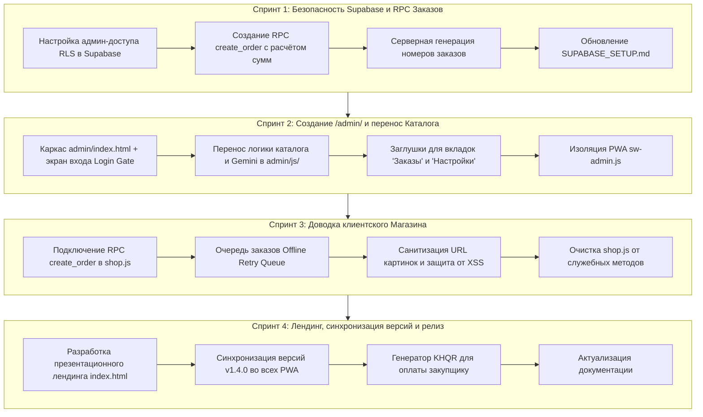

# FreshMarket — Журнал изменений (Changelog)

Все зафиксированные версии, обновления и архитектурные вехи экосистемы FreshMarket.
Формат документирования основан на принципах [Keep a Changelog](https://keepachangelog.com/).

---

## 🏁 Реализовано (Milestones Done)

### Версия v1.0.0 — Базовый PWA-каталог
* [x] Мультиязычный справочник продуктов утреннего рынка (Английский, Кхмерский, Русский).
* [x] Офлайн-словарь камбоджийских продуктов (`products_dictionary.json`).
* [x] Базовый интерфейс добавления и редактирования товаров.
* [x] Локальное хранение данных через `localStorage`.

### Версия v1.1.0 — Мульти-хранилище и медиа
* [x] Поддержка облачной загрузки фотографий через **Supabase Storage** (S3 API).
* [x] Альтернативный провайдер **Cloudinary** с кросс-удалением старых файлов.
* [x] Кроппинг и сжатие изображений перед загрузкой в соотношение 100:70.

### Версия v1.2.0 — AI Vision & UI Upgrade
* [x] Интеграция с **Google Gemini Vision API** для распознавания продуктов и ценников по фото.
* [x] Интерактивный UI с полноразмерными фото и свернутыми состояниями карточек.
* [x] Стек многоуровневых всплывающих уведомлений (Multi-toast stack).
* [x] Экспорт и импорт настроек с шифрованием ключей API.

### Версия v1.3.0 — v1.3.4 — Модульная архитектура & Клиентский магазин
* [x] Выделение клиентской витрины магазина (`shop.html`) с отдельным манифестом и независимым Service Worker (`sw-shop.js`).
* [x] Плавающая островная навигация (**Floating Island Dock**) с центральной кнопкой быстрого действия (FAB).
* [x] **2-Slide интерактивная карточка товара**:
  * Плавающая круглая кнопка добавления в заказ (FAB) в правом нижнем углу.
  * Плавный слайд влево к экрану выбора опций и веса (чипы быстрых весов + ручной ввод).
  * Морфинг иконки FAB (`🛒` → `✓` → `✏️`), бейдж выбранного веса в заголовке карточки (`✓ 1.5 кг`).
* [x] **Авторизация покупателей**: чистый OAuth (Google и Facebook) с сохранением контактов.
* [x] Мобильная шторка корзины (Bottom Sheet), расчет итогов и выбор правил автозамен продуктов.
* [x] Единая эталонная дизайн-система (`css/components.css`) и интерактивная витрина компонентов (`components.html`).

### Версия v1.3.5 — Стандартизация фирменного изумрудного градиента
* [x] Калибровка и закрепление CSS-токенов градиента в `:root`, `[data-theme="dark"]` и `[data-theme="light"]`:
  * `--accent-emerald-gradient: linear-gradient(135deg, #10b981, #059669);`
  * `--accent-emerald-gradient-hover: linear-gradient(135deg, #059669, #047857);`
* [x] Перевод всех ключевых активных элементов на единый токен градиента.

### Версия v1.3.6 — Публичная синхронизация Supabase & Режим «Нет сети»
* [x] Настроена прямая инициализация Supabase по умолчанию (`DEFAULT_SUPABASE_URL` и `DEFAULT_SUPABASE_KEY`).
* [x] Реализовано строгое состояние «Нет сети» (`offline-empty-state`) с экраном ошибки и кнопкой перезагрузки каталога.
* [x] Автоматическое отслеживание событий `online` и `offline` в браузере.

### Версия v1.3.7 — Единая светлая дизайн-система (Apple Cupertino Silk Light)
* [x] Полный отказ от темной темы и переключателей тем во всех интерфейсах (`index.html`, `shop.html`, `admin/index.html`, `components.html`).
* [x] Базовый токенизированный стиль в `:root` (`css/components.css`) зафиксирован в эталонной светлой палитре Apple Cupertino Silk Light (`#f5f5f7`, карточки `#ffffff`, шелковые разделители, мягкие тени).
* [x] Полная очистка кодовой базы от устаревших селекторов `[data-theme="dark"]`, ключей `freshmarket_theme`, JS-контроллеров тем и кнопок переключения.
* [x] Синхронизация PWA-манифестов (`manifest-shop.json`, `admin/manifest.json`) на светлый `theme_color` и `background_color` (`#f5f5f7`).

### Версия v1.3.8 — Мультиязычность и вынос локализации в JSON (RU / UA / EN / KM)
* [x] Создание структурированных словарей локализации: `locales/ru.json`, `locales/ua.json`, `locales/en.json`, `locales/km.json`.
* [x] Разработка легковесного модуля локализации `js/shared/i18n.js` с многоуровневым определением языка (URL `?lang=` → `localStorage` → `navigator.languages` → дефолт `ru`).
* [x] Разработка компонента выпадающего списка выбора языка (`.lang-dropdown-container`, `.lang-dropdown-trigger`, `.lang-dropdown-menu`) в стиле Apple Cupertino Silk Light.
* [x] Регистрация и интерактивная демонстрация компонента в каталоге `components.html` и мастер-стилях `css/components.css`.
* [x] Интеграция селектора и разметки `data-i18n` в клиентский магазин (`shop.html` + `js/shop.js`) и лендинг (`index.html`) с реактивной сменой без перезагрузки.
* [x] Разделение семантических ключей локализации: `categories.all` («Все» / «All» для пилюли-фильтра товаров) и `categories.tab_title` («Категории» / «Categories» для вкладки навигации), перевод вкладки каталога на «Все продукты» (`nav.catalog`).
* [x] Предкеширование словарей и модуля i18n в `sw-shop.js` для полной офлайн-работоспособности PWA.

### Версия v1.3.9 — Стандартизация элементов шапки и синхронизация UI Kit
* [x] Унификация кнопки выхода (`.btn-logout`) в мастер-стилях `css/components.css`:
  * Единая высота 38px, радиус скругления `var(--radius-full)`, отступы `0 13px`, элегантный hover с красным акцентом (`rgba(239, 68, 68, 0.12)`, граница `rgba(239, 68, 68, 0.35)`).
  * Полное удаление дублирующихся локальных правил `.btn-logout` из `css/shop.css`, `css/admin.css` и стилей `index.html`.
* [x] Гармонизация элементов навигационной шапки (`.app-header` и `.landing-header`):
  * Единая высота и центрирование (38px) для `.icon-btn`, `.btn-logout` и `.lang-dropdown-trigger`.
* [x] Обновление витрины компонентов `components.html`:
  * Внедрение адаптивной 3-колоночной сетки для шапок (`index.html`, `shop.html`, `admin/index.html`).
  * Добавление отдельного блока интерактивной демонстрации кнопок управления шапки (`.btn-logout`, `.icon-btn`, `.lang-dropdown-trigger`).
  * Исправление семантических классов в демонстрациях шапок (замена некорректного класса `.btn-logout` на `.icon-btn` для иконок профиля и настроек).

### Версия v1.4.0 — Полноценная архитектура 4 экранов нижней навигации (Bottom Navigation Tabs)
* [x] Перевод всех 4 разделов нижней навигации витрины магазина (`shop.html`) в полноценные независимые экраны (Views):
  * **Экран «Каталог» (`#viewCatalog`)**: строка поиска, табы режимов, сетка категорий и продуктов.
  * **Экран «Корзина» (`#viewCart`)**: полноценный экран корзины с управлением составом, расчетом сумм, блоком входа (Auth Gate) и формой оформления доставки.
  * **Экран «Заказы» (`#viewOrders`)**: история заказов со статусами, составом и ссылками на чеки.
  * **Экран «Профиль» (`#viewProfile`)**: экран настроек покупателя, выбора предпочтительного мессенджера, адреса по умолчанию, входа через соцсети и кнопки выхода из аккаунта.
* [x] Полный отказ от модалок и шторок для первичной навигации (устаревшие оверлеи `#cartModal`, `#ordersModal`, `#authModal` заменены на in-page представления).
* [x] Рефакторинг контроллера `js/shop.js`:
  * Внедрение метода `switchView(viewName)` с мгновенным переключением представлений и синхронизацией активного состояния табов нижней панели.
  * Реактивное обновление активного экрана при смене языка (`freshmarket:langchange`) и статуса авторизации.
  * Выход из аккаунта (`btnLogout`) локализован на экране «Профиль» с бесшовным переключением в гостевой режим.
* [x] Разгрузка верхней шапки магазина (`.app-header`): удалены дублирующие кнопки профиля и выхода, оставлен чистый брендинг и переключатель языков.

### Версия v1.4.1 — Реорганизация навигации админки, глобальная FAB и адаптивный скролл
* [x] **3-табовая островная нижняя навигация панели закупщика (`admin/index.html`)**:
  * **«Главная» (`#viewCatalog`)**: зеркальная структура клиентского каталога (зафиксированный поиск `shop-sticky-search-wrap`, переключатель «Категории» / «Все продукты», плиточная сетка категорий `#adminCategoryGrid`, липкие пилюли-фильтры `#categoryFilterPills`, свайп-карточки товаров).
  * **«Заказы» (`#viewOrders`)**: экран заявок на утренний закуп с утреннего рынка.
  * **«Параметры сервиса» (`#viewSettings`)**: параметры комиссий, зон доставки и драфт-секция словаря продуктов.
* [x] **Удаление верхней навигации**: старая панель `.admin-nav-bar` полностью демонтирована.
* [x] **Глобальная плавающая кнопка (FAB `+`)**:
  * Вынесена на уровень всей страницы (`#adminMainApp`) над плавающим доком навигации (`bottom: calc(84px + var(--safe-bottom))`).
  * Центрирована по границе адаптивного контейнера 440px и с отступом `20px` на мобильных экранах (`<= 480px`).
* [x] **Растяжение рабочей области по высоте**:
  * Для `.admin-workspace` и `.admin-workspace .main-content` задано `min-height: calc(100vh - 66px); flex: 1`, исключающее схлопывание контента при малом числе элементов.
* [x] **Модальная шторка технических настроек (`#settingsModal`)**:
  * Вынесена в шторку, открываемую кнопкой `⚙️` (`#btnTechSettings`) в шапке (Google Gemini API, Supabase, Cloudinary, экспорт/импорт).
* [x] **Драфт-секция словаря продуктов**:
  * Интегрирован двухуровневый справочник из 161 продукта (152 базовых + 9 из базы) с фильтрами и поиском.

### Версия v1.4.2 — Стандартизация лейаутов Магазина и Админки & Ликвидация горизонтального скролла
* [x] **Стандартизация глобальных контейнеров (`css/components.css`)**:
  * Класс `.app-container` зафиксирован как базовый контейнер приложения: `width: 100%; max-width: 480px; margin: 0 auto; min-height: 100vh; position: relative; display: flex; flex-direction: column; overflow-x: clip;` (сохраняет прилипание `position: sticky` для шапки, поиска и фильтров без создания паразитного контекста прокрутки).
  * Классы `.main-content, .shop-main-content` приведены к единым отступам `0 16px calc(96px + var(--safe-bottom)) 16px`, `min-width: 0` и `flex: 1`.
  * Экраны разделов `.admin-section-view` и `.shop-view-page` стандартизированы с `display: none; flex-direction: column; width: 100%; min-width: 0; flex: 1` (`.active { display: flex; }`).
* [x] **Полная ликвидация горизонтального скролла в админке**:
  * Устранен паразитный оверфлоу flex-контейнеров с добавлением `min-width: 0`.
  * Позиционирование кнопки FAB (`.floating-action-fab`) ограничено безопасным диапазоном `right: max(16px, calc(50% - 240px + 16px))` и зафиксировано на уровне страницы (вне анимированных секций `.admin-section-view`, исключая поломку `position: fixed` из-за `transform` в анимации `fadeIn`).
  * Стили `.floating-action-fab` стандартизированы в мастер-библиотеке `css/components.css` с наследованием в `css/admin.css` и регистрацией в каталоге компонентов `components.html` (Секция 4: Кнопки и FAB, Секция 8: Нижняя навигация панели закупщика).
  * Экран входа закупщика (`#loginGate`) переведен в полноэкранный фиксированный оверлей (`position: fixed; inset: 0; z-index: 10000; background: var(--bg-main)`), а контейнер рабочей области (`#adminMainApp`) очищен от инлайн-стилей `display` с переходом на декларативный CSS-класс `.is-hidden` (`admin-auth.js`), восстановив бесшовную работу Flexbox (`display: flex; flex-direction: column;`).
  * Исправлен синтаксический сбой в `css/products.css` (восстановлена закрывающая скобка на `.card-photo`, сняты конфликтующие переопределения паддингов).
* [x] **Наследование стилей и удаление дубликатов (Правило 3 архитектуры)**:
  * Все стили липкой навигации каталога (`.shop-sticky-search-wrap`, `.shop-segmented-tabs-wrap`, `.shop-tab-pane`, `.shop-sticky-pills-wrap`, `.category-count`) вынесены в мастер-библиотеку `css/components.css`.
  * Избыточные повторения удалены из `css/shop.css` и `css/admin.css`.
* [x] **Синхронизация фильтров категорий со счетчиками товаров**:
  * В админке (`admin/js/admin-catalog.js`) метод `renderCategoryFilterPills()` обновлен для вычисления количества товаров по каждой категории и отображения `${count}`.
  * Обновление счетчиков подключено реактивно в `updateStats()` при загрузке или модификации каталога.
  * Синхронизированы разметка и стили в `components.html`, `shop.html` (`shop.js`) и `admin/index.html` (`admin-catalog.js`).
* [x] **Разделение локализации сегментированной и главной навигации (RU / UA / EN / KM)**:
  * В словарях локализации выделена самостоятельная секция `tabs`: `tabs.categories` («Категории» / «Категорії» / «Categories» / «ប្រភេទទំនិញ») и `tabs.all_products` («Все продукты» / «Всі товари» / «All Products» / «ទំនិញទាំងអស់»).
  * Секция `nav` зафиксирована за экранами нижней навигации: `nav.home` («Главная»), `nav.cart`, `nav.orders`, `nav.profile`.
  * В `shop.html` сегментированные табы переведены на `data-i18n="tabs.*"`, а нижняя панель — на `data-i18n="nav.home"` и `data-i18n="nav.profile"`, устранив пересечение ключей.
* [x] **Консистентные векторные иконки нижней навигации (Shop & Admin & UI Components)**:
  * Замена растровых эмодзи в нижней навигации магазина (`shop.html`) на профессиональные векторные SVG (`stroke="currentColor" stroke-width="2.2"`).
  * Полное совпадение стиля и геометрии с админкой (`admin/index.html`): Главная (витрина/дом), Корзина, Заказы (планшет с чеклистом), Профиль (пользователь).
  * Корректная адаптивная подсветка активного таба фирменным изумрудным градиентом `#059669` и мягкий hover.
  * Синхронизация блока демонстрации в библиотеке компонентов (`components.html`).

### Версия v1.4.3 — Очистка иконок и стандартизация карточек («Параметры» и «Профиль»)
* [x] **Панель закупщика (`admin/index.html` — экран «Параметры сервиса» `#viewSettings`)**:
  * Удалены эмодзи из всех заголовков секций (`.settings-section-title`): «Курс валюты (USD → KHR)», «Google Gemini Vision», «Облачная база (Supabase)», «Медиа-хранилище (Cloudinary)», «Резервная копия и перенос», «Словарь продуктов (Draft)», «Услуги и комиссии сервиса».
  * Удалены иконки из кнопок действий секций: «Проверить подключение», «Перенести локальные данные в облако», «Проверить Cloudinary», «Экспорт настроек в файл», «Импорт настроек из файла», «Скопировать настройки в буфер», «Вставить настройки из буфера», «Сохранить параметры интеграций».
  * Удалены иконки из радиокнопок выбора провайдера базы данных (`IndexedDB` и `Supabase`).
* [x] **Клиентский магазин (`shop.html`, `js/shop.js` — экран «Профиль» `#viewProfile`)**:
  * Удалены эмодзи из всех заголовков аккордеона (`.settings-section-title`): «Контакты и доставка», «Язык интерфейса», «Приложение FreshMarket», «О сервисе FreshMarket», «Аккаунт и вход».
  * Удалены иконки из кнопки «Сохранить контакты», кнопки установки PWA, кнопки онбординга «Как работает FreshMarket», кнопок выбора мессенджера (Telegram, WhatsApp, Звонок), кнопок авторизации OAuth (Google, Facebook).
  * Флаги в кнопках выбора языков (🇷🇺 RU, 🇬🇧 EN, 🇺🇦 UA, 🇰🇭 KM) сохранены без изменений.
  * **Реорганизация секций экрана «Профиль»**: секция «Аккаунт и вход» (`#profileSectionAccount`) стала первой и открыта по умолчанию; секция «Контакты и доставка» (`#profileSectionContacts`) скрыта для гостей и доступна в свернутом виде (`is-collapsed`) для авторизованных пользователей; подключено реактивное обновление профиля при смене состояния авторизации.
* [x] **Синхронизация локализации (`locales/*.json`)**:
  * Синхронно обновлены все 4 языковых пакета (`ru.json`, `en.json`, `km.json`, `ua.json`) для ключей `install_app_btn`, `how_it_works_btn`, `messenger_telegram`, `messenger_whatsapp`, `messenger_phone`.
* [x] **Библиотека компонентов (`components.html`)**:
  * Эталонные образцы карточек `.settings-section` приведены к актуальному виду без эмодзи в заголовках.

### Версия v1.4.4 — Адаптивная витрина товаров (1 / 2 колонки) и интерактивная фото-карточка
* [x] **Адаптивная сетка витрины товаров (`.shop-products-grid`)**:
  * Поддержка компактной 2-колоночной сетки (`.layout-grid-2`, по умолчанию) и полноразмерной 1-колоночной сетки (`.layout-grid-1`).
  * Переключатель вида витрины (1 колонка / 2 колонки) вынесен в настройки экрана «Профиль» покупателя (`#profileSectionApp`) с сохранением в `localStorage` (`freshmarket_shop_layout`) и реактивной сменой класса без перезагрузки.
  * Синхронизированы ключи локализации `profile.layout_title`, `profile.layout_2_cols`, `profile.layout_1_col` во всех 4 языковых пакетах (`ru`, `en`, `ua`, `km`).
* [x] **Очистка карточки и удаление аккордеон-сворачивания**:
  * Удалена стрелочка `.btn-card-toggle` и клик по блоку названий `.card-names-block` — карточки витрины всегда полностью раскрыты и не ломают строки сетки.
  * Описание товара (`.card-desc`) скрыто (`display: none`), из разметки карточки витрины удалён вывод описания.
  * Адаптивная типографика: английский заголовок (13.5px в 2 колонках, 15px в 1 колонке), кхмерский и русский подзаголовки (11.5px).
* [x] **Интерактивный выбор веса по клику на изображение**:
  * Открытие слайда выбора веса привязано ко всей области фото-контейнера (`.card-photo-container`).
  * Сетка чипов опций веса в карточке адаптируется (2 колонки в плиточном режиме, 3 колонки в 1-колоночном режиме).
  * Выбор чипа сразу фиксирует товар в корзине, закрывает слайд и выводит уведомление (toast).
* [x] **Перенос бейджа корзины (`.badge-in-cart`) внутрь фотографии**:
  * Бейдж размещен внутри `.card-photo-container` над пилюлей цены (`bottom: 34px; left: 8px`).
  * Контрастный изумрудный фон, размытие подложки (`backdrop-filter: blur(8px)`), белый текст.
* [x] **Нижняя панель действий опций (`.card-options-actions`)**:
  * Блок действий переименован из `card-options-header-actions` в `.card-options-actions` и перенесён в нижнюю часть слайда опций под сетку чипов.
  * Содержит кнопку удаления товара из корзины с иконкой урны (`.btn-options-remove`) и кнопку закрытия слайда (`.btn-options-cancel`).
* [x] **Синхронизация Design System и документации**:
  * Стили стандартизированы в мастер-библиотеке `css/components.css` (раздел 3.6) и `css/shop.css`.
  * Интерактивная карточка покупателя синхронизирована в витрине компонентов `components.html`.
  * Обновлены версии кэширования ассетов в `shop.html` (`v=1.4.4`).

### Версия v1.4.5 — Бесшовное заполнение фотокарточки и компактный слайд опций
* [x] **Бесшовное растяжение фотографии (`.card-photo-container`)**:
  * Устранена пустота под изображением при flex-растяжении слайдов трека (`align-items: stretch`).
  * Для `.shop-product-card .card-photo-container` задано `flex: 1; height: 100%; min-height: 140px`, что гарантирует полное заполнение слайда без зазоров вне зависимости от высоты соседнего слайда опций.
  * Для `.shop-product-card .card-slide-main` сброшен `gap: 0` для исключения фантомных flex-отступов при скрытом текстовом описании.
* [x] **Компактная оптимизация геометрии слайда выбора опций (`.card-slide-options`)**:
  * Внутренние отступы слайда сжаты до `6px 7px` с `box-sizing: border-box`.
  * Сетка чипов переведена на зазоры `gap: 3px` и высоту чипов `padding: 5px 2px; font-size: 11px`.
  * Нижний отступ заголовка уменьшен до `4px`, а отступ панели нижних действий (`.card-options-actions`) сокращен до `padding-top: 2px`.
  * 6 чипов веса вместе с заголовком и кнопками закрытия/удаления компактно укладываются в базовые ~140px.
* [x] **Синхронизация Design System и кэширования**:
  * Мастер-стили зафиксированы в `css/components.css`.
  * Обновлены версии кэширования в `shop.html` (`v=1.4.5`).

### Версия v1.4.6 — Строгая фиксация высоты вьюпорта карточек товаров (140px / 180px)
* [x] **Строгая фиксация высоты на уровне вьюпорта (`.card-slider-viewport`)**:
  * Зафиксирована высота вьюпорта: `height: 140px` для 2-колоночной сетки и `height: 180px` для 1-колоночной сетки.
  * Трек (`.card-slider-track`), слайды (`.card-slide`, `.card-slide-main`) и контейнер фото (`.card-photo-container`) переведены на `height: 100%`.
  * Исключено раздувание карточки вертикальными фотографиями (например, Дайкон Редис): фото строго заполняет 140px через `object-fit: cover`, предотвращая увеличение высоты всей строки CSS-сетки.
  * Устранено появление паразитных белых полей в соседних карточках ряда (Лемонграсс и др.).
* [x] **Безопасный скролл чипов опций (`.card-slide-options`)**:
  * Задано `height: 100%; min-height: 0; overflow-y: auto; scrollbar-width: none` для слайда опций.
  * При любом количестве чипов карточка сохраняет идеальную геометрию без выталкивания границ.
* [x] **Синхронизация Design System и кэширования**:
  * Мастер-стили обновлены в `css/components.css`.
  * Версии кэширования в `shop.html` обновлены до `v=1.4.6`.

### Версия v1.4.7 — Форма «Бутылка», объемы (0.2, 0.5, 0.7, 1 л) и нормализация соусов
* [x] **Стандартизация формы «Бутылка» (`forms.bottle`)**:
  * Добавлена форма `{ id: 'bottle', label: 'Бутылка' }` в список `FORMS` панели закупщика (`admin-catalog.js`).
  * Синхронизированы 4 языковых пакета (`locales/*.json`): `ru`: «Бутылка», `en`: «Bottle», `ua`: «Пляшка», `km`: «ដប».
  * В `getFormInfo` (`shop.js`) добавлена мягкая нормализация: существующие в базе значения «соус» и «жидкий» автоматически маппятся в форму `'bottle'` («Бутылка»), исключая дублирование категории «Соусы и бакалея».
  * В витрину компонентов `components.html` добавлен образец бейджа «Бутылка».
* [x] **Калибровка AI-промпта Gemini Vision (`admin-catalog.js`)**:
  * В системный промпт анализа фото добавлена форма `"Бутылка"`.
  * Зафиксировано строгое правило: для бутылочных/баночных соусов, масел, соевого и рыбного соусов в категории «Соусы и бакалея» использовать форму «Бутылка» (или «Паста» для густых паст). Запрещено использовать термины «Жидкий» и «Соус».
* [x] **Линейка объемов бутылок (0.2 л, 0.5 л, 0.7 л, 1 л)**:
  * В справочник фасовок `UNITS` админки (`admin-catalog.js`) и селекторы формы (`admin/index.html`, `components.html`) добавлены единицы: `0.2 л` (`0_2_l`), `0.5 л` (`0_5_l`), `0.7 л` (`0_7_l`), `1 л` (`1_l`).
  * Добавлены переводы единиц объемов в `ru`, `en`, `ua`, `km`.
  * В контроллере витрины магазина (`shop.js` -> `getProductOptions`): для товаров в бутылках генерируются чипы выбора объема: `0.2 л`, `0.5 л`, `0.7 л`, `1 л`.
* [x] **Кэширование**:
  * Обновлены версии кэширования в `shop.html` (`v=1.4.7`).

### Версия v1.4.8 — Единый справочник форм (`data/forms.json` & `forms.js`) и синхронизация админки
* [x] **Вынос форм в отдельный JSON и модуль нормализации**:
  * Создан файл `data/forms.json` как единый источник правды (Single Source of Truth) с 14 формами продуктов, переводами (`ru`, `en`, `ua`, `km`) и синонимами нормализации (`aliases`).
  * Разработан общий легковесный модуль `js/shared/forms.js` (`window.FRESHMARKET_FORMS` и `window.normalizeFormInfo(form, lang)`), синхронно доступный в PWA без лишних сетевых задержек.
* [x] **Синхронизация панели закупщика (`admin/index.html` + `admin-catalog.js`)**:
  * Справочник `FORMS` в админке переведен на наследование из общего модуля `FRESHMARKET_FORMS`.
  * Карточки каталога в админке обновлены: бейджи форм формируются через `getFormInfo(item.form)`, обеспечивая унификацию бутылочных соусов и приправ в «Бутылка».
  * Подключен `../js/shared/forms.js` в `admin/index.html`.
  * Обновлены кэш-бастеры в `admin/index.html` (`components.css`, `products.css`, `admin.css`, `admin-catalog.js`, `admin-auth.js`) и версия сплэш-скрина до `v1.4.8`.
* [x] **Синхронизация клиентского магазина и UI Kit**:
  * Метод `getFormInfo` в `shop.js` делегирует нормализацию в `window.normalizeFormInfo`.
  * Файл `js/shared/forms.js` подключен в `shop.html` и `components.html`.
  * Обновлены кэш-бастеры в `shop.html` до `v=1.4.8`.
* [x] **Офлайн PWA-кэш (Service Workers)**:
  * Файлы `data/forms.json` и `js/shared/forms.js` добавлены в прекеш `sw-shop.js` (`v1.5.7`) и `admin/sw-admin.js` (`v1.5.9`).

### Версия v1.4.9 — Компактный бейдж категории (иконка) в карточке товара на витрине
* [x] **Компактный бейдж категории без текстовой перегрузки (`shop.js`)**:
  * В карточке витрины магазина (`.shop-product-card`) текстовый блок категории (`.badge-cat-name`) заменен на компактную иконку категории (`catIcon`: 🥫, 🥦, 🥔, 🥭, 🌿, 🫚, 🐟, 🥩, 🍄, 📦).
  * Полное локализованное название категории сохранено в `title` и `aria-label` для подсказок и доступности.
  * Устранено выталкивание бейджа формы (`.badge-form`) на вторую строку в 2-колоночной мобильной сетке; бейджи категории и формы гармонично располагаются в одну строку (`[🥫] [Бутылка]`, `[🥦] [Кочан]`).
* [x] **Стандартизация стилей бейджей (`css/components.css`)**:
  * Скорректированы стили `.shop-product-card .badge-category` (центрирование `display: inline-flex; justify-content: center; align-items: center; line-height: 1.2; font-size: 11px; padding: 2px 5px;`) с сохранением фирменного полупрозрачного изумрудного фона и рамки.
  * Синхронизирован образец интерактивной карточки (`#cardDemo3`) в UI-библиотеке `components.html`.
* [x] **Кэширование**:
  * Обновлены кэш-бастеры в `shop.html` (`v=1.4.9`).

### Версия v1.4.10 — Модульный конструктор карточки витрины (Фотография → Названия → Бейджи)
* [x] **Модульная структура рендеринга карточки (`shop.js`)**:
  * В методе `renderProducts()` разметка карточки `.shop-product-card` декомпозирована на 3 независимых семантических блока-переменных:
    * `photoBlock`: полноразмерный вьюпорт фото с ценой, отметкой корзины и интерактивным слайдом выбора опций;
    * `namesBlock`: трехуровневые названия продукта (английский заголовок, кхмерский и русский подзаголовки);
    * `badgesBlock`: компактный бейдж категории и бейдж формы.
  * Порядок вывода на витрине реорганизован в Вариант Б: **`Фотография` → `Названия` → `Бейджи`** (крупный визуальный акцент на фото сверху, названия посередине, компактные теги снизу).
  * Устранена устаревшая обертка `.card-collapsible-body`, выровнены отступы карточки.
* [x] **Синхронизация Design System (`components.html`)**:
  * Образец интерактивной клиентской карточки (`#cardDemo3`) синхронизирован с новым порядком блоков.
* [x] **Кэширование**:
  * Обновлены кэш-бастеры в `shop.html` (`v=1.4.10`).

### Версия v1.4.11 — Полноэкранный онбординг-walkthrough со скетчами (2/3 + 1/3)
* [x] **Полноэкранный формат walkthrough вместо модального окна**:
  * Полное перекрытие UI на мобильных устройствах (100dvh, inset: 0) и центрированный фрейм 480px на десктопе с глубоким затемняющим backdrop (`box-shadow: 0 0 0 100vmax rgba(0, 0, 0, 0.65)`).
  * Архитектурное разделение экрана: верхние 62% занимает художественный акварельный скетч с плавным градиентным фейдом, нижние 38% — контент (заголовок, описание, индикаторы, кнопки, чекбокс скрытия).
* [x] **Аутентичные акварельные скетчи камбоджийского утреннего рынка (Authentic Market style)**:
  * **Слайд 1 (`slide-1-market.png`)**: прилавок со свежей речной рыбой на банановых листьях, мясом, хрустящей зеленью и тропическими фруктами. Без искусственных надписей и ценников.
  * **Слайд 2 (`slide-2-receipt.png`)**: винтажные механические стрелочные весы (стрелка отклонена от нуля под весом товара), закупщик, продавец, чек с четким квадратным KHQR кодом и смартфон.
  * **Слайд 3 (`slide-3-delivery.png`)**: реалистичный курьер на классическом скутере с деревянным ящиком свежих овощей у дома.
  * Конвертация в прозрачный PNG с альфа-каналом: вырезан фон бумаги, пигменты и контуры сохранены с мягкими виньетками для бесшовного наложения на светлый интерфейс без прямоугольных рамок.
  * Исходные версии сохранены в архив `assets/onboarding/sketches_v1/` для возможности генерации альтернативных стилей.
* [x] **Очистка контроллеров и типографики**:
  * Удален эмодзи 🚀 из кнопки CTA во всех 4 локалях: «Начать покупки» (RU), «Get Started» (EN), «Почати покупки» (UA), «ចាប់ផ្ដើមទិញទំនិញ» (KM).
  * Добавлена полупрозрачная кнопка закрытия/пропуска в правом верхнем углу (`.btn-onboarding-skip-top`).
  * Реализована поддержка мобильных свайп-жестов (touch swipe left/right) и навигации с клавиатуры (стрелки, Escape).
  * На последнем слайде кнопка «Пропустить» скрывается, а CTA-кнопка растягивается на всю ширину сетки (`.single-btn`).
* [x] **Синхронизация Design System, PWA Service Worker и документации**:
  * Мастер-стили стандартизированы в `css/components.css` (раздел 10) с `object-fit: contain;` и прозрачным фоном `.onboarding-media-wrap`.
  * Секция 9 в витрине `components.html` обновлена с полноэкранными превью и интерактивным мини-плеером.
  * Ассеты добавлены в прекеш `sw-shop.js` (`STATIC_ASSETS`, кэш `freshmarket-shop-v1.5.9`), обновлены кэш-бастеры в `shop.html` (`v=1.4.12`).

### Версия v1.4.13 — Глобальный поиск по каталогу (от 2 символов) и полноширинный Empty State
* [x] **Глобальный поиск каталога без категориальных ограничений (`shop.js`)**:
  * Поиск активируется при вводе от 2 символов и более (`val.length >= 2`), исключая ложные срабатывания и преждевременные пустые выдачи на одну случайную букву.
  * При вводе поискового запроса активная категория автоматически сбрасывается в `all`, вкладка переключается на «Все продукты» (`this.setHomeTab('products')`), а фильтр-пилюли обновляются (`this.renderCategories()`) с фокусом на «Все».
  * Устранена проблема, когда при ранее выбранной категории поиск искал только внутри неё и не находил товары из других отделов.
* [x] **Полноширинная плашка «Нет результатов» (`css/components.css`)**:
  * Для компонента `.empty-state` добавлено свойство `grid-column: 1 / -1; width: 100%;`.
  * При отсутствии найденных товаров плашка занимает всю ширину 2-колоночной сетки каталога как полноценная карточка, исключая отображение в половинном размере.
* [x] **Очистка элементов управления онбординга (`shop.html`, `components.html`, `css/components.css`, `js/shop.js`)**:
  * Удалена избыточная плавающая верхняя кнопка-крестик `✕` (`.btn-onboarding-skip-top`), перекрывавшая верхний правый угол акварельных иллюстраций.
  * Управление пропуском централизовано на нижней кнопке «Пропустить» (`#btnSkipOnboarding`) в панели навигации слайдов.
* [x] **Синхронизация и кэширование**:
  * Обновлены кэш-бастеры в `shop.html` (`v=1.4.13`).

### Версия v1.4.14 — Актуализация бизнес-модели, тарифов доставки и расписания
* [x] **Актуализация экономической модели сервиса**:
  * Сервисный сбор зафиксирован на уровне 10% от суммы рыночного чека (единственный доход проекта, без минимального порога в $3.00 и без наценок на товар).
  * Доставка: фиксированный тариф по 3 зонам (Зона 1: Центр — $1, Зона 2: Средние районы — $2, Зона 3: Окраины — $3), целиком уходит курьеру.
  * Продавцы: проверенные продавцы базара по всем направлениям (овощи, фрукты, мясо, зелень и др.).
  * График: приём заказов до 23:00 предыдущего дня, закупка на рассвете, единый слот доставки с 9:00 до 12:00.
  * Оплата: наличные или перевод по факту доставки.
  * В клиентском интерфейсе скрыты внутренние операционные детали, отображаются прозрачные формулы, зонирование и стоимость.
* [x] **Синхронизация кода, интерфейсов и документации**:
  * `js/shared/utils.js`: обновлены `DELIVERY_ZONES` (Центр $1, Средние районы $2, Окраины $3) и очищены от географических привязок (правило 11).
  * `js/shop.js`: устранены устаревшие хардкоды `3.00` и `1.50`, обновлены формулы в чекауте, заказах и профиле.
  * `admin/js/admin-auth.js` и `admin/index.html`: актуализированы зоны и параметры сервиса.
  * `shop.html` и `components.html`: синхронизированы слайд 3 онбординга, баннеры расписания (9:00–12:00) и пояснение формулы в чекауте.
  * `index.html`: обновлены все 3 концепта (Журнал, Ряды, Шёлк) с новыми тарифами зон, слотом 9:00–12:00 и описанием продавцов.
  * Локализация: обновлены и синхронизированы все 4 языка (`ru.json`, `en.json`, `ua.json`, `km.json`).
  * Документация: обновлены `CONCEPT.md` и `ROADMAP.md`.

### Версия v1.5.0 — Три фундаментально разных статических концепта («Фотожурнал», «Торговые ряды», «Cupertino Silk»)
* [x] **Три принципиально разные архитектуры и верстки лендинга (без шаблонов, интерактива и анимаций)**:
  * **📖 Концепт 1: «Утренний фотожурнал» (`journal`) — Editorial / Food Story**:
    * *Смысловой нерв*: Современная журнальная верстка, теплое кулинарное доверие, фокус на утренний фоторепортаж байера.
    * *Палитра*: Теплый алебастровый фон `#fbf9f5`, глубокий эспрессо `#211f1c`, терракотовый акцент `#9c4221`.
    * *Композиция*: Асимметричный сплит Hero (крупный живой заголовок + реальное фото утреннего сбора в рамке с подписью), зигзагообразная фотохроника закупки (05:30 лодки → 07:00 отбор на весах → 08:30 доставка с чеком), бухгалтерская таблица-гроссбух расчета чека и список зон.
  * **🏪 Концепт 2: «Торговые ряды» (`stalls`) — Продуктовая витрина рынка**:
    * *Смысловой нерв*: Рынок прямого действия, изобилие свежести, акцент на продукты.
    * *Палитра*: Прохладный светлый сланец `#edf2ef`, темно-зеленый глубокий тон `#0c2017`, изумрудный хлорофилл `#059669`.
    * *Композиция*: 4 широкоформатные панорамные фото-секции прилавков (Рыбный ряд, Фермерские овощи, Фруктовые лавки, Пряные лавки с реальными фотографиями продуктов), 3-колоночный прозрачный алгоритм заказа (с вечера → байер на рассвете → доставка к завтраку) и тарифная таблица.
  * **🍏 Концепт 3: «Cupertino Silk» (`silk`) — Apple Minimalist / Воздух и чистота**:
    * *Смысловой нерв*: Строгий минимализм Apple Cupertino, отказ от коробок и рамок, максимум свободного воздуха.
    * *Палитра*: Светло-серый шелк `#f5f5f7`, чисто-белый `#ffffff`, чистый уголь `#1d1d1f`, акцент `#10b981`.
    * *Композиция*: Монументальный центрированный заголовок, 3 полноширинных широкоформатных блока с чередованием крупного макро-фото и лаконичного тезиса (Только утренний сбор, Честная цена по чеку, Бережная доставка), минималистичные цифры тарифов по зонам.
* [x] **Статическая витрина реальных продуктов (`.static-product-gallery`)**:
  * Чистая статическая сетка из 6 сочных продуктов с реальными фотографиями из базы Supabase/Cloudinary (имбирь, тайский баклажан, тамаринд, рыба-сиган, цветок банана, лемонграсс) с прямым переходом в магазин.
  * Полный отказ от JavaScript-слайдеров, анимаций и лишнего кода — максимальная скорость и надежность рендера.
* [x] **Плавающий 3-позиционный док переключения (`#landingConceptSwitcher`)**:
  * Переключатель `[ 📖 Фотожурнал ]` / `[ 🏪 Торговые ряды ]` / `[ 🍏 Cupertino Silk ]` со статическим переключением через CSS и сохранением в `localStorage`.
* [x] **100% паритет мультиязычности (RU / EN / KM)**:
  * Полная синхронизация структуры `landing.common`, `landing.journal`, `landing.stalls` и `landing.silk` в `locales/ru.json`, `locales/en.json`, `locales/km.json`.
* [x] **Универсальные тексты без географических якорей**:
  * Никаких локальных привязок, естественный и честный тон.

### Версия v1.5.1 — Стандартизация карточек пустых состояний (Empty States) и эталонных иконок
* [x] **Единая эталонная карточка `.empty-state` в мастер-библиотеке (`css/components.css`)**:
  * Фиксация стиля Cupertino Silk Light: белый фон `var(--bg-card)`, тонкая граница `1px solid var(--border-subtle)`, скругление 20px `var(--radius-xl)`, мягкая тень `var(--shadow-sm)`, внутренние отступы `32px 24px`, центрирование и аккуратная типографика (18px заголовок, 14px описание).
* [x] **Возврат оригинального векторного SVG плетёной корзинки**:
  * Восстановлен оригинальный богатый SVG (84×84px с деревянной ручкой, плетением, кольцами и мягкой тенью) в карточке пустого каталога (`admin/index.html`) и витрине компонентов (`components.html`). Полный отказ от плоского эмодзи `🧺`.
* [x] **Унификация и централизация иконок для всех состояний системы**:
  * Пустой каталог товаров: оригинальный SVG плетёной корзины.
  * Пустые заказы / заявки: планшет с заявкой `📋` (полная синхронизация между `admin-auth.js` и `shop.js`).
  * Пустая корзина: тележка покупок `🛒` (`shop.js`).
  * Поиск без результатов: лупа `🔍` (`shop.js`).
  * Каталог недоступен офлайн: антенна `📡` (`shop.js`).
* [x] **Ликвидация дублирующих классов и инлайн-стилей**:
  * Устаревший ad-hoc класс `.orders-stub-card` в `css/admin.css` и `admin/js/admin-auth.js` переведен на мастер-компонент `.empty-state`.
  * Удалены конфликтующие инлайн-паддинги `style="padding: 40px 0;"` в `js/shop.js`.
* [x] **Обновление витрины компонентов (`components.html`)**:
  * Добавлена раздельная демонстрация стандартизированных карточек для каталога товаров и списка заказов.

### Версия v1.5.2 — Примерная рыночная цена продуктов, конвертация в KHR и 100% паритет всех 4 локалей
* [x] **Примерная рыночная стоимость продуктов (`price`) в базе Supabase**:
  * Добавлена поддержка колонки `price NUMERIC(10, 2) DEFAULT NULL` в `SUPABASE_SETUP.md` (включая быструю 1-строчную миграцию для существующих проектов и схему инициализации с нуля).
  * Цена сохраняется исключительно в базу данных Supabase (`products.price`) и изолирована от локального словаря `products_dictionary.json`.
* [x] **Мастер-компонент плашки цены `.card-price-badge` в дизайн-системе (`css/components.css`)**:
  * Аккуратная черная капсула (`rgba(20, 20, 22, 0.88)`, `backdrop-filter: blur(14px)`, граница `1px solid rgba(255, 255, 255, 0.16)`, скругление `var(--radius-full)`, высота 34px).
  * Позиционирование в левом нижнем углу контейнера фотографии товара (`left: 12px; bottom: 12px`), зеркально балансируя плавающую кнопку корзины напротив (`right: 12px; bottom: 12px`).
  * Конвертация валют: отображение долларового номинала (`$1.50`) и эквивалента в камбоджийских риелях (`~6,000 ៛`) по курсу $1 = 4,000 KHR.
  * Если цена не заполнена (`null` / пусто): карточка отображает аккуратный бейдж со статусом `n/a`.
* [x] **Интеграция на витрине магазина (`js/shop.js`) и в панели закупщика (`admin/js/admin-catalog.js`)**:
  * Метод `renderPriceBadge(price)` формирует плашку для всех карточек товаров на клиентской витрине и в каталоге админки.
  * В формы добавления (`#addModal`) и редактирования (`#editModal`) админки добавлено поле ввода цены с живой подсказкой конвертации в риели (`≈ X,XXX ៛`).
* [x] **Вынесение курса риеля к доллару в параметры админки (Управление валютой)**:
  * В панель закупщика (`admin/index.html` → `#viewSettings`) добавлена секция «💱 Курс валюты (USD → KHR)» с бейджем текущего курса, полем ввода, быстрыми пресетами (`4,000 ៛`, `4,100 ៛`, `4,200 ៛`) и кнопкой сохранения.
  * Настройка сохраняется в `localStorage` (`freshmarket_khr_rate`) и синхронизируется через событие `freshmarket:ratechange` и слушатель `storage`.
  * Клиентская витрина магазина (`shop.js`) и каталог админки динамически пересчитывают риелевые ценники при смене курса на лету.
* [x] **100% паритет ключей во ВСЕХ 4 файлах локализации (`locales/`)**:
  * Синхронизированы `ru.json`, `ua.json`, `en.json`, `km.json` (ровно по 287 ключей в каждом файле, нулевые расхождения).
  * Добавлены ключи настроек курса `khr_rate_title`, `khr_rate_desc`, `khr_rate_save`.
  * Полная актуализация `ua.json` с профессиональными украинскими переводами всех секций лендинга (`common`, `journal`, `stalls`, `silk`) и новых ключей поля цены.
* [x] **Витрина компонентов (`components.html`)**:
  * Демонстрация плашки на интерактивной карточке товара и демонстрация независимых состояний (с ценой и `n/a`) в блоке бейджей.

### Версия v1.5.3 — Выбор валюты при вводе цены, поле веса/фасовки и локализация форм товаров
* [x] **Трехсоставной блок ввода цены и фасовки в одну строку (`.price-unit-row`)**:
  * Разработан компактный адаптивный грид-компонент в `css/components.css`: дропдаун валюты (`៛ KHR` по умолчанию, `$ USD`), ввод стоимости и поле фасовки/веса (`unit`) с datalist подсказками (`1 кг`, `500 г`, `1 шт`, `1 пучок` и т.д.).
  * Интегрирован в модальные окна добавления товара (`#addModal`) и редактирования (`#editModal`).
  * Базовый расчет и хранение цен реализованы в камбоджийских риелях (`KHR`), при вводе в USD происходит автоматический пересчет по курсу из настроек админки с живой подсказкой.
* [x] **Локализация форм и состояний продукта (RU / EN / UA / KM)**:
  * В словари локализации добавлен блок `"forms"` с 13 ключами (`whole`, `root`, `bunch`, `pods`, `sliced`, `fillet`, `minced`, `peeled`, `dried`, `powder`, `paste`, `pickled`, `frozen`).
  * Полная синхронизация всех 4 файлов в `locales/`.
* [x] **Внедрение `data-i18n` в бейджи карточки товара (`card-badges`)**:
  * Категории: снабжены атрибутами `data-cat-id` и дочерним `">`, иконка категории вынесена в `.badge-cat-icon` для предотвращения стирания при автоматическом обходе DOM.
  * Формы: снабжены атрибутами `data-form-id` и `data-i18n="forms.<id>"`.
  * Реализован хелпер `getFormInfo()` в `js/shop.js` для реактивного перевода форм на активный язык интерфейса.
  * Обновлена эталонная демонстрация бейджей в каталоге `components.html`.
* [x] **Кнопка «Отмена» со сбросом формы и пропорцией 1/3 к 2/3 (`.form-actions`)**:
  * В шторки добавления (`#addModal`) и редактирования (`#editModal`) слева от кнопки «Сохранить» добавлена кнопка «Отмена» (`.btn-secondary`).
  * Мастер-компонент `.form-actions` в `css/components.css` переведен на CSS Grid (`grid-template-columns: 1fr 2fr; gap: 10px;`) для строгого деления пространства: 1/3 для «Отмена» и 2/3 для «Сохранить».
  * Клик на «Отмена» полностью сбрасывает форму к дефолту (очистка полей, валюта KHR, дефолтные чипы, удаление превью фото) и скрывает модальную шторку.
  * Обновлена демонстрация в библиотеке компонентов `components.html`.

### Версия v1.5.4 — Стандартизация скругления пустых состояний, правило кнопок 1/3–2/3 и лаконичный UI
* [x] **Стандартизация скругления пустых состояний (`.empty-state`) под стандарт карточек**:
  * В `:root` мастер-библиотеки `css/components.css` добавлен токен `--radius-xl: 24px;`.
  * Скругление `.empty-state` зафиксировано на `var(--radius-lg);` (20px), устраняя баг резких углов и приводя пустые состояния каталога и заказов/заявок к эталонному закруглению карточек товаров (`.product-card`).
  * Полное наследование всеми экранами: пустой каталог админки, пустые заявки админки, пустой каталог и заказы витрины, корзина и поиск без результатов.
* [x] **Лаконичные тексты основных кнопок (1–2 слова)**:
  * Кнопка оформления заказа в корзине и чекауте: переведена на емкое «Оформить заказ» / «Place Order» / «Оформити замовлення» / «បញ្ជាទិញ».
  * Кнопка авторизации в корзине: сокращена до «Войти →» / «Sign In →» / «Увійти →» / «ចូលគណនី →».
  * Кнопка авторизации входа в панель закупщика (`#btnLogin`): «Войти».
  * Кнопка сохранения в модальных шторках админки (`#btnSaveSettings`, `#btnSaveEdit`, `#btnSave`): унифицирована в «Сохранить».
  * Кнопка установки PWA: сокращена до «📲 Установить» / «📲 Install App» / «📲 Встановити» / «📲 ដំឡើងកម្មវិធី».
  * Полный 100% паритет синхронизирован во всех 4 файлах словарей (`locales/ru.json`, `en.json`, `ua.json`, `km.json`).
* [x] **Универсальное правило 1/3 к 2/3 для всех парных кнопок в строке**:
  * Мастер-компонент `.form-actions` и ряд кнопок онбординга `.onboarding-btn-row` стандартизированы с пропорцией `grid-template-columns: 1fr 2fr; gap: 10px;`.
  * Правило 1/3–2/3 применено во всех сценариях двух кнопок в строке:
    * Форма добавления продукта (`#addModal`): 1/3 «Отмена», 2/3 «Сохранить».
    * Форма редактирования продукта (`#editModal`): 1/3 «Отмена», 2/3 «Сохранить».
    * Модальное окно удаления (`#deleteModal`): 1/3 «Отмена», 2/3 «🗑️ Удалить».
    * Модальное окно настроек (`#settingsModal`): 1/3 «Отмена», 2/3 «Сохранить».
    * Оформление заказа чекаута (`shop.html`): 1/3 «Назад», 2/3 «Оформить заказ».
    * Экран онбординга (`shop.html`): 1/3 «Пропустить», 2/3 «Далее →».
    * Эталонная библиотека компонентов (`components.html`): демонстрационные шторки и ряды действий переведены на 1/3 и 2/3.

### Версия v1.5.5 — Мультиязычные размерности и вес продуктов (units), селект фасовки в админке
* [x] **Вынос размерности/веса/фасовки в отдельную секцию `"units"` в локалях**:
  * В словари `locales/ru.json`, `locales/en.json`, `locales/ua.json`, `locales/km.json` добавлена секция `"units"` с 15 каноническими ключами: `1_kg`, `500_g`, `250_g`, `100_g`, `1_pc`, `1_bunch`, `1_pack`, `1_tray`, `1_bottle`, `10_pcs`, `kg`, `g`, `pc`, `bunch`, `pack`.
  * 100% паритет структуры и ключей во всех 4 языках интерфейса.
* [x] **Выпадающий список фасовки/веса (`.unit-select`) в формах товаров**:
  * В шторке добавления (`#addModal` в `admin/index.html`) текстовый инпут с datalist заменен на стилизованный `<select id="fieldUnit" class="text-input select-input unit-select">`.
  * В шторке редактирования (`#editModal` в `admin/js/admin-catalog.js`) поле заменено на синхронизированный `<select id="editUnit">` с предвыбором текущего значения товара.
  * В `css/components.css` реализованы стили `.price-unit-row .unit-select` (шеврон, паддинги, адаптив под экраны `<= 480px`).
* [x] **Реактивная мультиязычность плашек цен и обратная совместимость**:
  * Реализован хелпер `getUnitInfo(unit)` в `js/shop.js` и `admin/js/admin-catalog.js`, сопоставляющий канонические ключи и исторические текстовые значения из базы данных (`"1 кг"`, `"1 kg"`, `"500 г"`, `"1 шт"` и т.д.).
  * Плашки цен карточек товаров (`.card-price-badge`) выводят единицу измерения через `">`, обеспечивая мгновенный перевод ценников при смене языка витрины.
* [x] **Обновление витрины компонентов (`components.html`)**:
  * Интерактивная демонстрация `.price-unit-row` обновлена с интеграцией выпадающего списка фасовки/веса.

### Версия v1.5.6 — Унификация всех настроек Админки и Магазина в единый стиль карточек-аккордеонов
* [x] **Мастер-компонент карточки настроек (`.settings-section` в `css/components.css`)**:
  * Канонические стили Cupertino Silk Light: закругление `var(--radius-lg)`, мягкая граница `var(--border-subtle)`, легкая тень `var(--shadow-sm)`.
  * Шапка секции (`.settings-section-header`): кликабельный заголовок с эмодзи/иконкой, текстовым лейблом, статусным бейджем и кнопкой сворачивания (`.btn-card-toggle` с SVG-шевроном).
  * Плавная анимация раскрытия/скрытия тела (`.settings-section-body`) через `max-height: 1400px` ↔ `0`, `opacity: 1` ↔ `0` и поворот шеврона на `-90deg` при классе `.is-collapsed`.
  * Стили кнопок действий (`.settings-buttons-row`, `.btn-settings-action`), плиточного выбора провайдера (`.storage-provider-toggle`, `.provider-box`) и блоков статуса с пульсирующей точкой (`.settings-status-box`, `.status-dot`).
  * Удалены устаревшие дублирующие правила из `css/products.css` в пользу централизованной библиотеки `css/components.css`.
* [x] **Витрина компонентов (`components.html`)**:
  * Добавлена интерактивная секция `⚙️ Карточки настроек и параметров (.settings-section)` с демонстрацией раскрытой и свернутой карточки и рабочим аккордеонным переключением.
  * Добавлена навигационная ссылка в боковое меню верстака компонентов.
* [x] **Полная унификация настроек в Панели закупщика (`admin/index.html` и `admin/js/admin-catalog.js`)**:
  * Экран «Параметры сервиса» (`#viewSettings`) перестроен в модульный аккордеон из 7 стандартных карточек:
    1. 💱 **Курс валюты (USD → KHR)** *(раскрыта по умолчанию, инпут с префиксом ៛, кнопка сохранения, пресеты 4000, 4100, 4200)*;
    2. 🤖 **AI-сканер продуктов (Google Gemini API)** *(свернута, ключ API, селектор моделей 2.5/3.5/3.8 Flash / Своя, динамический бейдж статуса)*;
    3. ☁️ **Облачная база данных (Supabase)** *(свернута, переключатель IndexedDB vs Supabase, URL, Anon Key, проверка подключения, миграция данных, статусный бокс)*;
    4. 📸 **Медиа-хранилище (Cloudinary)** *(свернута, Cloud Name, Preset, Folder, API Key, Secret, проверка подключения, статусный бокс)*;
    5. 💾 **Резервная копия и перенос** *(свернута, экспорт в JSON, импорт из JSON, копирование и вставка из буфера обмена)*;
    6. 📖 **Словарь продуктов рынка (Market Produce Dictionary)** *(свернута, 161 слово, живой поиск RU/EN/KH, фильтры «Все / Базовые / Из базы», прокручиваемый список записей)*;
    7. 🏷️ **Услуги и комиссии сервиса** *(свернута, правила расчета 10%, зоны доставки $1/$2/$3, расписание)*.
  * Устранен дублирующий модальный оверлей `#settingsModal`, вызовы `openSettingsModal()` бесшовно переключают на экран `#viewSettings` с фокусировкой на нужной секции.
  * Автоматическая синхронизация всех значений полей из `localStorage` при переключении на экран параметров и старте приложения (`loadSettingsFormValues()`).
* [x] **Унификация настроек и профиля в Магазине (`shop.html` и `js/shop.js`)**:
  * Экран «Профиль и Настройки» (`#viewProfile`) перестроен в 5 стандартных карточек `.settings-section`:
    1. 👤 **Контакты и доставка** *(раскрыта по умолчанию, выбор мессенджера Telegram/WhatsApp/Звонок, ввод контакта, адрес по умолчанию, сохранение контактов)*;
    2. 🌐 **Язык интерфейса** *(свернута, текущий бейдж языка, кнопки быстрого переключения 🇷🇺 RU / 🇬🇧 EN / 🇺🇦 UA / 🇰🇭 KM)*;
    3. 📲 **Приложение FreshMarket** *(свернута, бейдж PWA, кнопка установки на экран смартфона, пояснение об офлайн-доступе)*;
    4. ℹ️ **О сервисе FreshMarket** *(свернута, график заказов и закупки на рассвете, формула расчета, кнопка запуска онбординга)*;
    5. 🚪 **Аккаунт и вход** *(свернута, статус «В сети» / «Гость», профиль пользователя с кнопкой выхода либо кнопки OAuth входа через Google и Facebook)*.
* [x] **Полная синхронизация локализации (100% паритет ключей)**:
  * В блоке `"profile"` добавлены ключи для заголовков всех карточек и правил сервиса в `locales/ru.json`, `locales/en.json`, `locales/ua.json`, `locales/km.json`.
* [x] **Изоляция плавающей кнопки добавления продукта (FAB) в контейнере каталога (`admin/index.html`)**:
  * Кнопка `#navBtnFabAdd` перенесена из глобального уровня страницы внутрь контейнера `<section id="viewCatalog">`.
  * В контроллере `admin/js/admin-catalog.js` (метод `switchMainView`) отображение FAB кнопки ограничено только экраном каталога (`viewId === 'viewCatalog' ? 'flex' : 'none'`), исключая её появление на экранах «Заказы» и «Параметры сервиса».
* [x] **Обновление версий кэша Service Worker**:
  * `sw-shop.js` и `admin/sw-admin.js` обновлены.

### Версия v1.5.5 — Три новых реалистичных концепта лендинга («Terminal», «Chronicle», «Concierge»)
* [x] **Удаление устаревших концептов («Фотожурнал» и «Торговые ряды»)**:
  * Полный демонтаж устаревших секций `#conceptJournal` и `#conceptStalls` из `index.html`.
  * Очистка неиспользуемых CSS-стилей из `css/landing.css`.
* [x] **Разработка 3 новых уникальных концепций на базе бизнес-модели сервиса**:
  * **⚡ Dawn Terminal (`terminal`)**:
    * Модульный Bento Grid в глубокой темно-изумрудной палитре (`#090e0c` / `#121a17` / `#10b981`).
    * Живой статус утреннего выезда (`Next Market Run: 06:00 AM • Order Cutoff: 23:00`).
    * Видоискатель прилавка с реальным фото утреннего сбора в 06:15.
    * Калькулятор чека по формуле: сумма по чеку торговца + 10% сервисный сбор + доставка (Зона 1: $1.00).
    * Спецификация холодовой цепи: термосумка для защиты от жары, крафтовые эко-пакеты, бумажный чек торговца.
    * Тарифные плашки зон доставки ($1, $2, $3).
  * **⏳ Dawn Chronicle (`chronicle`)**:
    * Документальная хроника «While you sleep, the market wakes» в теплой натуральной палитре (`#f7f5f0`).
    * Сплит-сцена двух утр: «At Your Home» (спокойный утренний кофе) vs «At The Dawn Market» (отбор зелени и бобов в плетеных корзинах в 6 утра).
    * Хронологическая шкала 4 шагов: 23:00 (заказ с вечера) → 06:00 (рассвет на базаре) → 07:30 (рыночные весы и бумажный чек) → 09:00–12:00 (доставка в термосумке).
    * Блок тарифов с крупным акцентом на +10% комиссию закупщика и фиксированные тарифы $1 / $2 / $3.
  * **📋 Market Concierge (`concierge`)**:
    * Практичный планшет личного закупщика в чистом канцелярском стиле (`#f8fafc`).
    * 4 правила закупщика: проверенные прилавки, нулевое складское хранение, термосумка для охлаждения, точный чек торговца.
    * Карточка условий и зон: приём до 23:00, закупка 6:00–8:30, доставка 9:00–12:00, оплата наличными или KHQR.
  * **🍏 Cupertino Silk (`silk`)**: сохранен в качестве 4-го варианта чистого светлого минимализма.
* [x] **Генерация реалистичных фотографий камбоджийского рынка (без текста)**:
  * Сгенерированы и размещены в `assets/landing/` фотографии реального колорита:
    * `terminal-harvest.jpg`: утренний прилавок с бок-чоем, лаймами и перцем на рассвете.
    * `chronicle-home.jpg`: горячий кофе у окна в лучах утреннего солнца.
    * `chronicle-market.jpg`: отбор зелени торговками в аутентичных плетеных корзинах в 6 утра.
    * `concierge-delivery.jpg`: курьерская доставка на скутере.
* [x] **Плавающий 4-позиционный док переключения (`#landingConceptSwitcher`)**:
  * Кнопки `[ ⚡ Terminal ]`, `[ ⏳ Chronicle ]`, `[ 📋 Concierge ]`, `[ 🍏 Silk ]` с динамической адаптацией темы и мгновенным переключением.
* [x] **Тексты без пафоса и шаблонов**:
  * Англоязычная подача с акцентом на факты, расписание и прозрачные тарифы.
* [x] **Соблюдение ограничений**:
  * Полное соблюдение правила 11 (никаких географических упоминаний городов и базаров в интерфейсе).

### Версия v1.6.0 — Флагманский адаптивный широкоформатный лендинг (Widescreen Responsive Canvas)
* [x] **Ликвидация узкого фиксированного контейнера десктопа**:
  * Базовый контейнер расширен до `max-width: 1440px` с флюидными отступами `clamp(18px, 3.6vw, 56px)`, исключая паразитные пустые поля на мониторах 1440px–1512px+.
  * Полноэкранный отзывчивый Canvas адаптируется от 375px (мобильные телефоны) через 768px (планшеты) до 1440px+ (десктоп).
* [x] **Панорамный 2-колоночный Hero-сплит в светлой органической теме**:
  * Левая колонка: флюидная монументальная типографика `clamp(2.4rem, 4.5vw, 4.4rem)`, 3-колоночный бар ключевых метрик (23:00, +10%, 9–12) и кнопки действий без лишнего текстового шума.
  * Правая колонка: вертикальный видоискатель утреннего сбора в 3 раза увеличенной высоты (`height: clamp(560px, 72vh, 760px)`), выступающий монументальным визуальным центром страницы.
  * Виджет калькулятора чека временно скрыт в разметке (`display: none;`) с сохранением всей логики и формул.
* [x] **Премиальная светлая палитра (Organic Light Theme)**:
  * Чистый молочно-фарфоровый фон `#fbfaf7`, светлые карманы секций `#f3f1ea`, белые карточки `#ffffff` с мягкими тенями, глубокий природный текст `#141f19` и насыщенный изумрудный акцент `#059669`. Полная гармония с клиентским магазином `shop.html` и мастер-стилями `components.css`.
* [x] **4-колоночная гармоничная Bento-матрица сервиса**:
  * Блок 1 (2 колонки): утренняя закупка на рассвете (`06:00 AM • At First Light`) с реальным фото закупщика у плетеных корзин.
  * Блок 2 (1 колонка): термозащита и крафтовая эко-упаковка с пиллами спецификаций.
  * Блок 3 (1 колонка): честная экономика без скрытых наценок (Stall Receipt + 10% Fee + Delivery).
* [x] **Бесшовная секция интерактивной векторной карты радиусов доставки (`#deliveryZones`)**:
  * *Единый контейнер `.unified-map-wrapper`:* секции `section-bento` и `section-zones-map` объединены под общей полупрозрачной региональной картой масштаба ~50–60 км (`assets/landing/regional_bokor_town_map.jpg`, `opacity: 0.35`, `mix-blend-mode: multiply`), мягко пропуская фирменный теплый фон `var(--c-bg-subtle)` (`#f3f1ea`).
  * *Географическая композиция:* обширный горный массив Бокор с высотными горизонталями расположен в верхней части (под Bento-сеткой), а компактный город у излучины реки и мосты зафиксированы внизу слева (`object-position: left bottom`).
  * *Интерактивный слой зонирования:* 3 концентрических радиуса доставки (Zone 1 $1, Zone 2 $2, Zone 3 $3) с ультратонкими 1px линиями, пульсирующий радар, утренний хаб (`🌱 Dawn Market Hub • 06:00`), маршрут курьера и плавающие интерактивные пины. Без географических топонимов в текстах согласно правилу 11.
  * *Автономная плавающая карточка тарифов и расписания:* правая панель (`.map-details-pane`) оформлена как самостоятельная плавающая белая карточка с закругленными углами со всех 4 сторон (`border-radius: 24px`), мягкой тенью, карточкой утреннего слота (`09:00 — 12:00`), 3 интерактивными строками тарифов и бейджем 100% курьерской выплаты.
  * *Двунаправленная реактивность и изумрудные активные акценты:* синхронная подсветка тонкой 1px линией концентрического радиуса, фирменным изумрудным градиентом с контрастным белым текстом для активной строки тарифа и пина на карте. На мобильных экранах (< 1080px) карта и карточка аккуратно складываются вертикально.
* [x] **Полноэкранная витрина утреннего рынка (Market Showcase)**:
  * 4 отобранных разноплановых продукта из отделов рынка (имбирь, тайский баклажан, тамаринд, рыба-сиган) в сбалансированной 4-колоночной сетке на десктопе с ценами в USD и KHR и кнопкой «View 160+ Products →».
* [x] **Горизонтальная 4-шаговая шкала времени (Timeline Matrix)**:
  * 23:00 (заказ с вечера) → 06:00 (отбор на рынке) → 07:30 (весы и чек) → 09:00–12:00 (доставка в термосумке).
* [x] **Контрастный темный Bento CTA-баннер и футер**:
  * Финишная карточка в стиле темного изумрудного бенто (`#0e1512` с радиальным неоновым изумрудным свечением, бейджем `TONIGHT'S ORDERS OPEN`, белой типографикой и сочной изумрудной кнопкой `Open Customer Storefront →`).

### Версия v1.6.1 — Универсальная 12-колоночная CSS Grid система (Layout Grid v1.5.0)
* [x] **Нативная 12-колоночная CSS Grid система (`css/components.css`)**:
  * Реализован системный контейнер `.grid-12` на чистом CSS Grid с 12 равными колонками (`grid-template-columns: repeat(12, 1fr)`) и адаптивным зазором `gap: clamp(16px, 2.5vw, 24px)`.
  * Разработан полный набор утилит ширины колонок: `.col-1` ... `.col-12` (`grid-column: span N`).
  * Смещения и позиционирование без пустых блоков через нативный `.col-start-1` ... `.col-start-12` и `.col-start-auto`.
  * Адаптивные модификаторы для средних и мобильных экранов: ноутбуки (`.col-lg-*`), планшеты (`.col-md-1`...`.col-md-12` для `<= 768px`) и смартфоны (`.col-sm-6`, `.col-sm-4`, безопасный авто-растяг на 100% для `<= 480px`).
  * Вспомогательные утилиты вертикального выравнивания (`.grid-items-center`, `.grid-items-start`, `.grid-items-end`) и масштабируемых зазоров (`.grid-gap-0`, `.grid-gap-sm`, `.grid-gap-md`, `.grid-gap-lg`, `.grid-gap-xl`).
* [x] **Интерактивная витрина и документация компонентов (`components.html`)**:
  * Добавлен пункт навигации «📐 12-колоночная Сетка» в блоке «Фундамент» бокового меню.
  * Развернута полноценная визуальная секция `#section-grid` с образцами 12x1, 6+6 (Hero-сплит), 4+4+4 (преимущества), 3+3+3+3 (этапы), 8+4 (контент и сайдбар) и центрирования со смещением (`.col-8 .col-start-3`).
* [x] **Внедрение системной сетки на лендинге (`index.html` & `css/landing.css`)**:
  * Секция Hero: `.hero-grid.grid-12` с делением 7 + 5 колонок (`.col-7` и `.col-5`) и адаптивным сворачиванием в 1 колонку на планшетах/смартфонах.
  * Блок метрик Hero: `.hero-metrics-bar.grid-12` с тремя колонками `.col-4 .col-sm-12`.
  * Bento-матрица: `.bento-grid-wide.grid-12` с пропорциями 6 колонок (`.col-6 .col-md-12`) для широкой карточки и по 3 колонки (`.col-3 .col-md-6 .col-sm-12`) для карточек термозащиты и экономики.
  * Зона доставки и карта (`#deliveryZones`): `.zones-details-container.grid-12` с посадкой плавающей карточки тарифов на 5 правых колонок (`.col-5 .col-start-8 .col-md-12`).
  * Таймлайн: `.timeline-matrix-row.grid-12` с 4 колонками `.col-3 .col-md-6 .col-sm-12` (2x2 на планшетах, 1x4 на мобильных).
  * Финальный CTA-баннер: `.section-final-cta .canvas-container.grid-12` с полноширинной капсулой `.cta-banner-card.col-12`.
  * Подвал (верхний уровень): `.footer-top.grid-12` с пропорциями 8 колонок для бренда (`.col-8 .col-md-12`) и 4 колонок для ссылок (`.col-4 .col-md-12`).
  * Подвал (нижняя строка): `.footer-bottom.grid-12` с пропорциями 8 колонок для копирайта (`.col-8 .col-md-12`) и 4 колонок для версии (`.col-4 .col-md-12`) с правосторонним выравниванием.

### Версия v1.6.2 — Единый 7+5 грид-контейнер для Hero и Интерактивной карты доставки
* [x] **Объединение секции доставки (`#deliveryZones`) в единый контейнер**:
  * Карта (`.map-visual-pane`) и плавающая карточка тарифов (`.map-details-pane`) собраны прямыми сестринскими колонками в общем контейнере `
`.
  * Ликвидировано устаревшее абсолютное позиционирование карты и искусственный оффсет карточки `.col-start-8`, устранив визуальный разрыв между элементами.
  * Левая колонка `.map-visual-pane` получила класс `.col-7 .col-lg-12` с естественным центрированием флюидного SVG карты и чипов легенды `.map-legend-row`.
  * Правая колонка `.map-details-pane` получила класс `.col-5 .col-lg-12` с гармоничным заполнением правой половины сетки.
* [x] **Синхронизация пропорций Hero-сплита**:
  * Снято устаревшее жесткое переопределение `grid-template-columns: 1.1fr 0.9fr;` у `.hero-grid` в пользу нативной сетки `.grid-12`.
  * Левый контентный блок `.hero-content` зафиксирован за `.col-7 .col-lg-12`, а правый видоискатель `.hero-visual` — за `.col-5 .col-lg-12`.
  * На экранах ноутбуков и планшетов (`< 1080px`) обе секции через нативный класс `.col-lg-12` плавно и консистентно перестраиваются в полноширинный вертикальный стек.
* [x] **Очистка стилей и кэш-бастинг**:
  * Удалены устаревшие селекторы `.zones-details-container` и хаки с фиксированной высотой карты в медиа-запросах.
  * Обновлен кэш-бастер лендинга (`landing.css?v=1.7.0`).

### Версия v1.6.3 — Стандартизация паддингов и типографики карточек Bento и Зон доставки
* [x] **Единые внутренние отступы (Padding)**:
  * Для всех информационных карточек (`.bento-tile`, `.bento-split-text`, `.map-details-pane`) установлен единый десктопный отступ `30px 28px`.
  * На экранах ноутбуков (`< 1080px`) синхронизированы адаптивные отступы `26px 22px`.
  * На планшетах (`< 768px`) задан отступ `22px 18px`.
  * На мобильных экранах (`< 480px`) зафиксирован единый компактный отступ `20px 16px`.
* [x] **Синхронизация типографики карточек**:
  * Категорийные теги унифицированы на базе `.tile-tag`: `11.5px`, `font-weight: 700`, `letter-spacing: 0.06em`, `text-transform: uppercase`, цвет `#059669`.
  * Заголовки унифицированы (`.tile-title` и `.map-pane-title`): `font-size: 20px`, `font-weight: 700`, `line-height: 1.25`, `letter-spacing: -0.02em`, `margin-bottom: 12px`.
  * Описания унифицированы (`.tile-desc` и `.map-pane-desc`): `font-size: 14px`, `color: var(--c-text-muted)`, `line-height: 1.55`, `margin-bottom: 20px`.
* [x] **Единая геометрия и глубина**:
  * Для `.map-details-pane` зафиксировано скругление `border-radius: var(--radius-xl)` (28px) и тень `box-shadow: var(--shadow-card)` в полном паритете с Bento-сеткой.
  * Кэш-бастер обновлен до `landing.css?v=1.7.1`.

### Версия v1.7.0 — Интеграция живой фоновой карты Leaflet (OpenStreetMap) с динамической хореографией
* [x] **Живой холст карты Leaflet на фоне общего контейнера (`#liveLeafletMap`)**:
  * Статичный растровый фон заменен на живой легковесный Leaflet v1.9.4 в подложке `.unified-map-underlay`.
  * Интегрированы надежные бесплатные тайлы **OpenStreetMap** (`https://{s}.tile.openstreetmap.org/{z}/{x}/{y}.png`), не требующие API-ключей (устранена блокировка и водяные знаки CARTO).
  * Центрирование точно на **городской хаб** (`[10.6120, 104.1780]`): четко отображаются улицы, река, мосты и центральный утренний рынок.
  * Настроен мягкий органический блендинг с молочно-кремовым фоном лендинга (`opacity: 0.88`, CSS-фильтр `saturate(0.85) contrast(0.96) brightness(1.02)`).
  * Отключен конфликтный перехват колесика мыши (`scrollWheelZoom: false`), обеспечен естественный скролл страницы.
* [x] **Интерактивные гео-слои радиусов доставки и маркеры**:
  * Реализованы гео-круги `L.circle`: Zone 1 (3000 м, изумрудная заливка), Zone 2 (6000 м, штриховая граница), Zone 3 (10000 м, внешний радиус).
  * Кастомный пульсирующий маркер утреннего хаба (`🌱 Dawn Market Hub • 06:00`) с мягкой радарной волной.
  * Интерактивные пины зон (`Zone 1 • $1`, `Zone 2 • $2`, `Zone 3 • $3`) с активными состояниями.
* [x] **Двунаправленная реактивность**:
  * При наведении/клике на строки тарифов в карточке справа соответствующий радиус на живой карте подсвечивается и усиливает заливку.
  * Клик по кругу или пину на карте активирует строку тарифа в карточке.
* [x] **Кинематографичная хореография скролла (Camera Choreography)**:
  * При просмотре Bento-карточек карта держит широкий обзор (zoom 11–12).
  * При доскролле до секции доставки (`#deliveryZones`) через `IntersectionObserver` карта плавно выполняет мягкий `flyTo` к хабу и зонам.
* [x] **Плавающие инструменты управления в левой колонке**:
  * Кнопки масштабирования `+` / `−` и возврат к хабу `🎯 Focus`.
  * Интерактивные чипы легенды зон (`Zone 1: 0–3 km`, `Zone 2: 3–6 km`, `Zone 3: 6–10 km`).
  * Сквозной проброс drag-событий к карте (`pointer-events: none` на контейнере, `auto` на кнопках).
  * Кэш-бастер обновлен до `landing.css?v=1.8.1`.

### Версия v1.7.1 — Динамическая калибровка видоискателя карты в пространстве col-7
* [x] **Алгоритм проекционного центрирования хаба в `col-7` (`getFramerCamera`)**:
  * Реализован точный расчет координат центра `.map-visual-pane` (`col-7`) относительно общей подложки `.unified-map-wrapper`.
  * Через методы проекции Leaflet (`liveMap.project()` и `liveMap.unproject()`) динамически вычисляется географическая точка прицела камеры, при которой хаб (`10.6120, 104.1780`) и концентрические радиусы зон (3, 6 и 10 км) позиционируются строго по центру левой колонки `col-7` напротив карточки тарифов.
  * На мобильных и узких экранах (<= 1080px) камера автоматически центрирует хаб с адаптивным масштабом (`zoom: 11.2`).
### Версия v1.7.2 — Минималистичная декоративная карта и тактильное ограничение перетягивания (Rubber-band Physics)
* [x] **Очистка оверлеев и переход к чистой декоративной подложке**:
  * Полностью удалены плавающие оверлеи в левой колонке: верхний чип радара, кнопки зума `+ / − / 🎯` и нижний ряд легенды зон.
  * Удалены текстовые пины с карты; сохранены только 3 интерактивных концентрических круга зон (3, 6, 10 км) и пульсирующий маркер хаба в географическом центре города.
  * Колонка `col-7` (`.map-visual-pane`) преобразована в чистый прозрачный спейсер без рамок, размытия и фонов на всех типах экранов.
* [x] **Тактильное ограничение перетягивания ($\pm 100\text{px}$) с пружинистым возвратом (Rubber-band)**:
  * Во время перетягивания карты мышью (`liveMap.on('drag')`) смещение жестко ограничивается диапазоном $\pm 100\text{px}$ по горизонтали и вертикали от выверенного центра.
  * При отпускании кнопки мыши (`liveMap.on('dragend')`) карта пружинисто и плавно возвращается в откалиброванный центр, сохраняя безупречную композицию блока.
### Версия v1.7.3 — Синхронизация геометрического центра маркера хаба и концентрических зон
* [x] **Пиксельная юстировка центра маркера хаба**:
  * Устранен паразитный сдвиг `transform: translate(-50%, -50%)`, вызывавший смещение точки хаба на 100px влево от реальных координат `HUB_COORDS`.
  * Контейнер маркера приведен к компактному квадрату `24x24 px` с якорной точкой строго в центре `iconAnchor: [12, 12]`.
  * Центральная зеленая точка `.hub-center-dot`, кольцо импульса `.hub-pulse-ring` и радиусы всех 3 зон доставки (3, 6 и 10 км) теперь имеют абсолютно единый, математически выверенный географический центр в сердце города (`[10.6120, 104.1780]`).
### Версия v1.7.4 — Интерактивный переключатель стилей карты (Пастель / Монохром / Esri Gray)
* [x] **Реализованы 3 визуальных стиля картографической подложки**:
  * 🎨 **Пастель (Pastel)**: приглушенные тайлы OpenStreetMap (`saturate: 0.32`, `opacity: 0.65`, мягкий контраст) — деликатный акварельный фон.
  * 📜 **Монохром (Monochrome)**: тайлы OpenStreetMap с теплым архивным оттенком (`grayscale: 0.85`, `sepia: 0.20`, `opacity: 0.70`) под льняную фактуру лендинга.
  * 🗺️ **Esri Light Gray Canvas**: официальные минималистичные светло-серые тайлы Esri (`server.arcgisonline.com`) без ярких пятен.
* [x] **Интерактивный переключатель предпросмотра `.map-theme-switcher`**:
  * Компактный переключатель в правом блоке тарифов для мгновенной оценки стилей в реальном времени.
### Версия v1.7.5 — Фиксация постоянного стиля карты «Пастель» (Muted Pastel Wash)
* [x] **Закрепление постоянной пастельной стилизации подложки**:
  * На постоянной основе зафиксированы мягкие акварельные параметры на тайлах OpenStreetMap (`opacity: 0.65`, `saturate: 0.32`, `contrast: 0.92`, `brightness: 1.05`).
  * Полностью удален временный тестовый переключатель `.map-theme-switcher` и сопутствующие CSS-правила.
  * Очищена JavaScript-логика от альтернативных слоев, оставлен чистый и легковесный контроллер карты.
### Версия v1.7.6 — Укрупнение масштаба карты (Zoom 12.3) и уплотнение секции Bento
* [x] **Увеличение масштаба карты**:
  * Базовый зум десктопной камеры поднят с `12.0` до `12.3` (на планшетах/мобильных — с `11.2` до `11.5`).
  * Детали городских кварталов, изгибы реки и концентрические зоны стали крупнее и детальнее, при этом 10-километровый радиус комфортно помещается в кадр.
* [x] **Уплотнение вертикального ритма**:
  * Нижний отступ секции `.section-bento` сокращен с `clamp(56px, 7vw, 100px)` до `clamp(16px, 2.5vw, 32px)`, убрав лишнюю пустоту перед блоком карты.
* [x] **Обновление версий**:
  * Кэш-бастер обновлен до `landing.css?v=1.8.7`.

### Версия v1.7.7 — Мобильная оптимизация доставки: скрытие map-visual-pane, нейтральные зоны и равные отступы блоков
* [x] **Скрытие контейнера `.map-visual-pane` на мобильных устройствах**:
  * В медиа-запросе `@media (max-width: 1080px)` задан `display: none !important;`, полностью устранивший пустой 280px-промежуток перед карточкой доставки.
* [x] **Отключение активной подсветки зон на мобильных устройствах**:
  * Строки зон доставки (`.zone-interactive-row`, `.zone-interactive-row.active`, `:hover`) приведены к единому нейтральному виду (белый фон, спокойная рамка, изумрудные цифры цен, отсутствие смещений и зеленой заливки).
  * В JavaScript функция `highlightZone` заблокирована на экранах `<= 1080px`.
* [x] **Синхронизация расстояний между блоками**:
  * Нижний отступ `.section-bento` на мобильных экранах установлен в `20px`, а верхний отступ `.section-zones-map` обнулен.
  * Расстояние между всеми 4 карточками (Бенто 1 → Бенто 2 → Бенто 3 → Карточка зон доставки) стало строго одинаковым (`20px`).
* [x] **Обновление версий**:
  * Кэш-бастер обновлен до `landing.css?v=1.8.8`.

### Версия v1.7.8 — Стандартизация лаконичного формата времени AM/PM, закупка в 5 AM и очистка hero-оверлея
* [x] **Унификация формата времени в AM/PM (без лишних нулей с неразрывными пробелами)**:
  * В `index.html` и английской локали `locales/en.json` все временные метки приведены к чистому краткому формату: вечерний дедлайн заказов `11&nbsp;PM`, утренний слот `9&nbsp;AM – 12&nbsp;PM`, взвешивание `7:30&nbsp;AM`.
  * В Hero-метриках обновлено значение третьей колонки с `9–12` на `9&nbsp;AM – 12&nbsp;PM`.
* [x] **Корректировка времени закупки на 5:00 утра**:
  * Утренний сбор продуктов на рынке зафиксирован на `5&nbsp;AM` (хедер, бейдж карточки Bento, фаза 02 таймлайна, маркер хаба на карте Leaflet и статус заказа в магазине).
* [x] **Удаление плашки `.photo-overlay-tag`**:
  * Удален оверлейный тег с главного фото первого экрана лендинга, удалены неиспользуемые классы `.photo-overlay-tag`, `.tag-title`, `.tag-sub` из `css/landing.css`.
* [x] **Обновление версий**:
  * Кэш-бастер обновлен до `landing.css?v=1.9.0`.

### Версия v1.7.9 — Мобильная адаптация первого экрана (Hero): фото после заголовка и метрики в одну строку
* [x] **Перемещение фото сразу после заголовка на мобильных экранах (`<= 1080px`)**:
  * В `.hero-grid` через `display: contents` и CSS `order` выстроен естественный мобильный порядок: Бейдж $\to$ Заголовок $\to$ **Контейнер фото (`.hero-visual`)** $\to$ Кнопки действий (`.hero-actions`) $\to$ Метрики (`.hero-metrics-bar`).
  * Десктопная 2-колоночная сетка осталась полностью неизменной.
* [x] **Размещение элементов `.hero-metrics-bar` в одну строчку**:
  * В медиа-запросе зафиксирован `grid-template-columns: repeat(3, 1fr) !important;` с адаптивным масштабированием шрифта `clamp(1rem, 3.8vw, 1.35rem)`.
  * Снято принудительное схлопывание `col-sm-12`, все три метрики (`11 PM`, `+10%`, `9 AM – 12 PM`) выстроены ровно в одну линию.
* [x] **Обновление версий**:
### Версия v1.7.10 — Аппаратный скролл-параллакс фоновой карты Leaflet, конфигурация параметров и расширение драга
* [x] **Плавный GPU-параллакс фоновой карты (`.unified-map-underlay`)**:
  * В `.unified-map-underlay` добавлен вертикальный буфер по 150px сверху и снизу (`top: -150px; height: calc(100% + 300px); will-change: transform;`), полностью исключающий появление белых полос при глубоком смещении.
  * Реализован легковесный обработчик скролла на базе `requestAnimationFrame`, смещающий подложку через 3D-трансформацию (`translate3d(0, Y, 0)`).
  * Параметры параллакса вынесены в именованную константу `MAP_PARALLAX_CONFIG` (`amplitude: 180`, `centerProgress: 0.7`) для гибкой регулировки хода и точки привязки скролла.
  * Выравнивание камеры (`getFramerCamera`) переведено на статическую опорную геометрию `.unified-map-wrapper`, предотвращая рассогласование центрирования маркера при скролле.
* [x] **Расширение тактильных границ свободного драга карты со 100px до 200px**:
  * Константа `MAX_DRAG` увеличена со 100 до 200px в обработчике события `drag`, предоставляя пользователю в 2 раза больший радиус свободного перемещения по карте перед срабатыванием эластичной пружины.
* [x] **Обновление версий**:
  * Кэш-бастер обновлен до `landing.css?v=1.9.3`.

### Версия v1.7.11 — 2-колоночная мобильная сетка карточек таймлайна Daily Operational Rhythm
* [x] **Изоляция и адаптация сетки таймлайна в две колонки на смартфонах (`<= 768px`)**:
  * В `index.html` со строки снят класс `grid-12`, а с карточек `.timeline-matrix-card` сняты классы 12-колоночных спанов (`col-3 col-md-6 col-sm-*`), устранив конфликт браузерного правила `grid-column: span 6` в 2-колоночном гриде.
  * В `css/landing.css` для `.timeline-matrix-card` явно зафиксирован `grid-column: auto !important;`, а для `.timeline-matrix-row` — `grid-template-columns: repeat(2, 1fr) !important;` с зазором `clamp(10px, 2.5vw, 16px)`, гарантируя идеальную раскладку 2×2 (Phase 01–02 в первой строке, Phase 03–04 во второй).
* [x] **Компактная типографика и пропорциональные отступы карточек**:
  * Внутренние отступы карточек уменьшены с десктопных `26px 22px` до `18px 14px` (на `< 768px`) и `14px 11px` (на `< 480px`).
  * Для часов `.matrix-hour` задан адаптивный размер `clamp(1.15rem, 3.8vw, 1.45rem)` с `white-space: nowrap`, исключающий перенос строк `9 AM — 12 PM` и `7:30 AM`.
  * Заголовки `.matrix-title` (`13.5px`, `line-height: 1.25`) и описания `.matrix-desc` (`11.5px`, `line-height: 1.38`) оптимизированы для комфортного чтения в узких колонках.
* [x] **Обновление версий**:
  * Кэш-бастер обновлен до `landing.css?v=1.9.5`.

### Версия v1.7.12 — 2-колоночная мобильная сетка карточек покрытия и зон доставки Logistics & Coverage
* [x] **Архитектурное объединение в матрицу 2×2 на смартфонах и планшетах (`<= 1080px`)**:
  * В `index.html` карточка расписания (`.map-slot-card`) и 3 карточки зон (`.zone-interactive-row` 1, 2, 3) объединены в общую адаптивную матрицу `.map-coverage-matrix.map-zones-interactive`.
  * При сохранении полной интерактивности и доступности (`role="tablist"`), на экранах `<= 1080px` матрица автоматически выстраивает карточки в 2 колонки (`grid-template-columns: repeat(2, 1fr) !important;`):
    * **Ряд 1**: [Карточка расписания (Fixed Schedule: 9 AM — 12 PM)] и [Зона 1: Center ($1.00 • 0–3 km)]
    * **Ряд 2**: [Зона 2: Mid Districts ($2.00 • 3–6 km)] и [Зона 3: Outskirts ($3.00 • 6–10 km)]
* [x] **Выравнивание пропорций, единая высота и адаптивная типографика**:
  * В `css/landing.css` для всех 4 карточек зафиксирована равная высота в ячейках (`align-items: stretch; height: 100%; display: flex; flex-direction: column; justify-content: space-between;`).
  * Для тарифов зон и часов расписания применен адаптивный моноширинный шрифт `ui-monospace` без нежелательных переносов строк.
  * На экранах `< 768px` и `< 480px` аккуратно оптимизированы внутренние отступы (`14px 12px` и `12px 10px`) и зазоры сетки (`12px` и `8px`).
* [x] **Очистка кнопки перехода в магазин в шапке лендинга**:
  * С кнопки `.landing-header-cta` удалены эмодзи корзины и внутренняя стрелка во всех 5 файлах локализации, обеспечив чистый минималистичный текстовый вид кнопки («В магазин» / «To Shop»).
* [x] **Обновление версий**:
  * Кэш-бастер обновлен до `landing.css?v=1.9.6`.

### Версия v1.4.15 — Мультиязычная витрина магазина (2-уровневые названия) и расширение словаря (UA, FR, img_url v1.5.0)
* [x] **Расширение базы словаря `products_dictionary.json` до версии v1.5.0**:
  * Для всех 161 позиций (152 core + 9 from_database) добавлены аутентичные кулинарные переводы на украинский (`ua`) и французский (`fr`) языки.
  * В структуру каждого товара добавлено поле `img_url: ""` для будущей синхронизации и хранения изображений.
* [x] **2-уровневая типографика названий на витрине (`shop.html` + `js/shop.js`)**:
  * Карточки избавлены от визуального шума из 3 строк: теперь строго 2 уровня.
  * **Уровень 1 (основной):** динамическое название на активном языке локали интерфейса (`ru`, `en`, `ua`, `fr`, `km`) с каскадным fallback-разрешением.
  * **Уровень 2 (подстрочник):** всегда кхмерское написание с фонетической транскрипцией в скобках (`.card-name-kh`).
  * Полная реактивность: при смене языка в профиле названия на витрине, в корзине (`#viewCart`) и системных тостах обновляются моментально.
* [x] **Мультиязычный поиск по каталогу**:
  * Поисковый алгоритм в `shop.js` фильтрует позиции одновременно по всем языкам (`ru`, `en`, `kh`, `ua`, `fr`), описанию и категории.
* [x] **Обновление версий и PWA-кеша**:
  * Кэш-бастер магазина обновлен: `shop.js?v=1.4.16`.
  * Версия кэша сервис-воркера в `sw-shop.js` поднята до `freshmarket-shop-v1.5.11` для принудительного обновления словаря в клиентах.

### Версия v1.4.16 — Полноценная французская локаль (FR), 100% паритет 5 языков и синхронизация словаря v1.5.1
* [x] **Создание французской локали `locales/fr.json` (339 ключей)**:
  * Полная адаптация всех текстов интерфейса на базе английской локали (`en.json`): категории, формы, единицы, корзина, заказы, настройки профиля, онбординг, концепты лендинга.
  * Достигнут 100% строгий паритет ключей во всех 5 файлах локализации (`en.json`, `ru.json`, `ua.json`, `km.json`, `fr.json` — ровно по 339 ключей в каждом, 0 расхождений).
* [x] **Интеграция французского языка в селекторы интерфейса**:
  * `js/shared/i18n.js`: регистрация `fr: { code: 'fr', label: 'FR', name: 'Français', flag: '🇫🇷' }` в реестре поддерживаемых языков и автоопределение языка браузера.
  * `js/shop.js`: добавление бейджа `🇫🇷 FR` и фильтр-кнопки переключения языка в секцию настроек профиля.
  * Автоматическое наследование французского языка во всех контейнерах `[data-lang-picker]` дизайн-системы (`components.html`).
* [x] **Синхронизация словаря `products_dictionary.json` (v1.5.1) по базе английского с вариациями**:
  * Все 161 позиция синхронизированы по формуле: английский с международными синонимами (`en`) → зеркальные вариации в `ru`, `ua`, `fr` (например, `Bitter Gourd / Bitter Melon` → `Margose / Melon amer` | `Гіркий огірок / Момордика` | `Горький огурец / Момордика`).
  * Полное соблюдение правила 11: очищены остаточные географические привязки в словаре и в локалях.
* [x] **Кэширование и версионирование**:
  * В `sw-shop.js` файл `./locales/fr.json` включен в список прекеша, версия поднята до `freshmarket-shop-v1.5.12`.
  * Кэш-бастер магазина в `shop.html` обновлен до `shop.js?v=1.4.17`.

### Версия v1.4.17 — Пользовательский сценарий выбора товара: Product Bottom Sheet, пожелания закупщику и Floating Cart Bar
* [x] **Переход на мобильную шторку выбора товара (Product Bottom Sheet)**:
  * Устранен тесный 2-слайдовый CSS-слайдер внутри ячеек карточек товаров (140px).
  * На карточку покупателя (`.shop-product-card`) добавлена заметная круглая кнопка действия `.card-btn-add` (`+`), клик по карточке или кнопке открывает полнофункциональную нижнюю шторку.
  * В шторке (`.product-bottom-sheet-card`): крупное медиа, двухуровневое название (локализованное + кхмерское), индикативная цена в USD и KHR, сетка чипов выбора веса/количества.
* [x] **Индивидуальные пожелания сборщику к товару**:
  * В шторке товара реализовано поле ввода пожеланий закупщику (например: спелость, калибр, очистка) и панель быстрых тегов (`Спелое`, `Потверже`, `Позеленее`, `Почистить`).
  * Пожелание сохраняется в структуре позиции корзины (`this.cart[id] = { product, qty, comment }`).
  * В корзине покупателя (`#viewCart`) пожелание отображается под товаром плашкой `💬 ...` с возможностью быстрого открытия шторки для редактирования.
  * В полезной нагрузке заказа (`orderItemsPayload`) поле `customer_comment` передается закупщику и отображается в истории заказов.
* [x] **Сквозная плавающая плашка заказа (Floating Cart Bar)**:
  * Компонент `.floating-cart-bar` всплывает над нижней панелью навигации при наличии $\ge 1$ позиции во время просмотра каталога.
  * Отображает счетчик позиций, ориентировочную сумму (`~$X.XX`) и кнопку быстрого перехода `В заказ →`.
  * Автоматически скрывается при переходе на экран корзины или оформление.
* [x] **Дизайн-система и 100% паритет локализации**:
  * Все эталонные компоненты (шторка, плавающая плашка, карточка с триггером) интегрированы в витрину `components.html` (Секция 10) и зафиксированы в `css/components.css`.
  * Во всех 5 файлах локализации (`ru`, `en`, `ua`, `km`, `fr`) добавлены 13 новых ключей (`sheet_title`, `comment_label`, `comment_placeholder`, теги и плавающая плашка) — строго по 352 ключа в каждом, 0 расхождений.
### Версия v1.4.18 — Блокировка скролла и изоляция контекста модальных шторок (Modal Scroll Containment)
* [x] **Глобальная блокировка скролла подложки (`body.modal-open`)**:
  * В `css/components.css` добавлен токенный класс `body.modal-open` (`overflow: hidden !important; overscroll-behavior: none;`).
  * Для `.modal-overlay` добавлена изоляция жестов `touch-action: none;` и `overscroll-behavior: contain;`, исключающая свайпы и прокрутку фонового каталога на мобильных и десктопных устройствах.
  * Для контейнеров содержимого шторок (`.modal-card`, `.product-bottom-sheet-card`, `.sheet-body-scroll`) подключены `touch-action: pan-y;`, `overscroll-behavior: contain;` и `-webkit-overflow-scrolling: touch;` для плавного нативного скролла длинных списков без передачи инерции на страницу (scroll chaining / background bleed).
* [x] **Реактивное управление состоянием шторок**:
  * В `js/shop.js` класс `modal-open` динамически навешивается и снимается при открытии/закрытии `Product Bottom Sheet` (`openProductSheet` / `closeProductSheet`) и онбординг-модалки.
  * В `admin/js/admin-catalog.js` класс `modal-open` синхронизирован со шторками добавления, редактирования и подтверждения удаления товаров с многослойной проверкой (`checkModalOpenState`).
  * В эталонной витрине `components.html` обновлены интерактивные контроллеры демонстрационных шторок.
### Версия v1.4.19 — Кросс-девайс синхронизация профиля и корзины (Supabase Profiles & Cloud Cart)
* [x] **Облачная синхронизация профиля (`public.profiles`)**:
  * В Supabase настроена таблица `profiles` (`id`, `full_name`, `email`, `avatar_url`, `phone`, `messenger`, `address`, `cart`, `role`).
  * Настроен серверный триггер `on_auth_user_created` (функция `handle_new_user`), автоматически создающий/обновляющий профиль при OAuth-входе (Google / Facebook / Email).
  * Настроены политики безопасности RLS: каждый покупатель имеет доступ только к своей строке (`auth.uid() = id`).
* [x] **Кросс-девайс синхронизация корзины и контактов в витрине (`shop.js`)**:
  * При авторизации (`loadUserProfileAndSyncCart`): автоматическая загрузка сохранённых контактов (`phone`, `address`, `messenger`) и объединение локальной корзины с облачной (`profile.cart`).
  * При изменении состава корзины (`saveCart`): мгновенное сохранение в `localStorage` (нулевой лаг UI) + дебаунсированный фоновый `update` в `profiles.cart`.
  * При оформлении заказа: автоматическая очистка корзины как локально, так и в облаке.
  * При сохранении контактов в профиле: мгновенная отправка в Supabase.
  * Отображение фото профиля: поддержка аватара из OAuth-метаданных (`avatar_url`) в шапке и карточке аккаунта.
### Версия v1.4.20 — Реактивная контекстная шапка магазина (Dynamic Shop Header & Header Cart)
* [x] **Дизайн-система шапки витрины (`css/components.css`)**:
  * Добавлены круглые компоненты действий `.header-avatar-btn` (36×36px) и `.header-cart-btn` (36×36px) со счетчиком `.header-cart-badge` (изумрудный градиент).
* [x] **Два контекстных состояния шапки витрины (`shop.html` + `shop.js`)**:
  * **Режим гостя**: переключатель языков (`#headerLangPicker`) + круглая кнопка с нейтральным силуэтом профиля (`#headerAvatarBtn`), клик открывает профиль / окно входа.
  * **Режим авторизованного пользователя**: переключатель языков скрыт (доступен в профиле) -> отображается кнопка-корзина (`#headerCartBtn`) с реактивным бейджем количества товаров + круглое фото из Google / Facebook (`avatar_url`).
  * Синхронизация счетчика корзины в шапке с нижней навигацией и плавающей плашкой заказа.
* [x] **Витрина компонентов и версионирование**:
  * В `components.html` (Секция 3) добавлены наглядные превью обоих состояний шапки витрины.
  * Кэш-бастеры обновлены: `components.css?v=1.5.3`, `shop.js?v=1.4.21`, `sw-shop.js` -> `v1.5.16`.

### Версия v1.4.21 — Коррекция валютной конвертации в шторке товара и мультивалютный формат корзины
* [x] **Калибровка расчета цен в шторке товара (`Product Bottom Sheet`)**:
  * Исправлена ошибка интерпретации базовой цены: цена продукта в базе хранится в камбоджийских риэлях (KHR, например `3500 ៛`).
  * В `openProductSheet()`: долларовая цена переведена на деление на курс `khrPrice / rate` (`$0.88`), а риэли форматируются напрямую из номинала `~3,500 ៛`.
  * В кнопке добавления/редактирования `updateSheetSubmitBtnText()`: ориентировочная стоимость выбранного веса `(khrPrice / rate) * qtyVal` рассчитывается динамически в обоих режимах: `Confirm • ~$0.88` при добавлении и лаконичное `Сохранить • ~$0.88` при редактировании позиции в заказе.
* [x] **Мультивалютный расчет суммы в плавающей плашке корзины (`Floating Cart Bar`)**:
  * В `updateFloatingCartBar()`: сумма корзины накапливается в KHR и переводится в USD по курсу `khrRate`.
  * Текст итоговой суммы отображается в сдвоенном формате через слеш: `~$USD / KHR ៛` (например: `~$0.88 / 3,500 ៛`).
* [x] **Синхронизация Design System, локализации и кэширования**:
  * В `locales/*.json` синхронизирован ключ `product.btn_update_order` на лаконичные формулировки («Сохранить», «Save», «Зберегти», «រក្សាទុក», «Enregistrer»).
  * В `components.html` эталонный образец плавающей плашки обновлен до формата `~$7.50 / ~30,000 ៛`, а интерактивный контроллер шторки синхронизирован с динамическим расчетом цены кнопки.
  * Кэш-бастеры обновлены: `shop.js?v=1.4.23`, `sw-shop.js` -> `v1.5.18`.

### Версия v1.4.22 — Кросс-девайс синхронизация предпочтений (Язык, Раскладка, Онбординг, Правило замен) и бейдж замен в Админке
* [x] **Кросс-девайс синхронизация пользовательских предпочтений (`public.profiles`)**:
  * Расширена схема `profiles` новыми полями: `preferred_lang` (язык интерфейса), `onboarding_completed` (флаг скрытия онбординга), `shop_layout` (раскладка витрины: `grid-2` или `grid-1`), `default_replacement_policy` (дефолтное правило замен при чекауте: `call_to_agree`, `picker_choice`, `do_not_replace`).
  * При авторизации на любом новом устройстве (`loadUserProfileAndSyncCart`):
    * Любимый язык автоматически активируется через `window.i18n.setLanguage(...)`.
    * Пройденный онбординг скрывается и не показывается повторно постоянным покупателям.
    * Раскладка витрины (1 или 2 колонки) мгновенно применяется к сетке каталога.
    * Предпочитаемое правило замен предзаполняется в чекауте.
  * При изменении любого из параметров на устройстве: изменения реактивно отправляются в облако (`updateProfileField`).
* [x] **Информативность правил замен в панели закупщика и истории заказов**:
  * В панели закупщика (`admin/js/admin-auth.js` -> `loadAdminOrders`): в карточке заявки выведен наглядный бейдж выбранного правила замены (`🔄 Замена: 📞 Согласовать звонком/сообщением` / `🔄 На усмотрение закупщика` / `❌ Не заменять`).
  * В истории заказов покупателя (`js/shop.js` -> `renderOrdersList`): под датой заказа добавлен бейдж политики замен на активном языке интерфейса.
  * В полезную нагрузку заказа добавлена поддержка полей `replacement_policy` и `replace_rule` для 100% совместимости с любыми версиями схемы БД.
* [x] **Обновление документации и кэширования**:
  * В `SUPABASE_SETUP.md` добавлен блок быстрой миграции новых колонок профиля и заказа.
  * Кэш-бастеры обновлены: `shop.js?v=1.4.24`, `sw-shop.js` -> `v1.5.19`, `admin-auth.js?v=1.4.9`, `sw-admin.js` -> `v1.5.10`.

### Версия v1.4.23 — Сохранение состояния сегментированной навигации (Категории / Все продукты) и умный возврат в Каталог
* [x] **Бесшовное переключение между экранами нижней навигации**:
  * Устранён принудительный сброс таба и выбранной категории при переходе в Корзину, Заказы или Профиль и обратно.
  * При возврате на экран «Главная» покупатель остаётся ровно на том табе («Категории» или «Все продукты») и с тем фильтром, где он остановился.
* [x] **UX мобильных приложений (Double-tap to root)**:
  * Если пользователь уже находится на витрине и повторно нажимает на иконку «Главная» в нижней навигации — срабатывает классический паттерн сброса в корень: плавный скролл наверх и переключение в «Категории» (`selectedCategory = 'all'`).
* [x] **Персистентность таба в `localStorage` (`freshmarket_home_tab`)**:
  * При переключении табов выбор сохраняется в `localStorage`.
  * При перезагрузке страницы или закрытии браузера восстанавливается последний активный режим отображения витрины.
* [x] **Кэш-бастеры обновлены**:
  * `shop.html` -> `shop.js?v=1.4.25`.
  * `sw-shop.js` -> `freshmarket-shop-v1.5.20`.

### Версия v1.4.24 — Детализация зон доставки (1 км / 3 км / 6 км) и синхронизация тарифов
* [x] **Новая тарифная сетка и диапазоны доставки**:
  * **Зона 1**: Центр — до 1 км, фиксированный тариф курьера **$1.00**.
  * **Зона 2**: Средние районы — 1–3 км, фиксированный тариф курьера **$2.00**.
  * **Зона 3**: Дальние районы / Окраины — 3–6 км, фиксированный тариф курьера **$3.50**.
* [x] **Лендинг (`index.html`)**:
  * В интерактивном калькуляторе чека обновлен чип Зоны 3 (`data-fee="3.50"` / `Zone 3 ($3.50)`).
  * В секции зон доставки актуализированы карточки с диапазонами километров и описанием.
  * На десктопе в интерактивной карте Leaflet обновлены концентрические SVG-круги (`1000m`, `3000m`, `6000m`) и зум камеры (`13.0`). На мобильных устройствах отображаются аккуратные карточки без SVG-слоя.
* [x] **Синхронизация по всему стеку проекта**:
  * `js/shared/utils.js`: обновлены параметры `DELIVERY_ZONES` (1.00, 2.00, 3.50).
  * `admin/js/admin-auth.js`: обновлен формат зон в карточках заказов.
  * `shop.html`: обновлена подсказка формулы расчета в чекауте.
  * `locales/` (`ru.json`, `en.json`, `ua.json`, `fr.json`, `km.json`): 100% паритет всех 5 языков с обновленными тарифами и диапазонами.
  * `SUPABASE_SETUP.md`: актуализирована справочная таблица зон доставки.
* [x] **Кэш-бастеры обновлены**:
  * `admin/index.html` -> `admin-auth.js?v=1.4.10`.
  * `admin/sw-admin.js` -> `freshmarket-admin-v1.5.11`.

### Версия v1.4.25 — Геолокация адреса в 1 клик, автоопределение зоны и недавние локации
* [x] **Умное поле адреса доставки и геолокация в 1 клик (Checkout UX)**:
  * В заголовок поля адреса чекаута добавлена кнопка «📍 Моё местоположение» через Web Geolocation API (`navigator.geolocation`).
  * Полученные координаты конвертируются в ссылку на карту Google Maps (`https://maps.google.com/?q={lat},{lng}`).
  * Исключен избыточный ручной выбор зон клиентом: при наличии координат система в фоне по формуле расстояния (Haversine) определяет дистанцию до центрального рынка (до 1 км — $1.00, 1–3 км — $2.00, 3–6 км — $3.50) и автоматически фиксирует точную `delivery_zone` и `delivery_fee` в `orderPayload`.
* [x] **История последних 3 локаций (Recent Delivery Locations)**:
  * При успешном заказе адрес автоматически сохраняется в `localStorage` (до 3 последних уникальных точек).
  * Под полем адреса выводятся компактные чипсы (`.recent-location-chip`) для мгновенного выбора и автозаполнения в 1 клик.
* [x] **Библиотека компонентов & Стили (`components.html`, `components.css`)**:
  * В мастер-каталоге компонентов (`components.html`, `#section-forms`) оформлен образец поля адреса с геолокацией и недавними адресами.
  * В `css/components.css` добавлены стандартизированные стили `.field-header-row`, `.btn-field-action`, `.recent-locations-container`, `.recent-locations-header`, `.recent-locations-list`, `.recent-location-chip`.
* [x] **Мультиязычность & Синхронизация**:
  * Во все 5 языковых файлов (`ru.json`, `en.json`, `ua.json`, `fr.json`, `km.json`) добавлены синхронные ключи `cart.btn_get_location`, `cart.btn_detecting_location`, `cart.recent_locations_title`, `toasts.location_detected`, `toasts.location_error`.
  * В `js/shared/utils.js` добавлены и экспортированы гео-утилиты: `calculateDistanceKm`, `getDeliveryZoneByDistance`, `extractCoordsFromText` и `MARKET_COORDS`.
  * `shop.html` подключил `js/shared/utils.js?v=1.4.26`.
  * Кэш-бастеры обновлены: `shop.html` (`v=1.4.26`), `sw-shop.js` (`freshmarket-shop-v1.5.21`).

### Версия v1.4.26 — Интерактивная мини-карта чекаута, инпут со встроенным GPS и обратное геокодирование
* [x] **Однострочный инпут с встроенной крупной кнопкой геолокации (`.input-action-wrapper`, `.input-trailing-btn`)**:
  * Заменен многострочный `<textarea>` на аккуратный `<input type="text">`.
  * Кнопка геолокации `📍` перенесена внутрь поля справа с увеличенным размером 38×38px для мгновенного тапа на мобильных.
  * Сокращен лейбл поля до «Адрес доставки *» во всех 5 локалях (`ru`, `en`, `ua`, `fr`, `km`).
* [x] **Интерактивная мини-карта Leaflet в чекауте (`.delivery-mini-map-wrap`)**:
  * В секцию чекаута встроена компактная карта с центром рынка, зонами доставки (1 км, 3 км, 6 км) и перетаскиваемым маркером `📍`.
  * Двухсторонняя синхронизация:
    * Определение GPS или вставка ссылки ➔ маркер перемещается в координаты, карта центрируется.
    * Перетаскивание маркера или клик по карте ➔ координаты и адрес в инпуте обновляются автоматически.
* [x] **Обратное геокодирование (OSM Nominatim API)**:
  * Функция `reverseGeocodeCoords(lat, lng)` в `js/shared/utils.js` определяет улицу и ориентир.
  * Координаты и ссылки в инпуте автоматически дублируются понятным текстом: `[Название / Улица] (https://maps.google.com/?q=...)`.
* [x] **Маршрутизация по реальным дорогам (OSM OSRM Driving API)**:
  * Внедрена функция `calculateRoadDistanceAndRoute(lat1, lon1, lat2, lon2)` в `js/shared/utils.js` для точного расчета пути курьера по реальной дорожной сети города (с учетом мостов, развязок и рек).
  * На мини-карте чекаута автоматически отрисовывается плавная изумрудная линия маршрута (`L.polyline`) от центрального рынка до точки доставки.
  * В статус-баре карты выводится честное расстояние и расчетное время в пути на скутере: например, `📍 Зона 1: Центр ($1.00) • 1.2 км по дороге (~4 мин)`.
  * Предусмотрен бесшовный офлайн-фоллбек (прямая дистанция × дорожный коэффициент 1.25), исключающий блокировку чекаута при отсутствии сети.
* [x] **Компоненты и документация**:
  * Образцы добавлены в `components.html` и `css/components.css`.
  * Кэш-бастеры: `shop.html` (`v=1.4.28`), `sw-shop.js` (`freshmarket-shop-v1.5.23`).

### Версия v1.4.50 — Интерактивная мини-карта в шторке профиля и дефолтный адрес в корзине
* [x] **Интерактивная карта и ввод геопозиции в шторке профиля**:
  * В шторке профиля (`renderProfileView`) для авторизованных пользователей статический `<textarea id="profileAddress">` заменён на блок с однострочным инпутом, кнопкой геолокации (`📍`) и интерактивной мини-картой Leaflet (`#profileMiniMap`).
  * Полный паритет с корзиной: зоны доставки (1 км, 3 км, 6 км), маркер хаба рынка (`🛒`), перетаскиваемый пин (`📍`), маршрутизация OSRM с отрисовкой линии пути и обратное геокодирование Nominatim.
  * Инвалидация размеров карты (`invalidateSize`) при раскрытии секции аккордеона «Контакты и доставка».
* [x] **Разграничение дефолтного адреса профиля и разового адреса заказа**:
  * Адрес из профиля сохраняется в `profiles.address` (Supabase) и `localStorage['freshmarket_default_address']`.
  * При первом открытии корзины дефолтный адрес из профиля автоматически подставляется в инпут `#deliveryAddress` и центрирует карту чекаута.
  * Пользователь может свободно изменить адрес в корзине (ввести другой текст, нажать GPS, перетащить пин или выбрать недавний адрес): изменение фиксируется только для текущего заказа и не перезаписывает дефолтный профильный адрес.
  * При закрытии/открытии шторки корзины в рамках сессии кастомный адрес сохраняется.
* [x] **Кэш-бастеры и версионирование**:
  * `shop.html` (`shop.js?v=1.4.50`).
  * `sw-shop.js` (`freshmarket-shop-v1.5.48`).

### Версия v1.5.1 — Идемпотентность RPC create_order и устойчивая фоновая синхронизация заказов
* [x] **Серверная идемпотентность `public.create_order` (`20261023000000_idempotent_order_creation.sql`)**:
  * Добавлена проверка существования заказа по клиентскому `p_order_id` в самом начале RPC-функции (до проверок частоты запросов и количества активных заявок).
  * Если заказ с данным UUID уже зарегистрирован за текущим пользователем (`user_id = auth.uid()`), функция немедленно возвращает существующие данные (`success: true`, `order_number`, `delivery_fee`, `status`, `idempotent_replay: true`), исключая ложные срабатывания `Rate limit exceeded` и `Maximum pending orders limit reached (5)`.
  * Чужие заказы защищены строгой проверкой авторизации (`Access denied`).
  * **Безопасная типизация `v_product public.products%ROWTYPE`:** устранена фатальная ошибка `record "v_product" is not assigned yet` при оформлении позиций без `product_id` (или не найденных в таблице `products`), обеспечен корректный fallback на клиентские названия и цены без сбоев транзакции.
  * **Строгая серверная валидация даты доставки и белых списков:**
    * Добавлена валидация `p_target_delivery_date`: запрещены даты в прошлом (`< v_local_date`) и даты позднее 14 дней (`> v_local_date + INTERVAL '14 days'`).
    * Добавлена строгая проверка полей `p_customer_messenger` (`telegram`, `whatsapp`, `phone`) и `p_replacement_policy` (`call_to_agree`, `picker_choice`, `do_not_replace` с нормализацией `shopper_choice` -> `picker_choice`) с генерацией исключения `RAISE EXCEPTION` при недопустимых значениях.
  * **Защита от состояния гонки (Race Condition Lock) и оптимизация номеров заказов:**
    * Внедрена транзакционная рекомендательная блокировка `pg_advisory_xact_lock(hashtext('create_order'), hashtext(v_user_id::text))` на уровне пользователя, предотвращающая обход ограничений частоты (`Rate limit`) и лимита активных заказов (`5 pending`) при одновременных параллельных запросах.
    * Генерация номера заказа из последовательности (`nextval('order_number_seq')`) отложена и выполняется **строго после** успешной валидации даты доставки и состава корзины, исключая холостой расход номеров при ошибках ввода.
* [x] **Устойчивая фоновая синхронизация витрины (`js/shop.js` -> `syncPendingOrders`)**:
  * Ликвидирована ошибочная принудительная отбраковка заказов в статус `rejected` при возврате серверных ограничений по частоте (2 минуты) или лимиту активных заявок (5 pending).
  * Заказы при временных ограничениях сохраняют статус `pending_sync` и безопасно дожидаются снятия лимита, предотвращая создание дубликатов покупателем.
  * Добавлен автоматический механизм восстановления (auto-heal) для ранее ошибочно отклоненных заказов из `localStorage`.
* [x] **Защита роли в `public.profiles` при создании профиля (`20261023010000_protect_profile_role_on_insert.sql`)**:
  * Расширен триггер `trg_protect_profile_role` на события `BEFORE INSERT OR UPDATE ON public.profiles`.
  * При операции `INSERT` неадминистратором (`auth.uid() IS NOT NULL AND NOT public.is_admin()`) роль принудительно выставляется в `'customer'`, предотвращая обход через прямое создание профиля.
  * Усилена RLS-политика `Users can insert own profile` явным условием `(role IS NULL OR role = 'customer' OR public.is_admin())` для двухуровневой защиты (Defense in Depth).
* [x] **Кросс-девайс синхронизация корзины (Last-Write-Wins & Защита от воскрешения товаров)**:
  * Изолировано объединение корзины гостя (`{ ...cloudCart, ...this.cart }`) строго до момента первичного входа в аккаунт на данном устройстве (`isFirstLoginOnDevice`).
  * Для авторизованных сессий реализован строгий приоритет Last-Write-Wins (LWW) по меткам времени `cart_updated_at`: если облако новее, локальная корзина безусловно принимает облачное состояние, что устраняет самопроизвольное воскрешение ранее удалённых товаров.
  * Устранён ложный блокирующий фильтр в `handleRemoteProfileUpdate`: при очистке корзины после заказа на одном устройстве второе устройство мгновенно принимает пустое состояние корзины вместо её повторного заполнения старыми данными.
  * Обеспечен немедленный сброс корзины в облаке при оформлении заказа (`this.saveCart(true)`).
* [x] **Серверный расчет зоны и стоимости доставки (`20261023020000_server_side_delivery_zone_calculation.sql`)**:
  * В таблицу `public.orders` добавлены колонки `delivery_lat` и `delivery_lng` для сохранения координат точки доставки.
  * В RPC `create_order` добавлены параметры `p_delivery_lat` и `p_delivery_lng`.
  * Реализован автономный серверный расчёт расстояния от базовых координат рынка по формуле гаверсинусов с дорожным коэффициентом 1.25, что устраняет зависимость тарификации от доступности публичного демо-сервера OSRM.
  * Внедрена защита от манипуляций клиентом: сервер самостоятельно определяет зону и стоимость (`zone_1` — $1.00, `zone_2` — $2.00, `zone_3` — $3.50), а при отсутствии координат автоматически выставляет безопасный тариф без возможности занижения.
* [x] **Актуализация Политики конфиденциальности и защиты данных (`privacy-geodata.html` & `locales/*.json`)**:
  * Полная детализация состава локального хранилища `localStorage`: контакты и профиль (имя, телефон, мессенджер, адрес по умолчанию), сессия Supabase Auth, активная корзина с метками LWW, кэш до 30 последних заказов, настройки интерфейса.
  * Юридически и технически точное описание передачи геоданных: сетевой IP-адрес и числовые координаты точки передаются провайдерам OpenStreetMap и OSRM для отрисовки карты и маршрута; персональные контакты и состав заказа внешним серверам не передаются.
  * Описание сторонних облачных обработчиков: Supabase Inc. (СУБД, Auth, Realtime), Google/Facebook OAuth, Cloudinary Inc. (CDN фото продуктов), Google Fonts.
  * Регламентированы сроки хранения данных на клиенте и в облаке.
  * Добавлен раздел о правах пользователей на забвение и удаление данных с контактами службы поддержки (Telegram, WhatsApp, Email).
  * Синхронизированы словари во всех 5 языковых локалях (RU, EN, KM, FR, UA) и текст модального окна в `shop.html`.
* [x] **Синхронизация документации и PWA**:
  * Обновлены `SUPABASE_SETUP.md`, `supabase/README.md`, версионирование `shop.html` (`shop.js?v=1.5.4`), `privacy-geodata.html` (`v=1.5.4`) и Service Worker `sw-shop.js` (`freshmarket-shop-v1.5.4`).

---

## 🎯 План реализации по спринтам (Current Sprints)

### 🚀 Спринт 1: Фундамент безопасности Supabase (База данных и Auth)
* [x] **Настройка прав доступа администратора (RLS):**
  * Закрепить права на запись (`INSERT`, `UPDATE`, `DELETE`) в таблицу `products` только за email администратора.
  * Исправить RLS для `order_items` с проверкой принадлежности к заказу текущего пользователя.
* [x] **Серверная структура заказов (Модель консьержа):**
  * Схема для 3 зон доставки ($1.00 / $2.00 / $3.00), фактического чека с рынка, фото чека и сервисного сбора 10%.
  * Генерация уникального последовательного номера заказа `FM-YYMMDD-XXX` через триггер и sequence.
* [x] **Актуализация `SUPABASE_SETUP.md`:** фиксация безопасных миграций для существующей базы.

### 🛠️ Спринт 2: Создание изолированной зоны `/admin/` и перенос Каталога
* [x] **Каркас панели закупщика (`admin/index.html` + `css/admin.css`):**
  * Экран авторизации (Login Gate) с проверкой сессии Supabase Auth.
  * Панель переключения вкладок в дизайн-системе `components.css`.
* [x] **Перенос и адаптация Каталога (Основной приоритет):**
  * Перенос логики каталога, словаря и AI-сканера Gemini в `admin/js/admin-catalog.js`.
  * Передача ключа Gemini через заголовок `x-goog-api-key` вместо URL-параметра.
  * Защита от XSS через `sanitizeUrl()` для картинок.
  * Безупречная работа создания, редактирования, поиска и фильтрации товаров.
* [x] **Заглушки для вспомогательных вкладок:**
  * Вкладка «Заказы» — живой список входящих заявок из таблицы `orders`.
  * Вкладка «Настройки» — блок параметров комиссий и API-ключей.
* [x] **PWA-изоляция:** `admin/manifest.json` и `admin/sw-admin.js` для работы на рынке.

### 🛍️ Спринт 3: Доводка клиентского Магазина (`shop.html` + `shop.js`)
* [x] **Навигация каталога и дизайн-система переключателей:**
  * Установка белого фона для `.segmented-tabs` (`#ffffff`) в master UI библиотеке `components.css`.
  * Фиксация строки поиска (`.shop-sticky-search-wrap`) при скролле каталога под шапкой.
  * Липкое прилипание горизонтальных фильтров категорий (`.shop-sticky-pills-wrap`) встык под поиском при прокрутке списка «Все продукты».
  * Архитектурный переход нижней навигации магазина на 4 полноценных страницы/вкладки (`#viewCatalog`, `#viewCart`, `#viewOrders`, `#viewProfile`).
* [x] **Интерактивная мини-карта и 3 зоны доставки в чекауте (`shop.html` + `shop.js`):**
  * Интерактивная карта Leaflet на открытом слое OpenStreetMap HOT (контрастные улицы, дома, POI без API-ключей).
  * Центр закупки обозначен чистым изумрудным бейджем с иконкой `🛒` без текстовых надписей.
  * Точный расчет дистанции и отрисовка маршрута курьера по реальным дорогам через OSRM API (с фолбэком на ортодромию).
  * Интеграция кнопки геолокации `📍` прямо внутрь однострочного поля адреса (`.input-action-wrapper` + `.input-trailing-btn`).
  * Обратное геокодирование Nominatim (подстановка названия улицы/ориентира и ссылки Google Maps).
  * Блок быстрого повторного выбора из 3 последних адресов доставки (`.recent-location-chip`).
* [x] **Оформление заявки на закупку (Консьерж-модель) и синхронизация схемы:**
  * Согласование схемы `orders` и `order_items` между базой Supabase и витриной (`product_title`, `quantity`, `unit`, `customer_notes`, `target_delivery_date`).
  * Статус по умолчанию `pending` («Новая заявка») для всех новых входящих заказов.
* [x] **Офлайн-очередь заказов (Offline Retry Queue) & Защита от потери данных:**
  * Сохранение неотправленных заявок со статусом `pending_sync` и автодосылка через `syncPendingOrders()` при появлении связи.
  * Явная индикация ошибки пользователю при сбое сети/БД вместо тихого проглатывания.
* [x] **Безопасность фронтенда и санитизация (Устранение Stored XSS):**
  * Полное экранирование полей заказов в панели закупщика `loadAdminOrders()` через `escapeHtml()`.
  * Подключение `utils.js` в `admin/index.html` и `admin/sw-admin.js`.
* [x] **Изоляция Service Worker роутинга (Фикс перехвата /admin/):**
  * Исключение путей `/admin/` и `components.html` из оффлайн-навигации магазина в `sw-shop.js`.
  * Добавление скрипта самоочистки конфликтующих регистраций в `admin/index.html`.
* [x] **Надежная RLS-защита и серверная ролевая модель (Supabase Auth & RLS):**
  * Создание централизованной функции `public.is_admin()` на основе серверных `app_metadata.role`.
  * Очистка политик `products`, `orders` и `order_items` от хардкода email-адресов.
  * SQL-сниппет выдачи роли `admin` через `raw_app_meta_data`.
  * Строгая проверка серверных ролей в `isAdminUser()` в `admin-auth.js`.
* [x] **Оптимизация веса онбординга (Assets Payload Optimization):**
  * Оптимизация PNG-иллюстраций онбординга с сохранением прозрачного альфа-канала (`hasAlpha: yes`, 600px width).
  * Сокращение веса слайдов с 5.3 МБ до 2.5 МБ (>50% экономии трафика), устранение неиспользуемых дублирующих JPG-файлов.
* [x] **Устранение дублирования кода в админке:**
  * Подключение `js/shared/categories.js` в `admin/index.html` и `admin/sw-admin.js`.
  * Замена локальных дублей `sanitizeUrl`, `generateUUID` и массива `CATEGORIES` на общие модули в `admin-catalog.js`.
* [x] **Безопасность ссылок, секретов и гигиена репозитория (Аудит v2):**
  * Повсеместная санитизация `img_url`, `receipt_url` и аватаров через `sanitizeUrl()` в `shop.js` и `admin-catalog.js`.
  * Исключение секрета Cloudinary `apiSecret` из открытого экспорта настроек и буфера обмена.
  * Валидация URL Supabase (`isValidSupabaseUrl`) с проверкой на домен `*.supabase.co`.
  * Устранение тихого переключения админки на `localStorage` при первом запуске (дефолтный fallback на URL/Key).
  * Устранение коллизии глобальной области видимости `DEFAULT_SUPABASE_URL` и `DEFAULT_SUPABASE_KEY` между `utils.js` и `shop.js` (перевод на `window.DEFAULT_SUPABASE_*`).
  * Повышение отказоустойчивости SW-прекэша в `sw-admin.js` (`v1.5.16`) и `sw-shop.js` (`v1.5.29`): замена атомарного `addAll` на `Promise.all` с индивидуальным перехватом ошибок.
  * Обновление кэш-бастеров витрины: `utils.js?v=1.4.31`, `shop.js?v=1.4.32`.
  * Очистка индекса Git от тяжелых исходников онбординга (`assets/onboarding/sketches_v1/originals/`, −7.8 МБ).
* [x] **Атомарное оформление заказов и серверная валидация (Пакет 1 / Аудит v2 §3.2, §2):**
  * Разработка и документирование транзакционной RPC-функции `public.create_order` в `SUPABASE_SETUP.md` (`SECURITY DEFINER`).
  * Серверный расчет тарифа доставки по зонам (`zone_1`=$1.00, `zone_2`=$2.00, `zone_3`=$3.50) с защитой от клиентских модификаций.
  * Серверная генерация последовательного номера заказа `FM-YYMMDD-NNN` на основе последовательности `order_number_seq`.
  * Атомарная транзакционная вставка заголовка `orders` и всех позиций `order_items` в рамках одного вызова.
  * Интеграция вызова `this.sb.rpc('create_order', ...)` в `js/shop.js` (`handleCheckoutSubmit`) с поддержкой синхронизации серверного номера заказа и мягким фоллбеком на случай постепенного развертывания миграции.
  * Обновление механизма досылки отложенных офлайн-заказов `syncPendingOrders()` на единый вызов RPC, исключающий конфликт RLS при `orders.upsert`.
  * Устранение бага «воскрешения» удаленных товаров из корзины: внедрение персистентной привязки сессии `freshmarket_cart_synced_user`, фиксация метки времени локальных изменений `freshmarket_cart_updated_at` (приоритет локальных удалений над устаревшими облачными снимками), каскадное обновление профиля (`update` -> `upsert`).
  * Реактивная межвкладочная синхронизация корзины через слушатель `storage` (`freshmarket_cart`).
  * Мгновенная синхронная инициализация сессии пользователя (`initCachedUser`) из `localStorage` (`freshmarket_customer_auth` и `freshmarket_user_profile`): устранено мерцание силуэта гостя, аватар отображается сразу на первом кадре.
  * Надежная валидация сессии через явный `sb.auth.getSession()` и безопасный `onerror` fallback для аватара пользователя (переключение на инициал при сетевых сбоях/блокировках внешнего CDN).
  * Обновление версий: `shop.js?v=1.4.36`, `shop.html` (`v=1.4.36`), `sw-shop.js` (`freshmarket-shop-v1.5.33`).
* [x] **Унификация ролевой модели и защита от эскалации привилегий (Пакет 2 / Аудит v2 §3.1, §4):**
  * Полное исключение хардкода email-адресов из `public.is_admin()` в Supabase и из `isAdminUser()` в `admin-auth.js`.
  * Перевод всей системы на 100% серверные роли RBAC (`admin` и `buyer` в защищенных `app_metadata`).
  * Защита от повышения привилегий в таблице `public.profiles`: внедрение триггера `protect_profile_role()`, блокирующего попытки клиентов изменить свою роль.
  * Исправление уязвимости search_path injection в функции `handle_new_user()` (`SET search_path = public, auth, pg_temp`) и ограничение триггера только событием `AFTER INSERT`.
  * Разрешение администраторам просмотра профилей покупателей (`SELECT ... USING (auth.uid() = id OR public.is_admin())`) и полного управления `Admin full access to profiles`.
  * Обновление версий: `admin/index.html` (`admin-auth.js?v=1.4.15`), `admin/sw-admin.js` (`freshmarket-admin-v1.5.17`).
* [x] **Усиление серверных транзакций и зачистка RLS (Пакет 1, Шаг 1а / Аудит v3 §3.1, §3.3, §4):**
  * **Защита от Hijacking чужих заказов в `create_order`:** условие `WHERE orders.id = v_order_id AND orders.user_id = v_user_id` при `ON CONFLICT DO UPDATE` с прерыванием транзакции через `IF NOT FOUND THEN RAISE EXCEPTION`.
  * **Строгая валидация лимитов входных данных:** ограничение длины имени (100), телефона (50), адреса (300), комментария (500) и количества позиций (1..50).
  * **Валидация количества товара (включая дробные веса):** проверка `qty > 0 AND qty <= 500` с сохранением точных долей (кг/г).
  * **Гибридное обогащение товаров:** получение проверенных метаданных и цен из таблицы `public.products` при наличии `product_id`, безопасный санитизированный fallback для кастомных товаров без ID.
  * **Закрытие прав вызова для анонимов:** `REVOKE ALL ... FROM PUBLIC, anon; GRANT EXECUTE ... TO authenticated;`.
  * **Зачистка устаревших (legacy) политик RLS:** добавление явных `DROP POLICY IF EXISTS "Allow ..."` для `products`, `orders`, `order_items`, `profiles` в `SUPABASE_SETUP.md`.
* [x] **Кросс-девайс и кросс-браузерная синхронизация корзины (Chrome <-> Safari):**
  * **Last-Write-Wins по таймстемпам:** сравнение `updated_at` облачного профиля и `freshmarket_cart_updated_at` в `localStorage` вместо блокировки загрузки облачной корзины для ранее активных устройств.
  * **Реактивные слушатели активности:** автоматическая догрузка актуальной корзины при переключении вкладки или окна (`visibilitychange`, `window.focus`).
  * **Supabase Realtime:** подписка на канал `cart-sync-{userId}` (`postgres_changes` на `public.profiles`) для мгновенного обновления состава корзины и бейджей без перезагрузки страницы.
  * **Обновление версий:** `shop.html` (`shop.js?v=1.4.39`), `sw-shop.js` (`freshmarket-shop-v1.5.36`).
* [x] **Закрытие прямого INSERT в базе и удаление fallback в коде (Пакет 1, Шаг 1б / Аудит v3 §3.3, §4):**
  * **Удаление прямых политик записи в Supabase:** удалены политики `Users can create orders` и `Users can insert order items` в `SUPABASE_SETUP.md`. Создание заказов возможно только через проверенную функцию `create_order`.
  * **Удаление fallback в `shop.js`:** удалены резервные прямые вставки в `handleCheckoutSubmit` и `syncPendingOrders`; заказы при отсутствии сети сохраняются в защищенную очередь `pending_sync`.
  * **Изоляция dev-сервера:** привязка сокета в `dev-server.py` к `127.0.0.1` вместо `0.0.0.0`.
  * **Обновление версий:** `shop.html` (`shop.js?v=1.4.40`), `sw-shop.js` (`freshmarket-shop-v1.5.37`).
* [x] **Закрепление внешних CDN-зависимостей и целостность ресурсов (Пакет 2 / Аудит v3 §4):**
  * **Фиксация версии Supabase JS:** закрепление `@supabase/supabase-js@2.118.0` с монолитным UMD-бандлом `/dist/umd/supabase.js` (устранено динамическое разделение на чанки Webpack).
  * **Subresource Integrity (SRI) для Supabase:** добавление `integrity="sha384-TcHRA3zBbn+Lexh5n+Oil4guNPOS3rjNDpGRAN46u/s/mB2IZ50ceC6TYDU2yvgK"` и `crossorigin="anonymous"` в `shop.html` и `admin/index.html`.
  * **SRI для Leaflet в витрине:** добавление проверенных хэшей `sha256-p4NxAoJBhIIN+hmNHrzRCf9tD/miZyoHS5obTRR9BMY=` для `leaflet.css` и `sha256-20nQCchB9co0qIjJZRGuk2/Z9VM+kNiyxNV1lvTlZBo=` для `leaflet.js` в `shop.html` (приведено к единому стандарту с `index.html`).
* [x] **Политика конфиденциальности геосервисов и Content-Security-Policy (Пакет 3 / Аудит v3 §4):**
  * **Раскрытие использования геоданных третьими сторонами:** внедрение юридического пояснения об обработке координат доставки через OpenStreetMap (Nominatim) и OSRM для маршрутизации курьера без передачи персональных данных.
  * **Синхронизация локалей:** добавление ключа `cart.geodata_privacy_hint` во все 5 языковых файлов (`ru.json`, `en.json`, `km.json`, `fr.json`, `ua.json`) без географических привязок (Правило 7, 11).
  * **Дизайн-система компонентов:** оформление `.delivery-map-privacy-note` в `css/components.css` (`v=1.5.5`) и регистрация компонента на странице `components.html` (Правило 3).
  * **Пояснение в лендинге:** добавление сноски о геосервисах в футер `index.html`.
  * **Content-Security-Policy (CSP):** интеграция сбалансированных `<meta http-equiv="Content-Security-Policy">` в `shop.html`, `admin/index.html` и `index.html` с белыми списками для Supabase API/Realtime WSS, Leaflet/OSM, Cloudinary, Google OAuth / Facebook аватарок и Gemini API.
  * **Обновление версий:** `shop.html` (`shop.js?v=1.4.43`, `components.css?v=1.5.5`), `sw-shop.js` (`freshmarket-shop-v1.5.40`), `components.html` (`components.css?v=1.5.5`).
* [x] **Изоляция гостевого режима и запрет создания заказов без авторизации:**
  * **Скрытие навигации «Заказы»:** кнопка `#navOrders` скрыта по умолчанию для неавторизованных посетителей; отображается только при активной сессии (`this.currentUser`).
  * **Защита маршрутизации:** при попытке переключения на экран заказов (`orders`) гость перенаправляется на витрину (`catalog`).
  * **Барьер в оформлении заказа:** в корзине неавторизованным пользователям показывается только баннер `cartAuthGate` («Войти для оформления заказа →»); форма заказа со всеми полями, картой и кнопкой отправки скрыта.
  * **Программный запрет в `handleCheckoutSubmit`:** немедленное прерывание оформления с редиректом в профиль при отсутствии авторизации; исключено сохранение локальных заказов без `user_id`.
* [x] **Вынос секретов в Supabase Edge Functions (Пакет 4, Шаг 4а / Аудит v3 §3.4):**
  * **Функция `cloudinary-destroy` (`supabase/functions/cloudinary-destroy/index.ts`):** серверное удаление фото с валидацией роли администратора, вычислением подписи SHA-1 и хранением `cloudinary_api_secret` в Vault.
  * **Функция `gemini-vision` (`supabase/functions/gemini-vision/index.ts`):** серверное распознавание продуктов через Google Gemini Vision с проверкой прав `admin` и хранением `gemini_api_key` в Vault.
  * **Интеграция в админке (`admin-catalog.js`):** переключение `CloudinaryService.delete` и `analyzeImageWithGemini` на вызовы Edge Functions с сохранением мягкого локального fallback.
  * **Автоматизация деплоя:** GitHub Actions workflow `.github/workflows/deploy-edge-functions.yml` для автоматического развертывания функций при push.
  * **Обновление версий:** `admin/index.html` (`admin-catalog.js?v=1.4.12`), `admin/sw-admin.js` (`freshmarket-admin-v1.5.19`).
* [x] **Структурирование миграций базы данных (Пакет 4, Шаг 4б / Аудит v3 §3.4, §5):**
  * **Каталог `supabase/migrations/`:** выделение атомарных SQL-миграций для командной разработки и CI/CD:
    * `20261017000000_initial_schema.sql` — базовая схема (`products`, `orders`, `order_items`, `profiles`), индексы, триггеры `set_order_number()` и `handle_new_user()`.
    * `20261018000000_security_hardening.sql` — RLS-защита, функции `is_admin()`, защита от эскалации привилегий `protect_profile_role()`, защищенная транзакционная RPC `create_order()`, зачистка устаревших политик.
  * **Синхронизация документации:** обновление `SUPABASE_SETUP.md` и `supabase/README.md` с описанием применения через Supabase CLI (`supabase db push`) и SQL Editor консоли.
* [x] **Автоматизация версионирования и кэш-бастинга (Пакет 4, Шаг 4в / Аудит v3 §5):**
  * **Утилита `scripts/bump_version.py`:** кроссплатформенный скрипт на стандартной библиотеке Python 3 (без сторонних зависимостей и без Node.js согласно Правилу 9).
  * **Комплексная синхронизация:** атомарное обновление кэшей Service Worker (`freshmarket-shop-v...`, `freshmarket-admin-v...`), JavaScript констант (`SHOP_VERSION`, `APP_VERSION`), разметки splash-экранов и параметров `?v=...` для всех локальных CSS/JS ассетов (20 ссылок в 4 HTML файлах).
  * **Режимы работы:** поддержка установки точной версии (`bump_version.py 1.5.0`), SemVer инкрементов (`--patch`, `--minor`, `--major`), инспекции (`--status`) и безопасной симуляции (`--dry-run`).
* [x] **Архитектурный стандарт «Client Pre-Validation First», UX Error Dialog и укрепление БД (Пакет 2 / Аудит v4, выполнен полностью):**
  - **Статус:** Серверная часть развёрнута в Supabase (миграция, RLS, UTC+7); UI диалогов готов; стандарт клиентской пре-валидации внедрен в `js/shop.js`.
  - **Дизайн-система компонентов:** стили `.modal-overlay-dialog`, `.dialog-card`, `.dialog-title`, `.dialog-message`, `.dialog-btn` в `css/components.css` с темным полупрозрачным оверлеем (`rgba(15, 23, 42, 0.72)`), размытием подложки (`backdrop-filter: blur(10px)`), pop-in анимацией и глобальной блокировкой экрана (`body.modal-open`).
  - **Регистрация в Workbench:** регистрация компонента и интерактивный стенд в Секции 10 библиотеки `components.html` с живым демо (`#demoAlertDialog`).
  - **Человеческие сообщения об ошибках (i18n):** перевод серверных исключений (код `P0001`: Rate Limit 2 мин, лимит 5 активных заказов, обязательные контакты) на понятный язык во всех 5 локалях (`ru`, `en`, `km`, `fr`, `ua`).
  - **Пре-валидация и чистая консоль (Clean Console UX):** устранение системных ошибок `POST ... 400 (Bad Request)` в DevTools за счёт клиентской проверки таймстемпа (`freshmarket_last_order_timestamp`) и проверки активных заказов легковесным `HEAD`-запросом перед вызовом `create_order`.
  - **Защита от бесконечного цикла синхронизации:** в `syncPendingOrders()` при получении ошибки бизнес-логики заказ помечается как `rejected`, сохраняется в `localStorage` и отображается диалог вместо постоянных повторных запросов 400 Bad Request.
  - **Сохранение корзины при ошибках чекаута:** в `handleCheckoutSubmit()` при срабатывании лимитов корзина не очищается, а пользователь информируется модальным окном.
  - **Интерактивный пин недавних адресов:** извлечение геокоординат и вызов `applyLocationToCheckout` при клике на чип недавнего адреса доставки, поддержка хранения `{ address, lat, lng }` и удаление блокировки `isTrusted`.
  - **Верификация живой базы Supabase:** применение миграции `20261020000000_hardening_v4.sql`, верификационный скрипт `scripts/verify_database.sql` (100% готовность), контрольный заказ `FM-261020-018` с локальным временем Камбоджи UTC+7.
  - **Изоляция cart_updated_at & Golden E-Commerce Rule:** переход синхронизации корзины на изолированную колонку `cart_updated_at`; внедрено безусловное сохранение и объединение гостевой корзины при авторизации (исключено затирание товаров пустой корзиной и Realtime-эхо).
  - **Версионирование:** обновление версий кэширования в `shop.html` (`shop.js?v=1.4.49`), Service Worker `sw-shop.js` (`freshmarket-shop-v1.5.47`).
* [x] **Клиентская безопасность, CSP без `'unsafe-inline'` и геоданные (Пакет 3 / Аудит v4, выполнен полностью):**
  - **Статус:** Вынос инлайн-кода в `js/landing.js` и `admin-auth.js`; удаление `'unsafe-inline'` из CSP всех страниц; синхронизация раскрытия геоданных во всех 5 словарях; санитизация позиций в админке.
  - **Вынос инлайн-скриптов:** из `index.html` вынесены скрипты интерактивной карты Leaflet, зон доставки, калькулятора чека и OAuth в `js/landing.js?v=1.5.0`; из `admin/index.html` инициализация Service Worker вынесена в начало `admin/js/admin-auth.js`.
  - **Ужесточение Content-Security-Policy:** удаление `'unsafe-inline'` из директивы `script-src` в `index.html`, `shop.html`, `admin/index.html` (`script-src 'self' https://unpkg.com https://cdn.jsdelivr.net;`); аудит и белый список всех источников изображений в `img-src` (добавлен `https://*.supabase.co`).
  - **Синхронизация приватности геоданных:** формулировка ключа `cart.geodata_privacy_hint` синхронизирована на 5 языках (`ru.json`, `en.json`, `km.json`, `fr.json`, `ua.json`) и в футере лендинга с честным раскрытием обработки координат и IP картографическими серверами OpenStreetMap и OSRM без передачи личных данных.
  - **Отдельная страница и модальный оверлей политики геоданных:** разработана отдельная страница `privacy-geodata.html` в дизайне Apple Cupertino Silk Light с полной локализацией на 5 языках; в `shop.html` под картой внедрена кнопка-помощник `.btn-help-badge` (`#btnGeodataPrivacy`) с вызовом модального окна `.modal-overlay-dialog` (`#geodataPrivacyDialog`), зарегистрированная в библиотеке `components.html` и стилях `css/components.css`.
  - **Санитизация и XSS-защита админки:** обязательное экранирование позиций заказа (`this.escapeHtml`) в `loadAdminOrders()` и модальных окнах `admin/js/admin-auth.js`; удаление инлайн-обработчиков `onclick` с переходом на делегированные слушатели событий.
  - **Соблюдение географического нейтралитета (Правило 11):** замена упоминания `Samaki Market` на `FreshMarket` в бейдже панели закупщика и `со свежего рынка` в библиотеке компонентов `components.html`.
  - **Обновление кэшей Service Worker:** `sw-shop.js` (`freshmarket-shop-v1.5.46`), `admin/sw-admin.js` (`freshmarket-admin-v1.5.20`).
* [x] **Стандартизация корзины и заказов в карточки `.settings-section`, лаконичная плашка геоданных и двухсоставной адрес доставки (Выполнено):**
  - **Лаконичный дисклеймер геоданных:** сокращение текста под картой до 2–3 слов (`Конфиденциальность геоданных` / `Geodata privacy`) во всех 5 языковых пакетах (`ru`, `en`, `ua`, `fr`, `km`), вынос полного текста политики в модальный диалог `#geodataPrivacyDialog`.
  - **Группировка корзины в стандартные карточки:** организация экрана `#viewCart` в единую систему складных карточек `.settings-section` («Выбранные продукты», «Детали доставки», «Замены и пожелания») с бейджами статуса и плавной аккордеон-анимацией.
  - **Оформление каждого заказа в карточку `.settings-section.order-card`:** форматирование каждого заказа в списке `#viewOrders` в отдельную складную карточку с заголовком (номер, дата, статус-пилюля, шеврон) и телом (состав, закупщик/замены, расчет сумм).
  - **Двухсоставной адрес доставки:** разделение адреса на кастомное имя/ориентир (`deliveryAddressName`: «Дом», «Офис», «Вилла» или произвольный ввод) и точку на карте/геокоординаты (`deliveryAddress`); чипы пресетов в корзине и профиле; отображение кастомных имен на чипах недавних адресов.
  - **Синхронизация Design System и Workbench:** добавление стилей `.address-preset-selector` и `.address-preset-pill` в `css/components.css`, обновление интерактивной витрины в `components.html`.
  - **Обновление версий кэширования:** `shop.html` (`shop.js?v=1.4.51`), `sw-shop.js` (`freshmarket-shop-v1.5.49`).
* [x] **Интерактивные пресеты адреса доставки и кинематическая анимация Leaflet Fly To (Выполнено):**
  - **Полноразмерный селектор пресетов в стиле `.messenger-pill`:** кнопки («Дом», «Офис», «Вилла», «Другое») оформлены в едином дизайне с селектором мессенджера (`.address-preset-selector`, `.address-preset-pill`), клик моментально заполняет `deliveryAddressName` и переключает активный статус; клик на «Другое» переводит фокус в поле ввода.
  - **Двусторонняя динамическая синхронизация:** при ручном вводе названия адреса совпадение активирует стандартный пресет; при вводе любого кастомного ориентира подсвечивается пресет «Другое».
  - **Устранение дергания карты и внедрение `flyToBounds` / `flyTo`:** замена резких скачков `setView` и `fitBounds` на плавный кинематический перелет камеры Leaflet, включение аппаратного ускорения тайлов карты (`will-change: transform, opacity`).
  - **Предотвращение ложных перерисовок:** кэширование координат `_lastCheckoutCoordsKey` и `_lastProfileCoordsKey` для исключения повторного дергания камеры при смене вкладок; отложенный вызов `invalidateSize({ pan: false })` (340ms) после завершения раскрытия аккордеон-карточки.
  - **Синхронизация Design System и 5 языков:** добавление `preset_other` во все 5 файлов `locales/*.json`, обновление стилей в `css/components.css` и интерактивной витрины в `components.html`.
* [x] **Админка и Edge Functions (Пакет 1 / Аудит v4, выполнен полностью):**
  - **Статус:** Переключение вызовов на `window.supabaseClient`; полная ликвидация `Cloudinary API Secret` из браузера; точечное удаление товаров строго по UUID; серверное укрепление Edge Functions.
  - **Вызовы Edge Functions в админке:** исправление поиска клиента Supabase в `admin/js/admin-catalog.js` (`window.supabaseClient || window.adminApp?.sb` в `CloudinaryService.delete` и `window.supabaseClient || this.sb` в `analyzeImageWithGemini`).
  - **Zero-Secret клиентская архитектура:** удаление поля `settingCloudinaryApiSecret` из разметки `admin/index.html` и из логики сохранения/чтения/экспорта/импорта; автоматическая самоочистка чувствительных ключей (`freshmarket_cloudinary_api_secret`, `freshmarket_cloudinary_secret`) из `localStorage` при старте.
  - **Точечное удаление продуктов строго по UUID:** исключение каскадного `DELETE ... /products?name_en=eq.` в `deleteProductEverywhere()`, исключающее риск удаления одноименных позиций каталога.
  - **Укрепление Edge Function `cloudinary-destroy`:** динамический origin-aware CORS, санитизация `public_id` (длина, regex, запрет `..`) и строгая проверка префиксов каталога (`freshmarket/`, `products/`), маскирование технических ошибок.
  - **Укрепление Edge Function `gemini-vision`:** динамический CORS, ограничение размера изображения до 7 МБ (~10 млн символов base64), белый список моделей (`gemini-2.5-flash`, `gemini-1.5-flash` и др.), маскирование технических ошибок.
* [x] **Релиз v1.5.0: Синхронизация версий, дедупликация кода и гигиена Git (Пакет 4 / Аудит v4, выполнен полностью):**
  - **Статус:** Единый канонический релиз v1.5.0 для всей экосистемы FreshMarket.
  - **Комплексная синхронизация версий (v1.5.0):** атомарное обновление кэшей Service Worker (`freshmarket-shop-v1.5.0`, `freshmarket-admin-v1.5.0`), констант (`SHOP_VERSION = '1.5.0'`, `APP_VERSION = '1.5.0'`), сплэш-экранов и параметров `?v=1.5.0` для всех 24 ссылок на локальные CSS/JS в 5 HTML-файлах (`shop.html`, `admin/index.html`, `index.html`, `components.html`, `privacy-geodata.html`).
  - **Централизация конфигурации и дедупликация констант:** единый глобальный объект `window.FreshMarketConfig` в `js/shared/utils.js` (`SUPABASE_URL`, `SUPABASE_ANON_KEY`); устранение сырых строковых литералов и дубликатов из `js/shop.js`, `admin/js/admin-catalog.js` и `admin/js/admin-auth.js`.
  - **Приватность Git и репозитория:** маскирование личного email разработчика во всей исторической документации и отчетах аудита (`FreshMarket-audit-v1.md`, `v2.md`, `v3.md`, `v4.md`, `FreshMarket-audit-v4-plan.md`).
  - **Укрепление GitHub Actions Workflow:** ограничение прав раннера минимальными привилегиями `permissions: contents: read` и фиксация проверенной версии Supabase CLI `2.66.0` в `.github/workflows/deploy-edge-functions.yml`.

### 🌟 Спринт 4: Платежи KHQR и финальный релиз
* [x] **Создание Лендинга (`index.html`):**
  * Презентационный промо-лендинг сервиса FreshMarket в дизайн-системе `components.css`.
  * Преимущества, условия доставки со свежего утреннего рынка, тарифная сетка зон, кнопка перехода в магазин.
* [ ] **Интеграция платежей KHQR:**
  * Генерация динамического/статического KHQR-кода для перевода оплаты закупщику.
* [ ] **Финальная ревизия документации:** обновление `CONCEPT.md` и `SUPABASE_SETUP.md`.

---

* [ ] **Улучшение алгоритма совпадения поиска (Search Matching Optimization):**
  * Нормализация специфических букв (`ё` → `е`), поддержка поиска независимо от порядка слов (multi-word tokenization).
  * Полнотекстовый поиск по дополнительным атрибутам (описание `desc`/`description`, форма `form`, синонимы) с учетом нюансов мультиязычной локализации (RU / EN / UA / KM).
* [ ] **Модульная декомпозиция (ES-модули):** разделение `shop.js` и `admin-catalog.js` на модули (`api.js`, `cart.js`, `ui.js`, `storage.js`).
* [x] **Двусторонняя синхронизация словаря и очистка дубликатов в базе (v1.5.2):**
  * Пополнение эталонного словаря `products_dictionary.json` рыночными позициями из Supabase (включая Green Tamarind, Spiny Eel с мультиязычной локализацией RU / EN / KH / UA / FR).
  * Корректировка транскрипций и форм эталонных продуктов (Fresh Ginger, Thai Eggplant, Soy Sauce).
  * Создание локальной консольной утилиты аудита и синхронизации `sync_tool/sync_dictionary_db.py` с документацией `sync_tool/README.md` и изоляцией в `.gitignore`.
* [x] **Синхронизация и мультиязычное автовыделение сохраненных адресов и пресетов доставки (v1.5.5):**
  * Универсальный резолвер канонических пресетов `resolveAddressPresetKey` (словарь синонимов на 5 языках: RU, EN, UA, FR, KM).
  * Корректное выделение пресета «Дом» (`home`) по умолчанию при загрузке сохраненного адреса доставки без явного имени.
  * Бесшовная синхронизация селектора пресетов при клике на чипсы недавних адресов (`.recent-location-chip`) с парсингом префиксов.
  * Синхронизация логики подсветки и сохранения пресета в Личном кабинете (`renderProfileView`, `syncProfilePresetPills`).
  * Защита связанных медиа-активов Cloudinary при удалении товара: метод `isImageShared` (двойная проверка в памяти и в Supabase), исключающий появление битых ссылок (HTTP 404) у других товаров.
  * Строгая обработка ошибок удаления из Supabase без проглатывания: блокировка локального удаления товара при сбое в БД и вывод понятного уведомления.
  * Полный переход на Zero-Secret клиентскую архитектуру для AI Vision: удаление поля `settingApiKey` из панели настроек, самоочистка `freshmarket_gemini_api_key` из `localStorage`, исключение ключей из экспорта/импорта бэкапов и удаление рудиментного клиентского fallback-кода (ключ хранится строго в Supabase Vault).
  * Ужесточение CORS-политики Edge Functions (`supabase/functions/_shared/cors.ts`): полная ликвидация wildcard `*.github.io` и `*`, строгий белый список (`http://localhost:3030`, `http://127.0.0.1:3030`, `https://deadproxor.github.io`).
  * Безопасность CI/CD (`.github/workflows/deploy-edge-functions.yml`): пиннинг Actions по неизменяемым commit SHA (`actions/checkout@11bd7190...`, `supabase/setup-cli@1dedf2c6...`), нулевые глобальные права `permissions: {}` с точечным `contents: read`, закрепление версии CLI через `env.SUPABASE_CLI_VERSION`.
  * Полная очистка персональных данных при выходе (Privacy Logout): удаление имени, телефона, мессенджера, адреса, недавних гео-точек и истории локальных заказов из `localStorage` с очисткой полей ввода и сбросом корзины.
  * Ликвидация защитных дубликатов (Deduplication): удаление повторных объявлений `sanitizeUrl`, `generateUUID` и `DEFAULT_SUPABASE_*` из `admin-catalog.js`, `admin-auth.js` и `shop.js` с прямым использованием канонических функций из `js/shared/utils.js`.
  * Выравнивание локализации цен: синхронизация плейсхолдера `{khr}` в ключе `product.price_rate_hint` по всем 5 локалям (`en.json`, `fr.json`, `km.json`, `ru.json`, `ua.json`) для корректного отображения суммы в риелях.
  * Переход на языконезависимые категории в БД (Language-Agnostic Categories): автоматическая нормализация категорий товаров в английские slug-и (`vegetables`, `fruits`, `herbs`, etc.) при сохранении в админке, поддержка обоих форматов в интерфейсах и SQL-миграция (`20261024000000_normalize_product_categories_to_slugs.sql`).
  * Надежное удаление товара в БД по ID: подключен `FreshMarketConfig` fallback в `deleteProductEverywhere()`, удаление в Supabase сделано первоочередным и строгим (Fail-Fast) с верификацией затронутых строк по первичному ключу ID (удаляется строго выбранный экземпляр).
  * 3-колоночные квадратные карточки категорий витрины (`shop.html`): адаптивная сетка `repeat(3, 1fr)`, строгие квадратные пропорции `aspect-ratio: 1 / 1`, крупные иконки в скругленных контейнерах `cat-card-icon-wrap` (30px), текстовые подписи снизу и аккуратный бейдж количества товаров.
  * Обновление Service Worker cache до `freshmarket-shop-v1.5.6` / `freshmarket-admin-v1.5.6` и версионирования скриптов.
* [x] **Полная мультиязычная синхронизация интерфейса витрины (v1.5.7):**
  * **100% паритет словарей (431 ключ на каждый из 5 языков):** синхронизированы все локали (`ru.json`, `en.json`, `km.json`, `fr.json`, `ua.json`), устранены 0 отсутствующих и 0 пустых значений.
  * **Добавление недостающих ключей:** в словари добавлены вызовы, отсутствовавшие ранее в JSON (`toasts.settings_saved`, `common.product`, `cart.specify_contact`, `common.unit_km`, `cart.zone_1_name`, `cart.zone_2_name`, `cart.zone_3_name`, `cart.zone_outside_name`, `orders.saved_offline_warning`).
  * **Полное покрытие разметки `shop.html`:** добавлены атрибуты `data-i18n`, `data-i18n-placeholder`, `data-i18n-title`, `data-i18n-aria-label` для кнопок шапки (корзина, профиль), строки поиска (`shopSearchInput`), бейджа и статуса зоны доставки, кнопки геолокации и шевронов карточек.
  * **Поддержка `data-i18n-aria-label` в `js/shared/i18n.js`:** метод `applyToDOM()` дополнен автоматическим переводом атрибутов доступности `aria-label`.
  * **Динамическая мультиязычность в `js/shop.js`:**
    * Интеграция `getLocalizedProductName()` в формирование позиций чекаута и предпросмотр заказов с учетом активного языка покупателя.
    * Перевод единиц расстояния (`common.unit_km`) и динамических названий зон доставки в `updateDeliveryMapBadge` и `updateProfileDeliveryMapBadge`.
    * Реактивный перерасчет и обновление статуса зоны доставки при переключении языка (`freshmarket:langchange`).
  * **Кэширование:** Service Worker повышен до `freshmarket-shop-v1.5.7`, обновлены параметры версий в `shop.html` (`v=1.5.7`).
* [x] **Подключение эталонного словаря продуктов к витрине и 5-язычная локализация (v1.5.8):**
  * **Обогащение каталога Supabase данными словаря (`products_dictionary.json`):** реализованы методы `loadProduceDictionary()` и `enrichProductsWithDict()` в `ShopApp` (`js/shop.js`), автоматически дополняющие товары переводами на украинский (`name_ua`) и французский (`name_fr`), а также описаниями.
  * **Локализация основного названия (`.card-name-primary`):** контейнер карточки товара на витрине, в шторке и в корзине теперь динамически отображает подлинный перевод товара на всех 5 языках интерфейса (`ru`, `en`, `ua`, `fr`, `km`) без скатывания в фолбэки.
  * **Устранение дублирования для кхмерского языка (`km`):** в методе `getKhmerSubtitle()` при активном кхмерском языке в основном названии выводится кхмерское имя, а в подзаголовке — английское название с транскрипцией, исключая повтор кхмерского текста дважды.
  * **Живой мультиязычный поиск:** поиск каталога мгновенно находит товары по украинским и французским терминам (`ua`, `fr`).
  * **Кэширование:** Service Worker повышен до `freshmarket-shop-v1.5.8`, обновлены параметры версий в `shop.html` (`v=1.5.8`).
* [x] **Новая категория Homemade («Домашние продукты») и брендовый сет иконок (v1.5.9):**
  * **Категория Homemade:** добавлена новая категория `{ id: 'homemade', name: 'Домашние продукты', icon: '🍯', img: 'assets/categories/homemade.png' }` в `js/shared/categories.js`, `js/shop.js`, `admin/js/admin-catalog.js`.
  * **100% паритет локализации:** добавлены переводы `"homemade"` во все 5 языковых словарей (RU: «Домашние продукты», EN: «Homemade», KM: «ផលិតផលធ្វើនៅផ្ទះ», FR: «Produits maison», UA: «Домашні продукти»).
  * **База данных и AI:** создана SQL-миграция `20261026000000_add_homemade_category.sql` для нормализации в Supabase, категория включена в системный промпт Edge Function `gemini-vision`.
  * **Оптимизированный сет иконок:** 12 прозрачных брендовых PNG-иконок уменьшены до оптимального разрешения 160×160 px (~45 КБ вместо 400 КБ) в директорию `assets/categories/`.
  * **Минималистичные фильтр-пилюли:** из компонента `.shop-sticky-pills-wrap` удалены иконки категорий согласно Правилу 10, оставлен лаконичный текст и счетчик товаров.
  * **Компоненты интерфейса:** оформлены стили `.cat-card-brand-img`, `.badge-cat-brand-img`, `.card-empty-brand-img` в `css/components.css` с сохранением возможности переключения на эмодзи-вариант; обновлены витрина `shop.html` и каталог компонентов `components.html`.
  * **Кэширование:** Service Worker повышен до `freshmarket-shop-v1.5.9`, обновлены параметры версий в `shop.html` (`v=1.5.9`).
* [x] **Синхронизация брендовых иконок, UX-полировка и пополнение словаря (v1.5.10):**
  * **Витрина закупщика (`admin/`):** сетка категорий `#adminCategoryGrid` переведена на 3-колоночные карточки с брендовыми иконками 50×50 px; из горизонтальных фильтр-пилюль `#categoryFilterPills` удалены эмодзи-иконки согласно Правилу 10; подключены иконки в чипсы модалки добавления товара и в статистику категорий.
  * **Стилизация карточек категорий (`components.css` & `shop.css`):** размер брендовой иконки зафиксирован на 50×50 px, фон обертки `.cat-card-icon-wrap` сделан полностью прозрачным (`background: transparent`), устранен зеленый оттенок подложки.
  * **UX клиентской витрины (`shop.js`):** плавный автоскролл активной фильтр-пилюли в центр экрана при выборе категории с главной страницы и из списка пилюль; нечувствительность к регистру и слагам при подсчете и фильтрации товаров (`toLowerCase()`).
  * **Пополнение эталонного словаря (`products_dictionary.json`):** добавлены 6 артикулов домашней продукции (творог, манговый джем, комбуча, кимчи, соленый арахис с чесноком, острый чили соус) с переводами на все 5 языков (RU, EN, KH, UA, FR).
  * **Синхронизация версий:** обновлены query-параметры `v=1.5.10` в `shop.html`, `privacy-geodata.html`, `components.html` и `admin/index.html`. Service Worker обновлен до `freshmarket-shop-v1.5.10` и `freshmarket-admin-v1.5.10`.
* [x] **Устранение избыточной вложенности карточек в корзине (v1.5.11):**
  * **Разделение состояний экрана корзины (`shop.html` & `shop.js`):** при пустой корзине скрывается аккордеон `#cartSectionItems` («Выбранные продукты • 0 позиций») и отображается самостоятельный чистый блок `#cartEmptyState` без эффекта «карточка в карточке». При добавлении товаров в корзину пустой блок скрывается, а список товаров разворачивается в полноценную карточку с формой оформления.
  * **Защита дизайн-системы (`components.css`):** для любых `.empty-state`, попадающих внутрь `.settings-section` или `.card`, сброшены дублирующие рамки, фон и тени (`background: transparent; border: none; box-shadow: none; margin: 0;`).
  * **Кэширование:** Service Worker витрины покупателя повышен до `freshmarket-shop-v1.5.11`, обновлены query-параметры версий в `shop.html`, `privacy-geodata.html` и `components.html`.
* [x] **Двусторонняя синхронизация консистентности базы и словаря продуктов (v1.5.11 & Словарь v1.5.3):**
  * **Унификация категорий в словаре (`products_dictionary.json` v1.5.3):** все 169 позиций эталонного словаря (158 `core` + 11 `from_database`) переведены с русских названий на языконезависимые канонические слаги (`vegetables`, `roots_tubers`, `fruits`, `herbs`, `spices_roots`, `seafood`, `meat`, `sauces`, `mushrooms`, `homemade`), обеспечив 100% паритет с базой Supabase и 0 расхождений в аудите.
  * **Панель синхронизации в админке (`admin/index.html` & `admin/js/admin-catalog.js`):** в разделе настроек словаря внедрена панель с бейджем соответствия (`21 / 21 в базе`) и тремя действиями:
    1. *«Сверить консистентность»* — быстрый аудит нестыковок категорий, транскрипций KH, описаний и форм с наглядным отчетом.
    2. *«Синхронизировать базу из словаря»* — пакетное обогащение товаров в Supabase по эталону словаря в один клик.
    3. *«Экспорт словаря»* — генерация и скачивание актуального файла `products_dictionary_v1.5.3.json`.
  * **Утилита синхронизации (`sync_tool/`):** консольный скрипт `sync_dictionary_db.py` дополнен режимом `--sync-to-db` с поддержкой `--dry-run` и документацией в `README.md`.
  * **Кэширование админки:** Service Worker закупщика обновлен до `freshmarket-admin-v1.5.12`, скрипт `admin-catalog.js` версионирован с параметром `?v=1.5.12`.
* [x] **Централизованный курс обмена KHR в Supabase и редизайн секции курса (v1.5.12 Shop / v1.5.13 Admin):**
  * **Таблица `service_settings` в базе данных Supabase (`20261027000000_service_settings_khr_rate.sql`):** создана таблица настроек сервиса с RLS-политиками (`SELECT` доступен всем, включая неавторизованных покупателей; модификация строго для роли `admin`), добавлена в публикацию `supabase_realtime` с начальным значением курса 4000 ៛.
  * **Редизайн секции курса в админке (`admin/index.html` & `admin/js/admin-catalog.js`):**
    * Полностью удалены кнопки-пресеты валют (`4,000 ៛`, `4,100 ៛`, `4,200 ៛`).
    * Применено правило пропорций **1/3 к 2/3** через `display: grid; grid-template-columns: 1fr 2fr; gap: 10px; align-items: center;`.
    * В инпут сразу подставляется сохранённое или дефолтное значение курса (4000 ៛).
    * Кнопка «Сохранить курс» выполнена в лаконичном стиле без второстепенных иконок (Правило 10).
    * При сохранении курс синхронизируется в `service_settings` в Supabase (с локальным fallback в `localStorage`).
  * **Автосинхронизация на витрине магазина (`js/shop.js`):**
    * Метод `loadServiceSettings()` при старте приложения подтягивает актуальный курс из базы данных.
    * Значение кэшируется в `localStorage`, обновляя отображение ориентировочных цен в риелях в карточках каталога, детальном просмотре и плавающей корзине.
  * **Кэширование:** Service Worker витрины покупателя повышен до `freshmarket-shop-v1.5.12` (`shop.js?v=1.5.12`), Service Worker админки — до `freshmarket-admin-v1.5.13` (`admin-catalog.js?v=1.5.13`).
* [x] **Realtime-заказы, звуковой сигнал и бейдж в панели закупщика (v1.5.14 Admin):**
  * **Публикация Realtime в Supabase (`20261027000001_realtime_orders.sql`):** таблицы `public.orders` и `public.order_items` включены в публикацию `supabase_realtime` с `REPLICA IDENTITY FULL` для полноценной передачи payload при изменении статусов.
  * **Realtime-подписка на заказы (`admin-auth.js`):** подключен канал `admin-realtime-orders` к таблице `orders` на события `INSERT`, `UPDATE` и `DELETE`.
  * **Мультисенсорное оповещение:** при поступлении нового заказа воспроизводится двухтональный звуковой сигнал через Web Audio API (гармонический перелив 880 Гц $\to$ 1174 Гц без внешних файлов) и запускается виброотклик `navigator.vibrate` для шумного рынка.
  * **Индикатор в навигации (`#adminOrdersBadge`):** добавлен бейдж над кнопкой «Заказы» на нижней панели, отображающий количество новых непросмотренных заявок; при переходе на экран заказов бейдж автоматически сбрасывается.
  * **Бесшовное обновление списка:** если закупщик находится на экране заказов, список обновляется в фоне без мерцания и промежуточных экранов загрузки (`isSilent = true`).
  * **Кэширование:** Service Worker админки обновлен до `freshmarket-admin-v1.5.14` (`admin-auth.js?v=1.5.1`).
* [x] **Защита геозоны доставки, лимит 10 км и буферная зона согласования (v1.5.15 Shop):**
  * **Серверная верификация в RPC `create_order`:** расчет расстояния на стороне PostgreSQL с поправочным коэффициентом извилистости дорог 1.25; предотвращение фальсификации клиентской зоны и стоимости доставки.
  * **Блокировка заказов свыше 10 км:** безопасное информирование покупателя об ограничении зоны обслуживания с рекомендацией уточнить точку.
  * **Буферная зона 6.0–10.0 км со статусом `clarify`:** интерактивный диалог подтверждения перед отправкой; закупщик согласует детали доставки через предпочтительный мессенджер покупателя.
  * **Синхронизация 5 словарей:** 100% паритет всех ключей локализации (`ru`, `en`, `km`, `fr`, `ua`).
* [x] **Синхронизация пресетов адреса, ночной тайм-слот 23:00–05:00 и вкладки заказов (v1.5.16 Shop):**
  * **Выделение активного пресета адреса (`address-preset-selector`):**
    * Канонический маппинг пресетов (`home`, `office`, `villa`, `other`) на всех 5 языках интерфейса.
    * Автоматический fallback на «Дом» (`home`) при наличии сохраненного адреса доставки.
    * Мгновенная синхронизация активной пилюли при клике на карточки недавних адресов доставки.
    * Поддержка кастомных названий адреса с корректной активацией кнопки «Другое».
  * **Ночной тайм-слот приема заказов (23:00–05:00 UTC+7):**
    * Функция `isNightCutoffActive()` и расчет целевой даты `getNextAvailableDeliveryDate()`.
    * Информационный баннер `#cartNightCutoffNotice` в форме чекаута корзины с указанием времени утренней доставки.
    * Предупреждающий диалог перед отправкой заказа в ночной период с возможностью подтверждения или отмены.
    * Серверная и локальная фиксация целевой даты доставки `target_delivery_date`.
  * **Сегментированные вкладки заказов в профиле:**
    * Вкладки «Текущие», «Будущие» и «Архивные» с разделением по целевой дате доставки и терминальным статусам.
    * Индивидуальные пустые состояния (`empty-state`) для каждой вкладки.
    * Отображение контекстных меток даты («Сегодня» / «Завтра» / дата) в карточках заказов.
  * **Исправление схемы базы данных (`public.orders`):**
    * Устранена ошибка `42703 (column orders.service_percent does not exist)` в RPC `create_order`: из оператора `INSERT` удалена колонка `service_percent` (сервис использует `service_fee NUMERIC(10, 2)`).
    * В миграции добавлен `ALTER TABLE public.orders ADD COLUMN IF NOT EXISTS service_percent NUMERIC(5, 2) DEFAULT 10.00;` для обратной совместимости.
  * **Кэширование:** Service Worker повышен до `freshmarket-shop-v1.5.16`, обновлены параметры версий в `shop.html` (`v=1.5.16`).
* [x] **Расширение словаря продуктов до 214 позиций и 4 новые категории с брендовыми иконками (v1.5.17 Shop / v1.5.15 Admin / Словарь v1.5.4):**
  * **Новые категории каталога (`js/shared/categories.js`, `js/shop.js`, `admin/js/admin-catalog.js`, `components.html`):**
    * `legumes_nuts` (🥜 Бобовые, орехи и тофу) — `assets/categories/legumes_nuts.png`
    * `grains_noodles` (🌾 Крупы, мука и лапша) — `assets/categories/grains_noodles.png`
    * `dairy_eggs` (🥚 Молочные продукты и яйца) — `assets/categories/dairy_eggs.png`
    * `street_exotic` (🦗 Уличная экзотика) — `assets/categories/street_exotic.png`
  * **Оптимизация иконок (`assets/categories/`):** новые прозрачные PNG-иконки (`dairy_eggs.png`, `grains_noodles.png`, `legumes_nuts.png`, `street_exotic.png`, `vegetables.png`) приведены к единому стандарту 160×160 px (32–57 КБ).
  * **Обновление эталонного словаря (`data/products_dictionary.json` v1.5.4):**
    * Словарь расширен до **214 позиций** (`203` в `core` + `11` в `from_database`): добавлено 46 новых рыночных товаров (морепродукты, бобовые и семена, рис и мука, молочные продукты и яйца, уличная экзотика).
    * Выполнена перекатегоризация существующих товаров из `sauces`/`vegetables`/`meat`/`seafood` в профильные категории (`legumes_nuts`, `grains_noodles`, `dairy_eggs`, `street_exotic`).
    * Убраны географические привязки (Правило 11), нормализованы канонические формы (`Бутылка` для жидких молочных продуктов), исключены замороженные креветки.
  * **100% паритет локализации (`locales/*.json`):** добавлены переводы 4 новых категорий во все 5 языковых словарей (`ru`, `en`, `km`, `fr`, `ua`).
  * **База данных и AI:** создана SQL-миграция `20261028000000_add_new_product_categories.sql` для нормализации слагов и перекатегоризации существующих товаров в `public.products` и `public.order_items`; обновлен промпт Edge Function `gemini-vision` до 14 категорий; актуализирован справочник `data/CATEGORIES.md`.
  * **Кэширование:** Service Worker витрины повышен до `freshmarket-shop-v1.5.17`, админки — до `freshmarket-admin-v1.5.15`.
* [x] **Исправление Unhandled Promise Rejection при выходе из профиля и фоновой синхронизации (v1.5.18 Shop / v1.5.16 Admin):**
  * **Выход из профиля (`handleCustomerLogout` в `js/shop.js`):** вызов несуществующего метода `this.updateCartCountBadge()` заменён на `this.updateCartUi()` и `this.renderProducts()`; сброс состояния корзины исправлен с массива `[]` на объект `{}`.
  * **Фоновая синхронизация курса и онбординга (`js/shop.js`):** в `loadServiceSettings()` вызов `this.renderFloatingCart()` заменён на `this.updateFloatingCartBar()`; при синхронизации флага `onboarding_completed` из профиля вызов `this.closeOnboarding()` заменён на `this.finishOnboarding()`.
  * **Синхронизация каталога со словарём (`admin/js/admin-catalog.js`):** в `syncDatabaseFromDictionary()` вызов несуществующего `this.renderCatalog()` заменён на `this.renderProductsList()`, `this.renderCategoriesGrid()` и `this.renderCategoryStatsBreakdown()`.
  * **Кэширование:** Service Worker витрины повышен до `freshmarket-shop-v1.5.18` (`shop.js?v=1.5.18`), админки — до `freshmarket-admin-v1.5.16` (`admin-catalog.js?v=1.5.16`).
* [x] **Единая система брендинга и айдентики приложения (`Fresh Buddy` по умолчанию, v1.5.19 Shop / v1.5.17 Admin):**
  * **Централизованный модуль брендинга (`js/shared/branding.js`):**
    * Создан класс `BrandManager` (`window.FreshMarketBrand`) — единая точка управления неймингом (`name`, `shortName`, `adminTitle`, `orderPrefix`), режимом логотипа (`mode: 'image' | 'svg' | 'emoji'`), слоганами (`slogans`), подзаголовками (`taglines`), ключевыми словами (`keywords`) и базовыми аспектами сервиса (`cutoffTime: '23:00'`, `dawnTime: '05:00'`, `deliveryWindow: '09:00–12:00'`, `serviceFee: '10%'`).
    * Установлен активный бренд по умолчанию **`Fresh Buddy`** (`id: 'fresh_buddy'`, `orderPrefix: 'FB'`), а также добавлены готовые пресеты `freshmarket` и `riper` с возможностью мгновенного переключения через `FreshMarketBrand.setBrandPreset(presetId)` и `FreshMarketBrand.setLogoMode(mode)`.
  * **Оптимизированные логотипы (`assets/brand/` и `css/components.css`):**
    * Подготовлены прозрачные PNG-логотипы 160×160 px (`assets/brand/logo-default.png`, `logo-freshmarket.png`, `logo-riper.png`) и мастер-стили `.brand-logo-img`, `.brand-logo-splash`, `.brand-logo-login` в `css/components.css`.
  * **Интеграция с локализацией (`js/shared/i18n.js` и `locales/*.json`):**
    * Метод `i18n.t()` автоматически подставляет брендовые токены `{brand}`, `{brand_short}`, `{brand_admin}`, `{brand_slogan}`, `{brand_tagline}`, `{cutoff_time}`, `{dawn_time}`, `{delivery_window}`, `{service_fee}`.
    * Во всех 5 языковых словарях (`ru`, `en`, `km`, `fr`, `ua`) хардкод названия заменён на динамический плейсхолдер `{brand}`.
  * **Применение во всех интерфейсах и манифестах:**
    * Добавлены декларативные атрибуты `data-brand-name`, `data-brand-logo`, `data-brand-slogan`, `data-brand-admin-title`, `data-brand-email-placeholder` в `shop.html`, `admin/index.html`, `index.html`, `privacy-geodata.html` и `components.html` (включая интерактивный переключатель пресетов и логотипов в UI Kit).
    * Генерация номеров заказов в `js/shop.js` (`generateOrderNumber`) переведена на динамический префикс бренда (`FB-XXXXX`).
    * Обновлены `manifest-shop.json`, `admin/manifest.json` и Service Workers (`freshmarket-shop-v1.5.19`, `freshmarket-admin-v1.5.17`).
  * **Исправление ошибки Leaflet `Invalid LatLng object: (NaN, NaN)` при входе в корзину (`js/shop.js`):**
    * Убраны лишние/дублирующиеся вызовы `prefillCheckoutData()` в `switchView('cart')`, `onAuthStateChange` и `handleCustomerLogout`, которые запускали инициализацию карты даже при пустой корзине или неавторизованном пользователе (`#checkoutForm` с `display: none`).
    * Добавлен защитный метод `safelyPositionMiniMap()` с проверкой видимости и размеров контейнера (`offsetWidth >= 64 && offsetHeight >= 64`), валидности координат и заменой уязвимого к делению на ноль `flyToBounds`/`flyTo` на безопасные `fitBounds`/`setView`.
    * Синхронизировано заполнение поля названия точки доставки (`#profileAddressName` и `#deliveryAddressName`) с активной по умолчанию пилюлей пресета («Дом / Home») в `renderProfileView()` и `prefillCheckoutData()`.

