# FreshMarket — Детальный план реализации (Аудит v4)

*Версия документа: 4.4.0 (Пакеты 2, 3 и 1 выполнены и верифицированы, следующий этап — Пакет 4 Релиз v1.5.0)*  
*Дата: 21 октября 2026*  
*Ветка разработки: `feature/beta`*  
*Основа: Документ аудита `FreshMarket-audit-v4.md` (коммит `5ac8ab9`)*

---

## 1. Преемственность и статус предыдущих аудитов

Перед переходом к Аудиту v4 зафиксируем результаты выполнения предыдущего цикла (Аудит v3, Пакеты 1–4) и текущий статус:

| Пакет Аудита | Область и задачи | Статус | Коммит / Верификация |
| :--- | :--- | :---: | :--- |
| **Аудит v3: ПАКЕТ 1** | Безопасность БД: транзакционная `create_order`, зачистка RLS, dev-server на `127.0.0.1` | ✅ **ВЫПОЛНЕН** | [`f267dcd`](https://github.com/deadproxor/fresh_market/commit/f267dcd) |
| **Аудит v3: ПАКЕТ 2** | Закрепление CDN-зависимостей (`@supabase/supabase-js@2.118.0`, `leaflet@1.9.4`) с SRI | ✅ **ВЫПОЛНЕН** | [`6774175`](https://github.com/deadproxor/fresh_market/commit/6774175) |
| **Аудит v3: ПАКЕТ 3** | Геоданные OSM/OSRM в 5 локалях, базовый CSP, барьер гостевого режима (запрет заказов) | ✅ **ВЫПОЛНЕН** | [`cd5de83`](https://github.com/deadproxor/fresh_market/commit/cd5de83) |
| **Аудит v3: ПАКЕТ 4** | Вынос секретов в Edge Functions (`cloudinary-destroy`, `gemini-vision`), миграции в `supabase/migrations/`, скрипт `scripts/bump_version.py`, CI/CD деплой | ✅ **ВЫПОЛНЕН** | [`723685c`](https://github.com/deadproxor/fresh_market/commit/723685c), [`1dec43a`](https://github.com/deadproxor/fresh_market/commit/1dec43a), [`5ac8ab9`](https://github.com/deadproxor/fresh_market/commit/5ac8ab9) |
| **Аудит v4: ПАКЕТ 2** | База данных: RPC `create_order`, Rate Limiting, таймзона UTC+7, стандарт Client Pre-Validation First, изоляция `cart_updated_at` | ✅ **ВЫПОЛНЕН** | [`b40285a`](https://github.com/deadproxor/fresh_market/commit/b40285a) |
| **Аудит v4: ПАКЕТ 3 & UX** | Фронтенд, безопасность и UX: Безопасный CSP без `'unsafe-inline'`, `privacy-geodata.html`, модалка геоданных, стандартные карточки корзины и заказов, двухсоставной адрес доставки, кинематический Leaflet Fly To | ✅ **ВЫПОЛНЕН** | [`45ca813`](https://github.com/deadproxor/fresh_market/commit/45ca813) |
| **Аудит v4: ПАКЕТ 1** | Админка и Edge Functions: переключение на `window.supabaseClient`, Zero-Secret архитектура Cloudinary, удаление по UUID, hardening функций | ✅ **ВЫПОЛНЕН** | [`6650998`](https://github.com/deadproxor/fresh_market/commit/6650998) |
| **Аудит v4: ПАКЕТ 4** | Релиз v1.5.0: комплексная синхронизация версий, дедупликация констант в `utils.js`, гигиена Git | ⏳ **В ОЧЕРЕДИ** | Шаг 4 (Текущий этап) |

---

## 2. Таблица полного соответствия замечаний Аудита v4 и Пакетов плана

Для абсолютной прозрачности и гарантии того, что **ни одно замечание аудитора не потеряно**, ниже приведена сводная матрица всех 27 пунктов Аудита v4:

| Раздел Аудита v4 | Пункт и проблема из аудита | Куда включено в план | Приоритет | Статус |
| :--- | :--- | :--- | :--- | :---: |
| **§2.2 (База)** | Применение миграции в живой базе не подтверждено | **Пакет 2** (Задача 2.4: SQL-скрипт верификации и контрольный заказ) | Критический | ✅ **ВЫПОЛНЕНО** |
| **§2.3 (RPC)** | Зону доставки выбирает клиент (потенциальный заниженный тариф) | **Пакет 2** (Задача 2.1: Архитектурная фиксация estimated + проверка) | Важный | ✅ **ВЫПОЛНЕНО** |
| **§2.3 (RPC)** | Нет Rate Limiting в `create_order` (риск спама заказами) | **Пакет 2** (Задача 2.1: Лимит 1 заказ в 2 мин + макс 5 active pending в БД) | Критический | ✅ **ВЫПОЛНЕНО** |
| **§2.3 (RPC)** | Не валидируются обязательные поля (`customer_name`, `address`) | **Пакет 2** (Задача 2.1: Строгая валидация длины и заполненности в БД) | Критический | ✅ **ВЫПОЛНЕНО** |
| **§2.3 / Архитектура** | **Client Pre-Validation First**: Отработка ошибок и полей сначала на клиенте во всём приложении | **Пакет 2** (Задача 2.1: Клиентская пре-валидация в `js/shop.js`, чистая консоль без 400 Bad Request) | Критический | ✅ **ВЫПОЛНЕНО** |
| **§2.3 (RPC)** | Свободный текст в `replacement_policy` и `messenger` | **Пакет 2** (Задача 2.1: Белые списки enum-значений на сервере) | Важный | ✅ **ВЫПОЛНЕНО** |
| **§2.3 (RPC)** | Позиции без `product_id` (не указана валюта, нет лимита цены) | **Пакет 2** (Задача 2.1: Ограничение диапазона цены и санитизация) | Важный | ✅ **ВЫПОЛНЕНО** |
| **§2.3 (RPC)** | Номера заказов по UTC (вчерашняя дата утром в UTC+7) | **Пакет 2** (Задача 2.1: Расчёт по таймзоне `Asia/Phnom_Penh`) | Важный | ✅ **ВЫПОЛНЕНО** |
| **§2.4 (Корзина)** | Корзина затирается из-за общего `profiles.updated_at` | **Пакет 2** (Задача 2.3: Изолированная колонка `cart_updated_at`) | Важный | ✅ **ВЫПОЛНЕНО** |
| **§2.4 (Realtime)** | Подписка Realtime на `profiles` не имеет публикации | **Пакет 2** (Задача 2.3: `ALTER PUBLICATION supabase_realtime`) | Важный | ✅ **ВЫПОЛНЕНО** |
| **§2.4 (SQL)** | `DROP POLICY` по именам оставляет другие старые политики | **Пакет 2** (Задача 2.2: Динамический цикл по `pg_policies`) | Важный | ✅ **ВЫПОЛНЕНО** |
| **§3.3 (RBAC)** | Избыточная роль `buyer` в `is_admin()` | **Пакет 2** (Задача 2.2: Унификация на строгую роль `admin`) | Средний | ✅ **ВЫПОЛНЕНО** |
| **§3.3 (Auth)** | Защита аккаунта администратора и MFA | **Пакет 2** (Задача 2.5: Инструкции по MFA и настройкам Auth) | Низкий | ✅ **ВЫПОЛНЕНО** |
| **§2.4 (CSP)** | `script-src` содержит `'unsafe-inline'` на витрине и лендинге | **Пакет 3** (Задача 3.1: Вынос инлайн-кода в `js/landing.js`, чистый CSP) | Критический | ✅ **ВЫПОЛНЕНО** |
| **§2.4 (CSP)** | `img-src` не разрешает все используемые источники фото | **Пакет 3** (Задача 3.1: Аудит и белый список всех CDN и тайлов) | Важный | ✅ **ВЫПОЛНЕНО** |
| **§2.4 (Приватность)** | Формулировка о геоданных скрывает передачу координат и IP | **Пакет 3** (Задача 3.2: Честное раскрытие во всех 5 языках и футере) | Важный | ✅ **ВЫПОЛНЕНО** |
| **§3.2 (XSS)** | Экранирование позиций заказа на детальном экране админки | **Пакет 3** (Задача 3.3: Обязательный `escapeHtml` для позиций) | Важный | ✅ **ВЫПОЛНЕНО** |
| **§3.3 (CSP)** | CSP админки содержит `'unsafe-inline'` | **Пакет 3** (Задача 3.1: Вынос инлайн-кода из `admin/index.html`) | Средний | ✅ **ВЫПОЛНЕНО** |
| **§3.3 (Админка)** | 🚨 **Админка НЕ вызывает Edge Functions** (`window.adminApp?.sb`) | **Пакет 1** (Задача 1.1: Переключение на `window.supabaseClient`) | Средний | ✅ **ВЫПОЛНЕНО** |
| **§3.3 (Админка)** | Секреты Cloudinary и Gemini в `localStorage` админки | **Пакет 1** (Задача 1.2: Ликвидация полей и очистка браузера) | Средний | ✅ **ВЫПОЛНЕНО** |
| **§3.3 (Админка)** | Общий origin с витриной (риск XSS-чтения секретов) | **Пакет 1** (Задача 1.2: Полное удаление секретов из браузера) | Средний | ✅ **ВЫПОЛНЕНО** |
| **§3.3 (Edge Functions)**| CORS wildcard `*`, нет проверки префикса папки Cloudinary | **Пакет 1** (Задача 1.4: Префикс `freshmarket/`, Origin фильтр) | Средний | ✅ **ВЫПОЛНЕНО** |
| **§3.3 (Edge Functions)**| В `gemini-vision` нет лимита размера фото и списка моделей | **Пакет 1** (Задача 1.4: Лимит 7 МБ, whitelist моделей, маскирование) | Средний | ✅ **ВЫПОЛНЕНО** |
| **§3.3 (Каталог)** | Широкое удаление `DELETE ... name_en=eq.` | **Пакет 1** (Задача 1.3: Удаление строго по `id=eq.${productId}`) | Средний | ✅ **ВЫПОЛНЕНО** |
| **§4 (Версии)** | Скрипт `bump_version.py` создан, но версии не выровнены | **Пакет 4** (Задача 4.1: Синхронизация всех файлов на `v1.5.0`) | Средний | ✅ **ВЫПОЛНЕНО** |
| **§4 (Дублирование)** | Дублирование `SUPABASE_URL`, `ANON_KEY`, `sanitizeUrl` | **Пакет 4** (Задача 4.2: Централизация в `js/shared/utils.js`) | Низкий | ✅ **ВЫПОЛНЕНО** |
| **§4 (Приватность)** | Публичный репозиторий содержит email автора | **Пакет 4** (Задача 4.3: Замена на нейтральные плейсхолдеры) | Низкий | ✅ **ВЫПОЛНЕНО** |
| **§3.3 (CI/CD)** | Workflow деплоя без `permissions` и с `version: latest` | **Пакет 4** (Задача 4.4: Закрепление `permissions` и версии CLI) | Низкий | ✅ **ВЫПОЛНЕНО** |

---

## 3. Оптимальная очерёдность выполнения пакетов

В соответствии с указанием пользователя и базовым допущением аудита:
> *«Принято допущение, что админкой пользуется один человек на одном доверенном устройстве, поэтому её проблемы имеют меньший приоритет, кроме критичных. В клиентской части главное — подтвердить в живой базе применение последней миграции и закрыть остаточные пробелы в `create_order`. В админской открытых критичных проблем нет.»*

### Архитектурное распределение приоритетов:

```mermaid
flowchart TD
    P2["✅ ШАГ 1: ПАКЕТ 2 (ВЫПОЛНЕН ПОЛНОСТЬЮ)<br/>База данных, RPC create_order и Client Pre-Validation<br/>• БД, RLS, таймзона UTC+7 и RPC: ✅ Готово в Supabase<br/>• Стандарт Client Pre-Validation First в js/shop.js: ✅ Готово<br/>• Человечные модальные диалоги UX во всех 5 языках: ✅ Готово<br/>• Изолированный cart_updated_at + Realtime: ✅ Готово"]
    --> P3["✅ ШАГ 2: ПАКЕТ 3 (ВЫПОЛНЕН ПОЛНОСТЬЮ)<br/>Клиентская безопасность, CSP и Геоданные<br/>• Вынос инлайн-кода в js/landing.js: ✅ Готово<br/>• Удаление unsafe-inline из CSP витрины, лендинга, админки: ✅ Готово<br/>• Синхронизация гео-политики во всех 5 языках: ✅ Готово<br/>• Экранирование позиций и удаление inline-onclick: ✅ Готово"]
    --> P1["✅ ШАГ 3: ПАКЕТ 1 (ВЫПОЛНЕН ПОЛНОСТЬЮ)<br/>Админка и Edge Functions<br/>• Переключение на window.supabaseClient: ✅ Готово<br/>• Ликвидация Cloudinary Secret из браузера и localStorage: ✅ Готово<br/>• Удаление товара строго по UUID: ✅ Готово<br/>• Защита Edge Functions (префиксы папок, лимит 7 МБ): ✅ Готово"]
    --> P4["✅ ШАГ 4: ПАКЕТ 4 (ВЫПОЛНЕН ПОЛНОСТЬЮ / Релиз v1.5.0)<br/>Синхронизация версий и Чистота Git<br/>• bump_version.py 1.5.0 (все HTML, SW, JS): ✅ Готово<br/>• Дедупликация сетевых констант в js/shared/utils.js: ✅ Готово<br/>• Замена личного email в документации: ✅ Готово<br/>• permissions: contents: read и CLI 2.66.0 в CI/CD: ✅ Готово"]

    style P2 fill:#ecfdf5,stroke:#10b981,stroke-width:2px;
    style P3 fill:#ecfdf5,stroke:#10b981,stroke-width:2px;
    style P1 fill:#ecfdf5,stroke:#10b981,stroke-width:2px;
    style P4 fill:#ecfdf5,stroke:#10b981,stroke-width:2px;
```



### Почему именно такой порядок:
1. **База данных и RPC (Пакет 2) выполнен первым: ** База данных защищена в живой базе Supabase (Rate Limiting, таймзона UTC+7, RLS) и на клиенте внедрен стандарт Client Pre-Validation First в `js/shop.js`, ликвидировавший системные ошибки 400 Bad Request в DevTools.
2. **Клиентский контур (Пакет 3) выполнен вторым: ** Устранение `'unsafe-inline'` из CSP витрины, лендинга и админки полностью заблокировало возможность выполнения стороннего JS в браузерах. Инлайн-код перенесён в `js/landing.js` и `admin/js/admin-auth.js`, гео-политика синхронизирована на 5 языках, позиции заказа полностью экранированы.
3. **Админка (Пакет 1) выполняется третьим (текущий этап):** Админкой пользуется закупщик. Мы подключаем Edge Functions через `window.supabaseClient`, зачищаем локальные секреты Cloudinary и сужаем операции удаления товаров строго по ID.
4. **Релиз v1.5.0 (Пакет 4) выполняется завершающим:** Массовый бамп версий и дедупликацию констант целесообразно делать один раз в конце, когда все функциональные изменения уже внесены и протестированы.

---

## 4. Максимально подробное описание каждого Пакета

---

### 📦 ПАКЕТ 2. База данных: Миграция `20261020000000_hardening_v4.sql` (RPC `create_order`, Rate Limiting, таймзона и Realtime)
*Очерёдность выполнения: **ШАГ 1 (Высший приоритет)***  
*Статус: **✅ ВЫПОЛНЕН ПОЛНОСТЬЮ (Серверная часть развёрнута в живой БД, клиентская пре-валидация и диалоги внедрены в js/shop.js)***

> **Главная цель пакета:** Устранить все оставшиеся уязвимости в процедуре оформления заказов, защитить базу от флуда и спама, выровнять часовые пояса, обеспечить надёжную синхронизацию корзины между устройствами и внедрить общесистемный архитектурный стандарт **«Client Pre-Validation First»** (обязательная клиентская валидация перед сетевыми вызовами с понятными модальными диалогами и чистой консолью браузера).

#### Задача 2.1. Доработка серверной RPC-функции `public.create_order` и Архитектурный стандарт «Client Pre-Validation First»
*Статус: **✅ ВЫПОЛНЕНО (Миграция в живой базе: ✅ ВЫПОЛНЕНО; UI-диалоги: ✅ ВЫПОЛНЕНО; Клиентская пре-валидация в js/shop.js: ✅ ВЫПОЛНЕНО)***

* **1. Серверная часть PL/pgSQL (Миграция `20261020000000_hardening_v4.sql`):**
  - **Rate Limiting (Защита от флуда заказами):**
    - Проверка времени создания последнего заказа текущим пользователем: запрет создания чаще 1 раза в 2 минуты (`RAISE EXCEPTION 'Rate limit exceeded: please wait 2 minutes between orders'`).
    - Ограничение очереди активных заказов: максимум 5 заказов со статусом `pending` на одного пользователя (`RAISE EXCEPTION 'Too many pending orders: maximum 5 active orders allowed'`).
  - **Обязательная валидация контактов и адреса:**
    - Имя клиента `p_customer_name`: обязательное поле, длина от 2 до 100 символов (исключает анонимные пустые заказы).
    - Адрес доставки `p_delivery_address`: обязательное поле, длина от 5 до 300 символов.
  - **Строгие белые списки параметров:**
    - `p_replacement_policy`: строго из списка `('call_to_agree', 'shopper_choice', 'do_not_replace')`, безопасный дефолт `call_to_agree`.
    - `p_customer_messenger`: строго из списка `('telegram', 'whatsapp', 'phone')`, дефолт `telegram`.
  - **Часовой пояс Камбоджи (UTC+7) для нумерации и дат:**
    - Расчёт даты по местному времени: `(now() AT TIME ZONE 'Asia/Phnom_Penh')::date`.
    - Генерация номера `FM-YYMMDD-NNN` непосредственно перед вставкой, исключая пропуски при ошибках валидации.
  - **Валидация позиций без `product_id` (ручные позиции):**
    - Название товара: проверка на непустую строку (1..100 символов).
    - Цена `estimated_price`: диапазон от 0 до 1,000,000 KHR.

* **2. Общесистемный архитектурный стандарт «Client Pre-Validation First» (Отработка ошибок сначала на клиенте):**
  > **Базовое правило архитектуры FreshMarket:**  
  > *Любые проверки заполненности полей, бизнес-ограничений, интервалов времени и лимитов должны в обязательном порядке отрабатываться на клиенте **ДО** отправки сетевого запроса к Supabase RPC, REST или Edge Functions. Данное правило действует сквозным образом в рамках всего приложения (витрина, корзина, чекаут, профиль, панель закупщика).*

  - **Принципы стандарта «Client Pre-Validation First»:**
    1. **Чистая консоль DevTools (Clean Console UX):** Предотвращение отправки заведомо некорректных запросов к API исключает генерацию браузером системных красных сообщений `POST ... 400 (Bad Request)`, которые невозможно перехватить через `try/catch`. Консоль разработчика и пользователя остаётся чистой.
    2. **Дружелюбный модальный диалог (UX Alert Dialog):**
       - Вместо сухих серверных исключений или незаметных исчезающих уведомлений пользователь получает интерактивное модальное окно (`.modal-overlay-dialog` в дизайн-системе `components.css`).
       - Темный полупрозрачный оверлей (`rgba(15, 23, 42, 0.72)`), размытие фона (`backdrop-filter: blur(10px)`), плавная анимация появления `dialogCardPopIn`.
       - Экран надёжно блокируется на время показа диалога.
       - Исправлено снятие блокировки прокрутки: класс `body.modal-open` снимается только тогда, когда на странице не осталось других активных модальных окон или шторок.
    3. **Полная мультиязычность (i18n):**
       - Все сообщения диалогов переведены и синхронизированы во всех 5 локалях (`ru`, `en`, `km`, `fr`, `ua`):
         - `dialogs.rate_limit_title` / `dialogs.rate_limit_desc` (ограничение 2 минуты между заказами);
         - `dialogs.too_many_orders_title` / `dialogs.too_many_orders_desc` (лимит 5 незавершённых заказов);
         - `dialogs.missing_contacts_title` / `dialogs.missing_contacts_desc` (проверка имени и адреса);
         - `dialogs.btn_ok` («Понятно» / «Got it»).
    4. **Клиентская пре-валидация чекаута в `js/shop.js`:**
       - Проверка локального таймстемпа `freshmarket_last_order_timestamp` (2 минуты): мгновенный показ диалога без запроса в сеть.
       - Проверка активных заказов легковесным запросом заголовков `HEAD` (`.select('id', { count: 'exact', head: true })` со статусами `['pending', 'new', 'shopping', 'purchasing']`). Если активных заказов $\ge 5$, показывается диалог и оформление прерывается.
       - Сохранение состава корзины при ошибках бизнес-лимитов: покупатель не теряет набранные товары.
    5. **Интерактивный пин недавних адресов:**
       - При клике на сохранённый адрес доставки в корзине (`.recent-address-chip`) координаты извлекаются из структуры `{ address, lat, lng }` и передаются в карту с центрированием и установкой пина (`applyLocationToCheckout(lat, lng, true)`).
    6. **Двухуровневая надёжность (Defense-in-Depth):**
       - Клиентский уровень обеспечивает идеальный UX и экономию запросов;
       - Серверный уровень в PL/pgSQL функции `create_order` гарантирует строгую безопасность при любых попытках прямого вызова API в обход интерфейса.

#### Задача 2.2. Унификация ролевой модели и динамическая зачистка политик
*Статус: **✅ ВЫПОЛНЕНО (Применено в живой базе)***
* **Удаление роли `buyer`:** В функции `public.is_admin()` оставлена исключительно роль `admin` из защищённых `app_metadata` JWT-токена.
* **Динамическая зачистка старых политик:** Применён динамический блок PL/pgSQL по `pg_policies` для таблиц `products`, `orders`, `order_items`, `profiles` с последующим наложением эталонных RLS-политик.

#### Задача 2.3. Изоляция метки времени корзины, Realtime публикация и Золотое правило защиты гостевой корзины
*Статус: **✅ ВЫПОЛНЕНО (Применено в живой базе и js/shop.js)***
* В таблицу `public.profiles` добавлена независимая колонка `cart_updated_at TIMESTAMPTZ DEFAULT now()`.
* Таблица `public.profiles` добавлена в публикацию `supabase_realtime` (`ALTER PUBLICATION supabase_realtime ADD TABLE public.profiles`).
* В `js/shop.js` синхронизация корзины переведена на изолированную метку `cart_updated_at` (вместо `profiles.updated_at`, который менялся при глобальных изменениях и смене аватара).
* **Golden E-Commerce Rule (Защита гостевой корзины):** при авторизации гостевая корзина больше никогда не затирается пустой `{}`. Если локально есть товары, а в облаке пусто — товары безусловно сохраняются и отправляются в облако. Если товары есть и локально, и в облаке — они автоматически объединяются (`merge: { ...cloudCart, ...this.cart }`).
* Устранено Realtime-эхо и гонки запросов через флаг `isSyncingAuthCart` и сброс сессионного ключа `freshmarket_cart_synced_user` при выходе.

#### Задача 2.4. Инструмент верификации живой базы
*Статус: **✅ ВЫПОЛНЕНО (100% подтверждено в живой БД)***
* Создан SQL-скрипт `scripts/verify_database.sql` для быстрой диагностики в SQL Editor консоли Supabase.
* Запущен в проекте `qifazsptdgcskrchfocc`: подтверждены права (`REVOKE` для `anon`), наличие триггеров и колонок.
* Оформлен и успешно подтверждён контрольный заказ `FM-261020-018` с локальным временем Камбоджи.

#### Задача 2.5. Настройки безопасности Auth и MFA
*Статус: **✅ ВЫПОЛНЕНО***
* Документация [SUPABASE_SETUP.md](file:///Users/elwis/dev/FreshMarket/SUPABASE_SETUP.md) и [`supabase/README.md`](file:///Users/elwis/dev/FreshMarket/supabase/README.md) дополнена инструкциями по настройке двухфакторной аутентификации (MFA) и защите сессий администратора.

---

### 📦 ПАКЕТ 3. Клиентская безопасность, CSP без `'unsafe-inline'` и геоданные
*Очерёдность выполнения: **ШАГ 2 (Высокий приоритет)***  
*Статус: **✅ ВЫПОЛНЕН ПОЛНОСТЬЮ (Инлайн-код вынесен в js/landing.js и admin-auth.js, CSP очищен от unsafe-inline во всех HTML, гео-политика синхронизирована на 5 языках, позиции экранированы)***

#### Задача 3.1. Ликвидация `'unsafe-inline'` из Content-Security-Policy
*Статус: **✅ ВЫПОЛНЕНО (Инлайн-код вынесен в js/landing.js и admin-auth.js, unsafe-inline удален из script-src во всех HTML)***
* **Проблема:**  
  В `index.html` и `shop.html` директива `script-src` содержит `'unsafe-inline'`, что снижает защиту CSP от инъекций вредоносных скриптов.
* **Что делаем:**
  1. **Лендинг (`index.html`):** Внизу страницы находится инлайн-скрипт на 120 строк (инициализация карты Leaflet, интерактивные полигоны зон доставки, анимации и кнопка выхода).  
     Выносим этот код в отдельный файл [`js/landing.js`](file:///Users/elwis/dev/FreshMarket/js/landing.js) и подключаем:
     `<script src="js/landing.js?v=1.5.0"></script>`.
  2. **Админка (`admin/index.html`):** В секции `<head>` находился инлайн-скрипт проверки Service Worker. Переносим эту инициализацию в самое начало файла [`admin/js/admin-auth.js`](file:///Users/elwis/dev/FreshMarket/admin/js/admin-auth.js).
  3. **Витрина (`shop.html`):** Инлайн-скриптов нет; все скрипты вынесены во внешние файлы.
  4. **Обновление CSP тегов:**  
     Удаляем `'unsafe-inline'` из `script-src` во всех трёх HTML-файлах (`shop.html`, `admin/index.html`, `index.html`):
     ```html
     script-src 'self' https://unpkg.com https://cdn.jsdelivr.net;
     ```
  5. **Аудит директивы `img-src`:**  
     Вносим в белый список все необходимые домены:
     ```html
     img-src 'self' data: blob: https://res.cloudinary.com https://*.supabase.co https://*.googleusercontent.com https://*.fbcdn.net https://*.tile.openstreetmap.org https://*.tile.openstreetmap.fr https://unpkg.com;
     ```

#### Задача 3.2. Точные формулировки геоданных во всех 5 локалях, страница `privacy-geodata.html` и модальное окно
*Статус: **✅ ВЫПОЛНЕНО (Синхронизировано в 5 словарях, создана страница privacy-geodata.html, внедрена кнопка помощи со знаком вопроса и диалог .modal-overlay-dialog)***
* **Проблема:**  
  В текущей подсказке утверждается, что «персональные данные не передаются», однако IP-адрес и точные координаты точки доставки технически отправляются серверам OpenStreetMap (Nominatim) и OSRM для геокодирования и маршрутизации. Требовалось подробное юридическое раскрытие и гарантия неприкосновенности личных данных.
* **Что сделано:**
  1. **Отдельная страница [`privacy-geodata.html`](file:///Users/elwis/dev/FreshMarket/privacy-geodata.html):**  
     Создана полноценная адаптивная страница в дизайне Apple Cupertino Silk Light с полной мультиязычной поддержкой на 5 языках (`ru`, `en`, `km`, `fr`, `ua`), разъясняющая:
     - Какие именно геоданные обрабатываются серверами OpenStreetMap (Nominatim) и Project OSRM (только числовые координаты и IP без привязки к личности);
     - Что гарантированно остаётся в тайне и никуда не передаётся (имя, телефон, аккаунт в мессенджере, корзина, комментарии и чеки);
     - Отсутствие рекламных трекеров и использование `localStorage` исключительно для технических настроек;
     - Добровольность использования GPS и возможность ручного ввода адреса.
  2. **Кнопка-помощник со знаком вопроса и модальный оверлей:**  
     - В [`shop.html`](file:///Users/elwis/dev/FreshMarket/shop.html) под картой оформления заказа добавлена кнопка `.btn-help-badge` (`#btnGeodataPrivacy`);
     - По клику открывается стандартный модальный оверлей `.modal-overlay-dialog` (`#geodataPrivacyDialog`) с краткими тезисами и прямой ссылкой на полный текст политики;
     - Компонент зарегистрирован в библиотеке [`components.html`](file:///Users/elwis/dev/FreshMarket/components.html) и стилях [`css/components.css`](file:///Users/elwis/dev/FreshMarket/css/components.css).
  3. **Синхронное обновление словарей на 5 языках:**  
     В `locales/{ru,en,km,fr,ua}.json` добавлены ключи `cart.geodata_btn_label`, `cart.geodata_modal_title`, `cart.geodata_modal_summary`, `cart.geodata_modal_link`, `cart.geodata_modal_close` и полный раздел `privacy_geodata` (Правила 7 и 11 строго соблюдены).

#### Задача 3.3. Гарантированное экранирование позиций заказов в админке
*Статус: **✅ ВЫПОЛНЕНО (Позиции в admin-auth.js санитизированы через this.escapeHtml, inline-onclick заменены на делегированные слушатели)***
* Проверяем методы рендеринга позиций заказа в `admin-catalog.js` (`renderOrderItemsTable`, модальное окно деталей заказа).
* Оборачиваем вывод `product_title`, `customer_comment`, `unit`, `product_name_en`, `product_name_ru` в функцию `escapeHtml()`.

#### Задача 3.4. Стандартизация корзины и заказов в карточки `.settings-section`, лаконичная плашка геоданных и двухсоставной адрес доставки
*Статус: **✅ ВЫПОЛНЕНО***
* Сокращение подсказки геоданных под картой до 2-3 слов на 5 языках с модальным окном подробностей.
* Группировка корзины и каждого отдельного заказа в карточки `.settings-section` с аккордеоном и бейджами статуса.
* Разделение адреса на имя/ориентир (`deliveryAddressName`) и точку на карте (`deliveryAddress`).

#### Задача 3.5. Интерактивные пресеты адреса доставки и кинематическая анимация Leaflet Fly To
*Статус: **✅ ВЫПОЛНЕНО***
* Оформление селектора пресетов (`.address-preset-selector`, `.address-preset-pill`) в стиле `.messenger-pill` (Дом, Офис, Вилла, Другое).
* Клик по пресету мгновенно обновляет `#deliveryAddressName` и переключает активный статус; клик на «Другое» переводит фокус в поле ввода.
* Двусторонняя синхронизация: ручной ввод адреса активирует стандартный пресет при совпадении либо пресет «Другое» при кастомном ориентире.
* Устранение дергания карты Leaflet: переход на `flyToBounds` и `flyTo` с аппаратным ускорением слоев (`will-change: transform, opacity`), кэширование координат (`_lastCheckoutCoordsKey`, `_lastProfileCoordsKey`) для исключения повторных перерисовок при смене вкладок, задержка `invalidateSize({ pan: false })` до 340ms после завершения анимации аккордеона.
* Синхронизация 5 словарей локализации (`preset_other`) и библиотеки компонентов `components.html`.

---

### 📦 ПАКЕТ 1. Админка: Подключение Edge Functions, ликвидация секретов из браузера и безопасность каталога
*Очерёдность выполнения: **ШАГ 3 (Средний / Внутренний приоритет)***  
*Статус: **✅ ВЫПОЛНЕН ПОЛНОСТЬЮ***

> **Главная цель пакета:** Устранить разрыв в клиентской части админки: перевести вызовы на `window.supabaseClient`, стереть секретные ключи из браузерного хранилища оператора и обезопасить операции каталога.

#### Задача 1.1. Исправление вызовов Edge Functions в админке
*Статус: **✅ ВЫПОЛНЕНО (Вызовы функций в admin-catalog.js переведены на window.supabaseClient, коммит 6650998)***
* **Проблема:**  
  В `admin/js/admin-catalog.js` вызов удаления фото в Cloudinary пытался читать `window.adminApp?.sb` (строка 434), а распознавание Gemini вызывало `this.sb.functions` (строка 2225). Клиент Supabase инициализируется в модуле `admin-auth.js` и сохраняется в глобальную переменную `window.supabaseClient`. В результате админка молча откатывалась к локальным секретам.
* **Что делаем:**
  1. В `admin/js/admin-catalog.js` в `CloudinaryService.delete`:
     ```javascript
     const sb = window.supabaseClient;
     if (sb && sb.functions) {
       const { data, error } = await sb.functions.invoke('cloudinary-destroy', {
         body: { public_id: publicId }
       });
       if (!error && (data?.result === 'ok' || data?.data?.result === 'ok')) {
         return data;
       }
     }
     ```
  2. В `analyzeImageWithGemini`:
     ```javascript
     const sb = window.supabaseClient;
     if (sb && sb.functions) {
       const { data, error } = await sb.functions.invoke('gemini-vision', {
         body: { imageBase64: base64Data, mimeType: file.type || 'image/jpeg' }
       });
       ...
     }
     ```
  3. Кнопка «Проверить Cloudinary» в интерфейсе параметров переводится на прямое тестирование удаления через Edge Function.

#### Задача 1.2. Ликвидация `Cloudinary API Secret` из браузера
*Статус: **✅ ВЫПОЛНЕНО (Поле #settingCloudinaryApiSecret удалено из HTML, самоочистка localStorage при старте, коммит 6650998)***
* **Проблема:**  
  Секретный ключ Cloudinary хранился в `localStorage` открытым текстом.
* **Что делаем:**
  1. В `admin/index.html` из секции настроек `#viewSettings` полностью удаляем поле ввода `cloudinary_api_secret` (оставляем только `Cloud Name` и публичный `API Key` / `Upload Preset`, необходимые для клиентской загрузки фото).
  2. В `admin-catalog.js` удаляем сохранение и чтение `apiSecret` в `localStorage`.
  3. Добавляем процедуру самоочистки при старте: `localStorage.removeItem('freshmarket_cloudinary_secret');`.

#### Задача 1.3. Точечное удаление товаров по первичному ключу (`UUID`)
*Статус: **✅ ВЫПОЛНЕНО (Удален каскадный вызов name_en=eq., удаление строго по sb.delete(id), коммит 6650998)***
* **Проблема:**  
  В `admin-catalog.js` (строка 2955) при удалении товара отправлялся запрос `DELETE ... /products?name_en=eq.${encodedName}`. Если в базе было несколько товаров с одинаковым названием, удалялись все сразу.
* **Что делаем:**
  Переводим удаление строго на первичный ключ: `DELETE ... /products?id=eq.${productId}`. Ошибку удаления обрабатываем явно с выводом тоста пользователю в случае сбоя.

#### Задача 1.4. Серверное укрепление Edge Functions (`Deno / TypeScript`)
*Статус: **✅ ВЫПОЛНЕНО (Динамический CORS с origin-проверкой, валидация путей и префиксов в cloudinary-destroy, лимит 7 МБ и whitelist моделей в gemini-vision, коммит 6650998)***
* **Проблема:**  
  Функция `cloudinary-destroy` принимала любой `public_id` без проверки пути, а `gemini-vision` не ограничивала размер передаваемого base64 и принимала произвольные имена моделей.
* **Что делаем:**
  1. В `supabase/functions/cloudinary-destroy/index.ts`:
     - Добавляем валидацию: `public_id` обязан начинаться с разрешённых префиксов проекта: `freshmarket/` или `products/`. Попытка передать произвольный ID отклоняется с кодом 400.
  2. В `supabase/functions/gemini-vision/index.ts`:
     - Ограничиваем входящий размер `imageBase64`: не более 7 МБ (защита от исчерпания памяти Deno isolate).
     - Фиксируем белый список моделей: разрешены только проверенные быстрые модели `gemini-2.5-flash` и `gemini-1.5-flash`.
     - Маскируем внутренние технические стектрейсы, возвращая понятные сообщения об ошибках.
  3. В `supabase/functions/_shared/cors.ts`:
     - Добавляем проверку заголовка `Origin`: разрешаем запросы с `http://localhost:3030`, `http://127.0.0.1:3030`, а также с домена GitHub Pages проекта.

---

### 📦 ПАКЕТ 4. Релиз v1.5.0: Синхронизация версий, дедупликация кода и гигиена Git
*Очерёдность выполнения: **ШАГ 4 (Завершающий этап)***  
*Статус: **✅ ВЫПОЛНЕН ПОЛНОСТЬЮ (Синхронизация v1.5.0 завершена, константы дедуплицированы, email замаскирован, CI/CD укреплен)***

> **Главная цель пакета:** Привести всю кодовую базу к единому каноническому стандарту `v1.5.0`, избавиться от дублирования констант и навести порядок в репозитории.

#### Задача 4.1. Запуск комплексной синхронизации версий (`v1.5.0`)
* Запускаем утилиту на стандартной библиотеке Python (Правило 9):
  `python3 scripts/bump_version.py 1.5.0`
* Скрипт в один проход обновит:
  - `sw-shop.js` → `freshmarket-shop-v1.5.0`
  - `admin/sw-admin.js` → `freshmarket-admin-v1.5.0`
  - `js/shop.js` → `SHOP_VERSION = '1.5.0'`
  - `admin/js/admin-catalog.js` → `APP_VERSION = '1.5.0'`
  - Все 24 ссылки на локальные CSS и JS в 5 HTML файлах (`shop.html`, `admin/index.html`, `index.html`, `components.html`, `privacy-geodata.html`) получают строгий параметр `?v=1.5.0`.
  - Версии в сплэш-экранах обновляются до `v1.5.0`.

#### Задача 4.2. Дедупликация сетевых констант и функций
* **Проблема:**  
  Константы `DEFAULT_SUPABASE_URL` и `DEFAULT_SUPABASE_KEY` сейчас повторно объявляются в `admin-auth.js`, `admin-catalog.js` и `shop.js`. Функция `sanitizeUrl` также дублируется.
* **Что делаем:**
  - Делаем [`js/shared/utils.js`](file:///Users/elwis/dev/FreshMarket/js/shared/utils.js) единственным источником правды для сетевых констант:
    `window.FreshMarketConfig = { SUPABASE_URL: '...', SUPABASE_ANON_KEY: '...' };`
  - Во всех остальных файлах убираем локальные дубликаты и используем глобальный объект конфигурации и общую функцию `sanitizeUrl()`.

#### Задача 4.3. Очистка репозитория от личного email
* Заменяем вхождение личного email разработчика в `CONCEPT.md`, `SUPABASE_SETUP.md` и документации на строгую маску без реальных адресов: `***@***.***`.

#### Задача 4.4. Укрепление GitHub Actions Workflow
* В файле `.github/workflows/deploy-edge-functions.yml`:
  1. Добавляем явный блок минимальных привилегий для токена раннера:
     ```yaml
     permissions:
       contents: read
     ```
  2. Заменяем `version: latest` у `supabase/setup-cli@v1` на конкретную проверенную версию (например `v2.66.0`), исключая неожиданные поломки при обновлениях CLI.

---

## 5. Матрица рисков и план отката

| Риск | Вероятность | Влияние | Предотвращение | План отката |
| :--- | :--- | :--- | :--- | :--- |
| Ошибка в `create_order` при блокировке по Rate Limit | Низкая | Низкое | Ограничение в 2 минуты не задевает реальных покупателей, оформляющих заказ раз в день | Корректировка интервала в миграции |
| Блокировка карты Leaflet новым CSP без `'unsafe-inline'` | Низкая | Высокое | Проверка консоли DevTools на ошибки `Refused to execute inline script` после выноса `js/landing.js` | Временное добавление sha256 хеша в CSP |
| Ошибка вызова Edge Function в админке | Низкая | Среднее | Тестирование через кнопку «Проверить Cloudinary» в админке перед коммитом | Логирование в консоль с понятным сообщением |
| Рассинхрон кэша Service Worker при переходе на `v1.5.0` | Низкая | Среднее | `bump_version.py` одновременно меняет имя кэша в SW и `?v=` в HTML, что принудительно обновляет кэш у всех клиентов | `caches.delete()` при активации SW |

---

## 6. Пошаговый порядок согласования и внедрения (Строгое соблюдение Правила 2)

Внедрение ведётся строго по шагам оптимальной очерёдности с предварительным обсуждением каждого шага:

1. **ШАГ 1 (Пакет 2 — База данных, RPC `create_order`, Client Pre-Validation First и UX Dialogs):** ✅ *ВЫПОЛНЕН ПОЛНОСТЬЮ*
   - [x] Формирование миграции `supabase/migrations/20261020000000_hardening_v4.sql`.
   - [x] Применение миграции в живой базе Supabase проекта `qifazsptdgcskrchfocc`.
   - [x] Добавление `cart_updated_at` и Realtime публикации для `public.profiles`.
   - [x] Создание проверочного скрипта `scripts/verify_database.sql` и успешная верификация живой БД (100% готовность).
   - [x] Тестовый заказ реального пользователя `FM-261020-018` с датой UTC+7 и лимитами.
   - [x] Разработка компонента `.modal-overlay-dialog` в `components.css` и регистрация в `components.html`.
   - [x] Интеграция модального диалога в `shop.html` с локализацией на 5 языках (`ru`, `en`, `km`, `fr`, `ua`).
   - [x] Реализация стандарта «Client Pre-Validation First» в кодовой базе `js/shop.js` (упреждающая проверка rate limit 2 мин по таймстемпу, HEAD-запрос активных заказов $\ge 5$, валидация длины полей ДО сетевого вызова, предотвращение 400 Bad Request в консоли).
   - [x] Исправление центрирования карты и установки пина при выборе сохраненных адресов доставки.
   - [x] Исправление блокировки скролла страницы при закрытии диалогов (`body.modal-open`).

2. **ШАГ 2 (Пакет 3 — Клиентская безопасность, CSP и Геоданные):** ✅ *ВЫПОЛНЕН ПОЛНОСТЬЮ*
   - [x] Вынос кода интерактивной карты и OAuth из `index.html` в отдельный файл `js/landing.js`.
   - [x] Вынос SW-инициализации из `<head>` `admin/index.html` в `admin/js/admin-auth.js`.
   - [x] Удаление `'unsafe-inline'` из `script-src` мета-тегов CSP в `index.html`, `shop.html`, `admin/index.html`.
   - [x] Синхронизация `cart.geodata_privacy_hint` в 5 локалях (`ru`, `en`, `km`, `fr`, `ua`) и в футере лендинга.
   - [x] Добавление гарантированного `escapeHtml` для позиций заказа и удаление inline-onclick в админке.
   - [x] Устранение географического упоминания `Samaki Market` из бейджа админки и компонентов (Правило 11).
   - [x] Тестирование в браузере, подтверждение 100% работоспособности и чистой консоли DevTools.

3. **ШАГ 3 (Пакет 1 — Админка и Edge Functions):** ✅ *ВЫПОЛНЕН ПОЛНОСТЬЮ*
   - [x] Замена `window.adminApp?.sb` и `this.sb.functions` на `window.supabaseClient`.
   - [x] Удаление поля `Cloudinary API Secret` из интерфейса и логики `localStorage` (Zero-Secret клиентская архитектура).
   - [x] Сужение удаления товара на `DELETE ... id=eq.${productId}` (строго по UUID).
   - [x] Добавление папочных ограничений в `cloudinary-destroy` и лимита 7 МБ в `gemini-vision`.
   - [x] Тестирование в панели закупщика, браузерный прогон и автотесты (коммит `6650998`).

4. **ШАГ 4 (Пакет 4 — Релиз v1.5.0 и гигиена Git):** 🎯 *ТЕКУЩИЙ ЭТАП (К СОГЛАСОВАНИЮ И РЕАЛИЗАЦИИ)*
   - [ ] Выравнивание версий через `python3 scripts/bump_version.py 1.5.0`.
   - [ ] Дедупликация сетевых констант в `js/shared/utils.js`.
   - [ ] Замена личного email в документации на маску `***@***.***`.
   - [ ] Фиксация `permissions` и версии CLI в GitHub Actions.
   - [ ] Финальный прогон тестов и подготовка предложения коммита (Правило 1).
